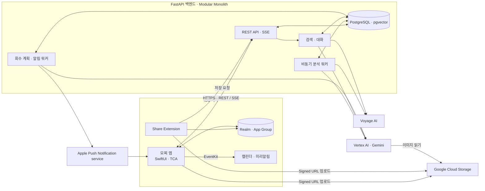
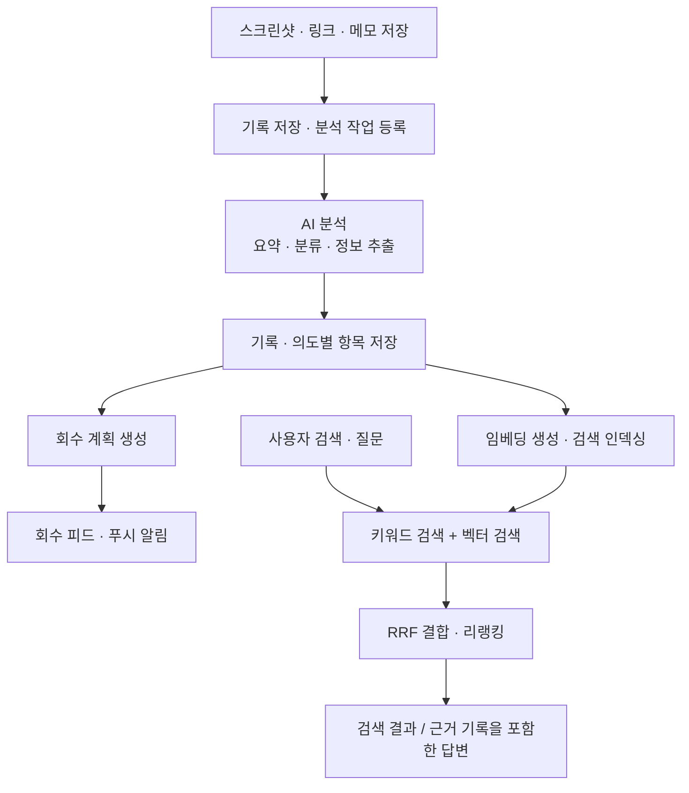
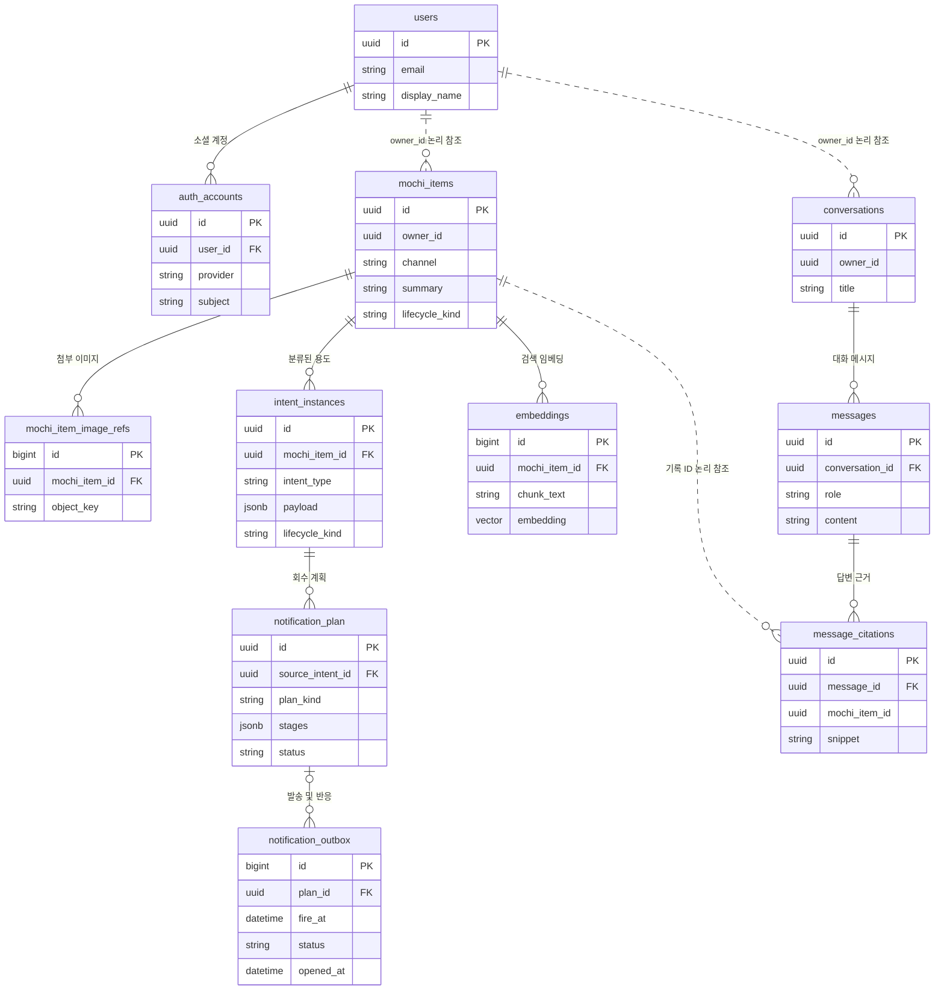

<div align="center">


# 모찌 · MOCHI

**저장한 정보를, 필요할 때 다시 꺼내 쓰도록.**

스크린샷·링크·메모를 모아 AI로 정리하고,<br />
검색과 질문, 일정과 알림으로 이어 주는 iOS 기록 관리 서비스

단국대학교 캡스톤 프로젝트 · 팀 **세얼간이**<br />
2026 SW중심대학 디지털 경진대회 SW부문 출품작

[서비스 소개](#서비스-소개) · [주요 기능](#주요-기능) · [시연](#시연) · [프로젝트 산출물](#프로젝트-산출물)<br />
[시스템 아키텍처](#시스템-아키텍처) · [ERD](#erd) · [기술 스택](#기술-스택) · [실행 방법](#실행-방법) · [팀 소개](#팀-소개)

</div>

## 서비스 소개

나중에 보려고 캡처한 모집 공고, SNS에 저장한 장소, 메모해 둔 할 일. 저장은 간편하지만, 정보가 쌓일수록 **어디에 저장했는지, 언제 다시 봐야 하는지** 기억하기 어려워집니다.

모찌는 흩어진 기록을 한곳에 모으고, 내용을 이해해 다시 활용할 수 있도록 돕습니다. 사용자가 폴더를 하나씩 정리하는 대신 AI가 내용을 요약하고 용도를 분류하며, 저장한 기록을 자연어로 찾거나 일정과 할 일로 연결할 수 있습니다.

| 일상에서 겪는 문제 | 모찌의 접근 |
| --- | --- |
| 스크린샷·북마크·메모가 여러 앱에 흩어져 있다 | 공유 시트와 앱 내 입력으로 한곳에 저장 |
| 기록마다 제목과 분류를 직접 붙이기 번거롭다 | 이미지·링크·텍스트의 맥락을 분석해 요약과 분류 생성 |
| 정확한 제목이나 단어가 기억나지 않는다 | 키워드·의미 검색과 저장 기록 기반 질문 지원 |
| 저장한 일정이나 마감을 잊어버린다 | 캘린더·미리알림 연동 및 다시 볼 기록을 알려 주는 능동 회수 |

## 주요 기능

```text
01 저장                  02 AI 정리                03 다시 찾기              04 활용
스크린샷 · 링크 · 메모  →  요약 · 분류 · 정보 추출  →  자연어 검색 · 질문     →  일정 · 할 일 · 회수 알림
```

### 01. 보고 있던 정보를 간편하게 저장

- 다른 앱의 **공유 시트**에서 스크린샷과 링크를 모찌로 전달합니다.
- 앱에서 텍스트와 메모를 직접 입력할 수 있습니다.
- 백탭은 사용자가 설정한 **단축어 → 스크린샷 → 공유 시트** 경로로 연결됩니다.
- 이미지에서 민감정보를 감지하고 가리는 기능을 제공해 업로드 전 확인을 돕습니다.

### 02. AI가 내용을 읽고 용도에 맞게 정리

멀티모달 AI가 이미지·링크·텍스트의 맥락을 분석하고, 요약과 함께 기록의 용도를 정리합니다. 하나의 기록에 여러 용도가 있으면 각각의 항목으로 관리합니다.

| 분류 | 기록 예시 | 활용 |
| --- | --- | --- |
| 일정 `schedule` | 행사 안내, 약속, 예약 내역 | 날짜·시간을 확인하고 캘린더로 연결 |
| 할 일 `todo` | 신청 공고, 제출 안내, 해야 할 일 | 마감과 완료 여부를 관리하고 미리알림으로 연결 |
| 지식 `knowledge` | 학습 자료, 참고 글, 다시 볼 정보 | 검색·질문의 근거로 활용하고 다시 확인 |
| 메모 `memo` | 짧은 생각, 개인 기록 | 필요할 때 조회하고 직접 관리 |

분류가 불확실한 경우에는 사용자에게 확인할 후보를 제시합니다.

### 03. 기억나는 말로 검색하고 질문

- **하이브리드 검색**: 키워드와 벡터 검색 결과를 결합해 저장한 기록을 찾습니다.
- **기록 기반 대화**: 저장된 정보를 찾아 답변하고, 근거가 된 기록을 함께 제시합니다.
- **스트리밍 응답**: 분석 진행 상태와 채팅 응답을 앱에서 확인할 수 있습니다.

> 사용 예시: “전에 저장한 전시 정보 찾아줘”, “이번 주에 마감하는 할 일이 있어?”
>
> 예시 질문이며, 실제 답변은 사용자가 저장한 기록과 연결된 서비스 설정에 따라 달라집니다.

### 04. 저장한 기록을 행동으로 연결

- 일정과 할 일을 기기의 **캘린더·미리알림**에 연결합니다.
- **능동 회수**는 저장한 기록을 다시 떠올릴 수 있도록 피드와 푸시 알림으로 제공합니다.
- 기록의 용도와 상태, 알림에 대한 사용자 반응을 바탕으로 후속 처리를 관리합니다.

## 시연

| 자료 | 상태 |
| --- | --- |
| 서비스 시연 영상 | 준비 중 |
| 앱 설치·체험 안내 | 준비 중 |
| 주요 화면 및 사용 예시 이미지 | 준비 중 |

### 시연 시나리오

1. **저장** — 날짜와 장소가 포함된 행사 안내 스크린샷을 공유 시트로 전달합니다.
2. **분석** — AI가 생성한 요약, 일정 분류, 추출된 정보를 확인합니다.
3. **활용** — 일정 정보를 확인하고 기기 캘린더에 연결합니다.
4. **검색·질문** — 행사와 관련된 자연어 질문을 입력하고 답변의 근거 기록을 엽니다.
5. **다시 보기** — 회수 피드와 알림에서 다시 볼 기록을 확인합니다.

시연에는 AI·스토리지·푸시 설정과 기기 권한이 필요합니다. 위 순서는 시연 구성안이며, 영상과 실제 화면은 추후 추가합니다.

## 프로젝트 산출물

| 구분 | 자료 | 내용 |
| --- | --- | --- |
| 시연 영상 | 준비 중 | 저장부터 검색·활용까지의 서비스 시연 |
| 발표자료 | 준비 중 | 개발 배경, 서비스 구성, 주요 기능 |
| 최종 발표자료 | 준비 중 | 캡스톤 최종 발표용 자료 |
| 프로젝트 결과보고서 | 준비 중 | 설계·구현·검증 결과와 한계 |
| 시스템 아키텍처 | [아키텍처 보기](#시스템-아키텍처) | 클라이언트·백엔드·외부 서비스 구성 |
| 데이터 설계 | [ERD 보기](#erd) | 주요 테이블과 관계 |
| API 명세 | [OpenAPI](mochi-backend/openapi.json) | 엔드포인트와 요청·응답 스키마 |
| 개발 문서 | [iOS](mochi-ios/README.md) · [백엔드](mochi-backend/README.md) | 모듈 구조와 개발 환경 안내 |

## 시스템 아키텍처

### 서비스 구성

아래는 저장소 코드 기준의 논리 구성입니다. 운영 서버의 배포 토폴로지는 포함하지 않습니다.



- **클라이언트**: SwiftUI·TCA 기반으로 기능을 모듈화하고, App Group으로 앱과 공유 확장의 로컬 데이터를 공유합니다.
- **백엔드**: 인증·기록·분석·검색·대화·알림을 하나의 애플리케이션 안에서 모듈로 나누고, 도메인과 외부 서비스 구현을 분리합니다.
- **이미지 저장**: 서버에서 업로드용 Signed URL을 발급받아 GCS에 직접 업로드하고, 기록에는 이미지 참조를 전달합니다.
- **비동기 처리**: 분석 워커와 알림 워커는 FastAPI 애플리케이션의 수명주기에서 기동합니다. 그림의 분리는 역할을 나타냅니다.

### AI 분석과 검색 흐름



모델과 외부 API는 환경 설정으로 연결합니다. Voyage API 키가 없으면 벡터 검색과 리랭킹을 생략하고 키워드 검색을 사용합니다. 분석·알림의 실제 동작에는 해당 서비스의 인증과 설정이 필요합니다.

## ERD

기록과 의도별 항목, 대화의 근거, 회수 알림 사이의 **주요 관계를 발췌**했습니다. `논리 참조`로 표시한 관계는 DB 외래 키가 없는 애플리케이션 수준의 연결입니다.



하나의 기록(`mochi_items`)에 여러 의도별 항목(`intent_instances`)이 연결됩니다. 원본 기록의 분석 상태와 각 일정·할 일의 생명주기를 분리하고, 답변에는 근거의 스냅샷(`message_citations`)을 보관합니다.

상세 정의: [인증 ORM](mochi-backend/app/modules/auth/infrastructure/orm.py) · [기록 ORM](mochi-backend/app/modules/mochi_items/infrastructure/orm.py) · [대화 ORM](mochi-backend/app/modules/conversations/infrastructure/orm.py) · [알림 ORM](mochi-backend/app/modules/notifications/infrastructure/orm.py) · [마이그레이션](mochi-backend/alembic/versions/)

## 기술 스택

| 영역 | 기술 | 사용 목적 |
| --- | --- | --- |
| iOS UI·상태 관리 | Swift, SwiftUI, TCA | 화면 구성, 상태와 비동기 효과 관리 |
| iOS 프로젝트 관리 | Tuist, Swift Package Manager | 모듈별 타깃과 의존성 관리 |
| 로컬 저장 | Realm, App Group | 기록 캐시와 앱·공유 확장 간 데이터 공유 |
| 기기 연동 | Share Extension, EventKit, Vision, Core Image | 공유 입력, 일정·미리알림, OCR·민감정보 가림 |
| 지도·이미지 | Naver Maps SDK, Kingfisher | 장소 표시와 이미지 캐싱 |
| API 서버 | Python 3.12+, FastAPI, Pydantic | 비동기 API와 요청·응답 검증 |
| 데이터 접근 | SQLAlchemy 2, asyncpg, Alembic | 비동기 DB 접근과 스키마 마이그레이션 |
| 데이터베이스 | PostgreSQL 16, pgvector | 기록·대화·알림 저장과 벡터 검색 |
| AI 분석·대화 | Vertex AI, Gemini | 멀티모달 분석과 도구 호출 기반 대화 |
| 검색 | Voyage AI, RRF | 임베딩·리랭킹과 검색 결과 결합 |
| 이미지 스토리지 | Google Cloud Storage | Signed URL 기반 이미지 업로드 |
| 인증·푸시 | Sign in with Apple, Google Sign-In, JWT, APNs | 로그인·세션 관리와 기기 알림 |
| 개발·검증 | uv, Docker Compose, pytest, Ruff, mypy, SwiftLint | 패키지·로컬 DB 관리와 테스트·정적 검사 |

AI 모델은 역할별 환경 설정으로 선택합니다. 현재 코드의 분석·대화 기본 모델은 `gemini-3.1-flash-lite`, 검색 임베딩은 `voyage-4-large`(1024차원), 리랭커는 `rerank-2.5`입니다. 실제 배포 설정은 다를 수 있으며, [설정 코드](mochi-backend/app/core/config.py)에서 확인할 수 있습니다.

설계·디자인 자료와 운영 배포 구성 문서는 **준비 중**입니다.

## 실행 방법

### 저장소 구성

```text
mochi/
├── README.md          서비스 소개 및 캡스톤 프로젝트 안내
├── mochi-ios/         iOS 앱 · 공유 확장 · 위젯
└── mochi-backend/     FastAPI API · 분석/알림 워커 · DB 마이그레이션
```

### 백엔드

Python 3.12 이상, uv, Docker Compose가 필요합니다.

```bash
git clone https://github.com/dku-mochi/mochi.git
cd mochi/mochi-backend
make install
cp .env.example .env
# .env에서 AI·스토리지 등 사용할 외부 서비스 설정을 입력합니다.
make db-up
make migrate
make dev
```

기본 API 문서: [로컬 Swagger UI](http://localhost:8000/docs). Vertex AI 인증 등 상세 설정은 [백엔드 개발 문서](mochi-backend/README.md)를 확인해 주세요.

### iOS

macOS, Xcode, Tuist가 필요하며 앱의 최소 지원 버전은 iOS 17입니다. 저장소 루트에서 실행합니다.

```bash
cd mochi-ios
tuist install
tuist generate
open Mochi.xcworkspace
```

앱의 서버 주소와 로그인 설정, 실기기 서명·App Group·기기 권한은 실행 환경에 맞게 구성해야 합니다. 자세한 내용은 [iOS 개발 문서](mochi-ios/README.md)를 확인해 주세요.

<details>
<summary>테스트와 품질 검사 명령</summary>

백엔드(`mochi-backend/`):

```bash
make test
make lint
make typecheck
```

iOS(`mochi-ios/`):

```bash
tuist test
```

위 명령은 개발 시 사용하는 검사 방법입니다. 정량 성능 평가와 사용자 검증 결과는 결과보고서에 추가할 예정입니다.

</details>

## 팀 소개

**세얼간이** · 단국대학교 캡스톤 프로젝트 팀

| 이름 | 담당 역할 | GitHub |
| --- | --- | --- |
| 준비 중 | 준비 중 | 준비 중 |
| 준비 중 | 준비 중 | 준비 중 |
| 준비 중 | 준비 중 | 준비 중 |

<!-- 캡스톤 자료 확보 후 시연·산출물 링크, 주요 화면, 팀원 정보 및 역할을 교체합니다. -->
