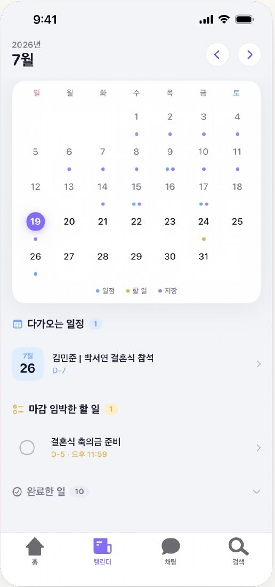
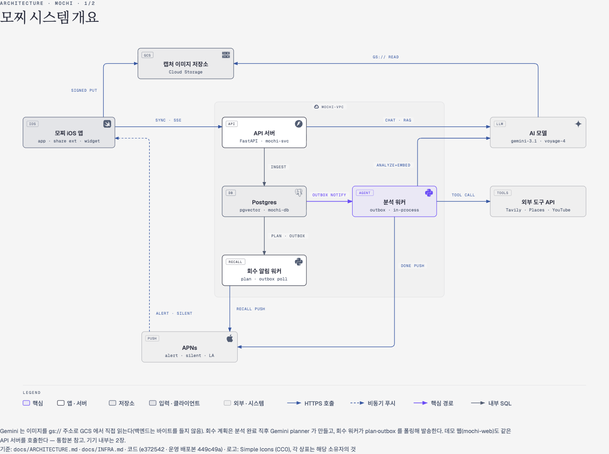
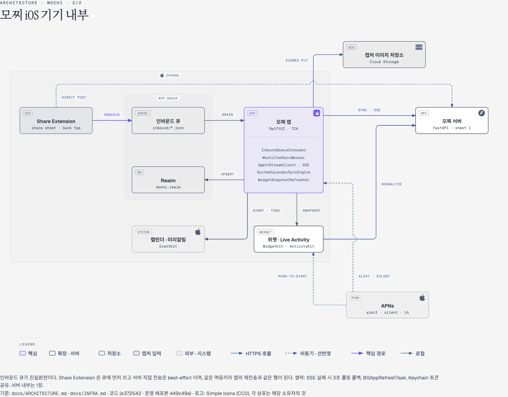
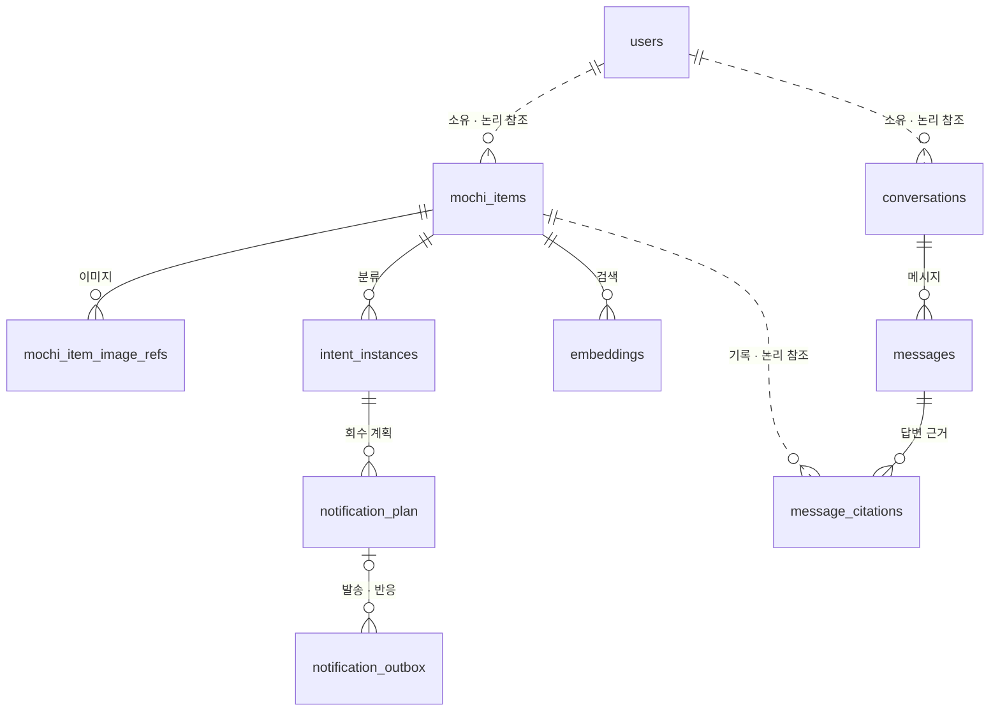

# 모찌 · MOCHI

**저장한 정보를, 필요할 때 다시 꺼내 쓰도록.**

스크린샷·링크·메모의 AI 정리부터 검색·질문, 일정·알림까지 
흩어진 기록을 다시 활용하기 위한 iOS 기록 관리 서비스

**2026 SW중심대학 디지털 경진대회 SW부문 최우수상 수상작**

단국대학교 캡스톤 프로젝트 · 팀 **세얼간이**

## 바로가기

| 구분 | 내용 |
| --- | --- |
| 서비스 | [소개](#서비스-소개) · [주요 기능](#주요-기능) · [시연](#시연) |
| 설계·기술 | [시스템 아키텍처](#시스템-아키텍처) · [ERD](#erd) · [기술 스택](#기술-스택) |
| 프로젝트 | [산출물](#프로젝트-산출물) · [실행 방법](#실행-방법) · [팀 소개](#팀-소개) |

## 서비스 소개

여러 앱에 흩어진 스크린샷·링크·메모를 한곳에 모아, **저장부터 정리·탐색·활용까지 연결하는 개인 기록 관리 서비스**

> **저장만으로 끝나지 않는 기록**
>
> 흩어진 정보의 통합 저장 · AI 자동 정리 · 필요한 순간의 재발견

## 주요 기능

1. **저장** — 공유 시트로 스크린샷·링크 수집, 앱 내 메모 입력
2. **AI 정리** — 요약·분류·정보 추출, 불확실한 분류의 사용자 확인
3. **검색·질문** — 키워드·의미 검색과 근거 기록 기반 대화
4. **활용** — 캘린더·미리알림 연동, 회수 피드·푸시 알림

- **기록 분류**: 일정 · 할 일 · 지식 · 메모 — 하나의 기록에 여러 분류 연결 가능
- **민감정보 보호**: 업로드 전 이미지 내 민감정보 감지·가림
- **백탭 입력**: 사용자 단축어의 스크린샷·공유 시트 경로 이용

### 서비스 화면

  
  &nbsp;&nbsp;
  

<b>일정·할 일 관리</b> &nbsp; · &nbsp; <b>저장 기록 기반 대화</b> 첨부 발표자료 17–18쪽의 서비스 화면 발췌

## 시연

**[▶ 모찌 서비스 시연 영상](https://www.youtube.com/watch?v=Y2UenIJ6z1w&t=2s)**

저장 → AI 정리 → 검색·질문 → 일정·알림 활용

- 앱 설치·체험 안내: 준비 중

## 시스템 아키텍처

### System Architecture

### iOS Architecture

## ERD

기록·분류·대화·알림 중심의 주요 관계 요약. `논리 참조`는 DB 외래 키 없이 연결되는 관계.

전체 테이블·컬럼 정의: [DB 마이그레이션](mochi-backend/alembic/versions/)

## 기술 스택

**SwiftUI · TCA / FastAPI / PostgreSQL · pgvector / Gemini · Voyage AI**

영역별 기술 스택 펼치기

### iOS

| 구분 | 기술 |
| --- | --- |
| UI·상태 관리 | Swift, SwiftUI, TCA |
| 프로젝트·로컬 저장 | Tuist, Swift Package Manager, Realm, App Group |
| 기기 연동 | Share Extension, EventKit, Vision, Core Image |
| 지도·이미지 | Naver Maps SDK, Kingfisher |

### 백엔드·AI·데이터

| 구분 | 기술 |
| --- | --- |
| API | Python 3.12+, FastAPI, Pydantic |
| 데이터베이스 | PostgreSQL 16, pgvector, SQLAlchemy 2, asyncpg, Alembic |
| AI·검색 | Vertex AI · Gemini, Voyage AI |
| 스토리지·인증·푸시 | Google Cloud Storage, Apple·Google 로그인, JWT, APNs |

### 개발·검증

| 구분 | 기술·자료 |
| --- | --- |
| 패키지·로컬 환경 | uv, Docker Compose |
| 테스트·정적 검사 | pytest, Ruff, mypy, SwiftLint, TCA TestStore |
| 설계·디자인 자료 | 준비 중 |

## 프로젝트 산출물

| 자료 | 링크·상태 |
| --- | --- |
| 시연 영상 | [YouTube 시연](https://www.youtube.com/watch?v=Y2UenIJ6z1w&t=2s) |
| 발표자료 | [발표자료 PDF](docs/mochi-presentation.pdf) |
| 최종 발표자료 | [최종 발표자료 PDF](docs/mochi-presentation.pdf) |
| 포스터 | [모찌 포스터 PNG](docs/mochi-poster.png) |
| 프로젝트 결과보고서 | 준비 중 |
| API 명세 | [OpenAPI](mochi-backend/openapi.json) |
| 개발 문서 | [iOS](mochi-ios/README.md) · [백엔드](mochi-backend/README.md) |

## 실행 방법

| 프로젝트 | 실행 환경 | 상세 안내 |
| --- | --- | --- |
| [`mochi-ios/`](mochi-ios/) | macOS, Xcode, Tuist · iOS 17+ | [빌드·실행](mochi-ios/README.md#시작하기) |
| [`mochi-backend/`](mochi-backend/) | Python 3.12+, uv, Docker Compose | [설치·실행](mochi-backend/README.md#시작하기) |

AI·스토리지·로그인·푸시 사용 시 외부 서비스 설정 필요. 기기 기능 사용 시 서명·권한 설정 필요.

## 팀 소개

**세얼간이** · 단국대학교 캡스톤 프로젝트 팀

| 이름 | 담당 역할 | GitHub |
| --- | --- | --- |
| 준비 중 | 준비 중 | 준비 중 |
| 준비 중 | 준비 중 | 준비 중 |
| 준비 중 | 준비 중 | 준비 중 |

<!-- 설치 안내·결과보고서·팀원 정보 확보 후 ‘준비 중’ 항목 교체 -->
