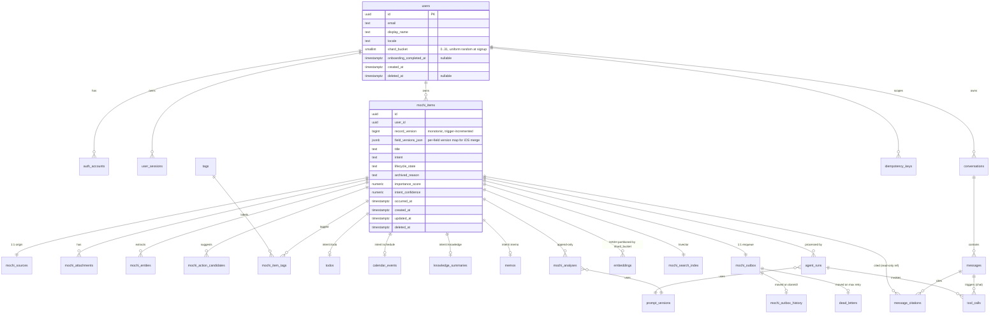

# 모찌(MOCHI) — 도메인 & 데이터베이스 설계 v3.0

> Multimodal AI 기반 스크린샷·링크·기록 통합관리 에이전트
> Backend: `mochi-backend` Postgres 16 + pgvector (partitioned, RLS FORCED)
> iOS: `mochi-ios` Realm v3 mirror + per-field version vector merge
> 대상 독자: 사람 개발자 + AI 코드 어시스턴트 모두

> **v3 변경 핵심**:
> - **Bounded Context 재정의**: "6개 BC" 모델 폐기 → **Mochi Aggregate (1 BC) + Conversation BC + Operations BC (3개)** 로 단순화. 자식 테이블이 같은 BC 안 sub-entity 임을 명시
> - **Intent derivation trade-off 정면 명시**: DB trigger 채택 근거 + event-driven 대안 비교
> - **벡터 scale reality reset**: 10^10 가정 폐기, **10^9 까지 Postgres / 그 이상은 외부 vector DB 명시**
> - **`embeddings` partition key 수정**: `hashtext` skew 위험 → `users.shard_bucket smallint` 사전 할당 (UUID 균등 분포)
> - **record_version monotonic 강제**: client spoof 불가
> - **soft-delete immutability** trigger 추가
> - **intent × lifecycle 매트릭스** CHECK 강제
> - **derived 1:1 invariant** 양방향 강제 (parent → child & child → parent + DELETE trigger)
> - **`FORCE ROW LEVEL SECURITY`** 모든 tenant 테이블
> - **모든 자식 테이블 DDL 완전 작성** (생략 금지)
> - **`mochi_search_index` 완전 DDL + tsvector trigger**
> - **outbox lease index, idempotency lookup, messages composite, citations user-item** 인덱스 추가
> - **iOS per-field version vector** 명세

---

## 0. 설계 원칙

| # | 원칙 | 구체 적용 |
|---|---|---|
| 1 | Self-documenting names | 약어 금지. 풀네임 |
| 2 | One concept = one table | God-table 금지 |
| 3 | **Tenant safety is structural** | (a) composite FK `(user_id, parent_id) → 부모(user_id, id)`. (b) `ENABLE ROW LEVEL SECURITY` + `FORCE ROW LEVEL SECURITY` 모든 tenant 테이블. (c) app 은 트랜잭션 시작 시 `set_config('app.current_user_id')` 만 책임 |
| 4 | **Invariants live in the schema** | 가능한 모든 invariant 를 CHECK/UNIQUE/FK/trigger 로 표현. 표현 불가능한 항목은 §부록 D 의 *application-enforced* 표에 명시 + 자동 테스트 |
| 5 | Explicit lifecycle | enum + 전이 매트릭스 + trigger |
| 6 | Time is UTC `timestamptz` | `_at` suffix |
| 7 | Append-only history | LLM 분석 결과 (mochi_analyses) 와 audit_log 는 append-only trigger |
| 8 | UUID v7 (pgcrypto) | 분산 + 시간 정렬 + tenant 비누설 |
| 9 | **Soft-delete is immutable** | `deleted_at IS NOT NULL` row 는 trigger 가 UPDATE 거부 (zombie write 차단) |
| 10 | **Monotonic version** | `record_version` 은 항상 `OLD+1` (client spoof 불가) |

---

## 1. Bounded Context Map (v3 재정의)

v2 에서는 6개 BC 를 선언했으나 ERD 가 그 규칙을 위반했다. v3 는 **현실에 맞게 3개 BC** 로 단순화한다.

```
┌─────────────────────── Identity & Tenancy ────────────────────────┐
│  users · auth_accounts · user_sessions                              │
│  (shard_bucket 부여 — embeddings 균등 분포 키)                       │
└────────────────────────────────┬──────────────────────────────────┘
                                 │ user_id (모든 자식의 composite FK target)
                                 ▼
┌─────────────────────────── Mochi Aggregate ────────────────────────┐
│  ★ AGGREGATE ROOT: mochi_items                                       │
│                                                                      │
│  ┌─ Sub-entities (1:1 또는 1:N, 같은 트랜잭션 boundary) ────────┐  │
│  │ mochi_sources                  (1:1 origin)                    │  │
│  │ mochi_attachments              (1:N files)                     │  │
│  │ mochi_entities                 (1:N AI 추출)                   │  │
│  │ mochi_action_candidates        (1:N AI 제안)                   │  │
│  │ tags · mochi_item_tags         (N:M user tags)                 │  │
│  │                                                                 │  │
│  │ Intent-typed sub-entity (1:0..1, intent 별 단 하나):           │  │
│  │   todos · calendar_events · knowledge_summaries · memos        │  │
│  │                                                                 │  │
│  │ AI analysis (1:N append-only):                                 │  │
│  │   mochi_analyses · embeddings · mochi_search_index             │  │
│  │   prompt_versions (read-only reference)                        │  │
│  └────────────────────────────────────────────────────────────────┘  │
└──────────────────┬──────────────────────────┬────────────────────────┘
                   │ mochi_item_id            │ user_id
                   │ (read-only FK)           │
                   ▼                          ▼
┌─────────────────────────┐      ┌──────────────────────────────────┐
│  Conversation BC        │      │  Operations BC                    │
│  conversations          │      │  idempotency_keys                 │
│  messages               │      │  mochi_outbox (hot)               │
│  message_citations ──┐  │      │  mochi_outbox_history (cold)      │
│  tool_calls          │  │      │  agent_runs · tool_calls          │
│  (mochi_item_id 인용  │  │      │  dead_letters · audit_log         │
│   = read-only)        ▼  │      │  (모두 audit/append-only)         │
└─────────────────────────┘      └──────────────────────────────────┘
                   ▲                          ▲
                   └─ cited mochi_item        └─ FK to mochi_items
                       (cross-BC read-only reference)
```

### BC 규칙 (v3 명시)

1. **Mochi Aggregate** 안의 자식들은 **같은 BC** 다. composite FK + deferred constraint trigger 로 묶인 1:1/1:N 관계는 BC 위반이 아니라 *aggregate 내부 무결성*. (BC 규칙 위반이 아니다.)
2. **Conversation BC, Operations BC** 는 Mochi Aggregate 의 **read-only reference** 만 갖는다. 즉 cross-BC FK 는 `ON DELETE CASCADE` + read direction (citation, outbox, audit target). 역방향 (Mochi → Conversation) 은 금지.
3. **모든 cross-BC reference 는 owner-scoped** — `user_id` 가 일치할 때만 의미.

### 자식이 같은 BC 인 이유 (Gemini 비판 정면 답변)

Gemini 는 v2 §5.6 의 `enforce_intent_derivation()` trigger 가 "BC 자율성 침해 안티패턴"이라고 지적했다. v3 는 이 비판을 *부분 수용*하되 trigger 를 유지하는 근거를 명시:

| 대안 | 장점 | 단점 | v3 채택 여부 |
|---|---|---|---|
| **A. DB trigger 강제 (v2 패턴)** | 강한 일관성, 트랜잭션 원자성, 단일 commit | DB 에 비즈니스 로직 누수, debug 어려움 | **선택** — 이유: 4-Intent 분류는 Mochi 의 본질 invariant. eventual consistency 가 사용자에게 보이는 "한 모찌가 잠시 intent 없는 상태"를 만들 가능성을 제거. |
| B. Event-driven (Outbox → consumer) | BC 자율성, scaling | eventual consistency, 분류 누락 가능성, debug 분산 | 미선택 — Intent 누락 시 사용자 UX 손상이 크다 (목록에 안 보임) |
| C. Single `mochi_items.intent_payload jsonb` | 단순 | sparse 컬럼 회피 못 함, 타입 안전성 ↓ | 미선택 — todos.due_at 같은 typed query 가 안 됨 |

**근거 명문화**: Mochi Aggregate 는 4-Intent typed 1:0..1 을 invariant 로 가지므로, 자식 테이블은 같은 aggregate 내 *vertical partitioning* 으로 본다. event-driven 대안은 v3.1 의 multi-region 확장에서 재검토.

---

## 2. Ubiquitous Language

| 용어 | 정의 |
|---|---|
| **MochiItem** | aggregate root. UUID 식별 |
| **Intent** | enum `schedule`/`todo`/`knowledge`/`memo` |
| **Lifecycle State** | enum 7값 (§5) |
| **Source / Attachment / Entity / ActionCandidate / Tag** | Mochi sub-entities |
| **AgentRun / ToolCall / OutboxMessage** | Operations BC |
| **Conversation / Message / Citation** | Conversation BC |
| **record_version** | monotonic per-item bigint. trigger 가 OLD+1 강제 |
| **shard_bucket** | `users.shard_bucket smallint NOT NULL` (0..31). 사용자 생성 시 uniform random 할당. embeddings HASH partition key |
| **set_config('app.current_user_id', ...)** | 트랜잭션 entry, RLS 동력 |

---

## 3. ERD (Mermaid, v3 정확)



---

## 4. 엔티티 명세 (v3 — 전체 DDL 명시, 생략 없음)

### A. Identity

#### A.1 `users`

```sql
CREATE TABLE users (
    id                       uuid PRIMARY KEY DEFAULT uuid_generate_v7(),
    email                    text NOT NULL,
    display_name             text NOT NULL DEFAULT '',
    locale                   text NOT NULL DEFAULT 'ko-KR',
    shard_bucket             smallint NOT NULL,    -- v3: pre-assigned uniform 0..31
    onboarding_completed_at  timestamptz,
    created_at               timestamptz NOT NULL DEFAULT now(),
    deleted_at               timestamptz,
    CONSTRAINT ck_users__email_format CHECK (email = lower(email)),
    CONSTRAINT ck_users__shard_bucket  CHECK (shard_bucket BETWEEN 0 AND 31),
    CONSTRAINT uq_users__id_shard      UNIQUE (id, shard_bucket)  -- composite FK target
);
CREATE UNIQUE INDEX uq_users__email__active ON users(email) WHERE deleted_at IS NULL;

ALTER TABLE users ENABLE ROW LEVEL SECURITY;
ALTER TABLE users FORCE ROW LEVEL SECURITY;          -- v3: superuser 외 우회 불가
CREATE POLICY rls_users__self ON users
    USING      (id = current_setting('app.current_user_id', true)::uuid)
    WITH CHECK (id = current_setting('app.current_user_id', true)::uuid);

-- shard_bucket 자동 할당
CREATE OR REPLACE FUNCTION assign_shard_bucket() RETURNS trigger AS $$
BEGIN
    IF NEW.shard_bucket IS NULL THEN
        NEW.shard_bucket := (random() * 32)::smallint;   -- uniform 0..31
    END IF;
    RETURN NEW;
END $$ LANGUAGE plpgsql;
CREATE TRIGGER trg_users__shard BEFORE INSERT ON users
    FOR EACH ROW EXECUTE FUNCTION assign_shard_bucket();

-- soft-delete 시 PII purge
CREATE OR REPLACE FUNCTION purge_user_pii_on_delete() RETURNS trigger AS $$
BEGIN
    IF NEW.deleted_at IS NOT NULL AND OLD.deleted_at IS NULL THEN
        NEW.email := 'deleted+' || NEW.id || '@invalid.local';
        NEW.display_name := '';
    END IF;
    RETURN NEW;
END $$ LANGUAGE plpgsql;
CREATE TRIGGER trg_users__pii BEFORE UPDATE OF deleted_at ON users
    FOR EACH ROW EXECUTE FUNCTION purge_user_pii_on_delete();
```

**왜 random 인가?** `hashtext(user_id)` (Gemini 지적) 는 비균등 분포 위험. UUID v7 의 lower bits 도 timestamp 의존. random() 으로 uniform 보장 + 사용자 생성 시 1회만 할당이라 stable.

#### A.2 `auth_accounts`

```sql
CREATE TABLE auth_accounts (
    id             uuid PRIMARY KEY DEFAULT uuid_generate_v7(),
    user_id        uuid NOT NULL REFERENCES users(id) ON DELETE CASCADE,
    provider       text NOT NULL,
    subject        text NOT NULL,
    email_at_link  text NOT NULL,
    linked_at      timestamptz NOT NULL DEFAULT now(),
    revoked_at     timestamptz,
    CONSTRAINT ck_auth__provider CHECK (provider IN ('apple','google'))
);
CREATE UNIQUE INDEX uq_auth__provider_subject ON auth_accounts(provider, subject);
CREATE UNIQUE INDEX uq_auth__user_provider     ON auth_accounts(user_id, provider);
CREATE INDEX idx_auth__user_id ON auth_accounts(user_id);

ALTER TABLE auth_accounts ENABLE ROW LEVEL SECURITY;
ALTER TABLE auth_accounts FORCE ROW LEVEL SECURITY;
CREATE POLICY rls_auth__owner ON auth_accounts
    USING (user_id = current_setting('app.current_user_id', true)::uuid)
    WITH CHECK (user_id = current_setting('app.current_user_id', true)::uuid);
```

#### A.3 `user_sessions`

```sql
CREATE TABLE user_sessions (
    id                  uuid PRIMARY KEY DEFAULT uuid_generate_v7(),
    user_id             uuid NOT NULL REFERENCES users(id) ON DELETE CASCADE,
    refresh_token_hash  text NOT NULL,
    device_fingerprint  text NOT NULL DEFAULT '',
    issued_at           timestamptz NOT NULL DEFAULT now(),
    expires_at          timestamptz NOT NULL,
    revoked_at          timestamptz,
    CONSTRAINT ck_user_sessions__expires CHECK (expires_at > issued_at)
);
CREATE UNIQUE INDEX uq_user_sessions__refresh ON user_sessions(refresh_token_hash);
CREATE INDEX idx_user_sessions__user__active ON user_sessions(user_id) WHERE revoked_at IS NULL;

ALTER TABLE user_sessions ENABLE ROW LEVEL SECURITY;
ALTER TABLE user_sessions FORCE ROW LEVEL SECURITY;
CREATE POLICY rls_sessions__owner ON user_sessions
    USING (user_id = current_setting('app.current_user_id', true)::uuid)
    WITH CHECK (user_id = current_setting('app.current_user_id', true)::uuid);
```

---

### B. Mochi Aggregate

#### B.1 `mochi_items` ★ aggregate root

```sql
CREATE TABLE mochi_items (
    id                  uuid NOT NULL DEFAULT uuid_generate_v7(),
    user_id             uuid NOT NULL,
    shard_bucket        smallint NOT NULL,                          -- v3: denorm from users for partition routing
    record_version      bigint NOT NULL DEFAULT 1,
    field_versions_json jsonb NOT NULL DEFAULT '{}'::jsonb,         -- v3: per-field versions for iOS merge
    title               text NOT NULL DEFAULT '',
    intent              text NOT NULL,
    lifecycle_state     text NOT NULL DEFAULT 'ingested',
    archived_reason     text,
    importance_score    numeric(4,3) NOT NULL DEFAULT 0,
    intent_confidence   numeric(4,3) NOT NULL DEFAULT 0,
    occurred_at         timestamptz,
    created_at          timestamptz NOT NULL DEFAULT now(),
    updated_at          timestamptz NOT NULL DEFAULT now(),
    deleted_at          timestamptz,
    PRIMARY KEY (user_id, id),                                       -- composite (tenant-safe FK target)
    CONSTRAINT uq_mochi_items__id UNIQUE (id),                       -- global unique 유지
    CONSTRAINT fk_mochi_items__users
        FOREIGN KEY (user_id, shard_bucket)
        REFERENCES users(id, shard_bucket) ON DELETE CASCADE,
    CONSTRAINT ck_mochi_items__intent
        CHECK (intent IN ('schedule','todo','knowledge','memo')),
    CONSTRAINT ck_mochi_items__lifecycle
        CHECK (lifecycle_state IN ('ingested','analyzing','active','decaying','review_requested','archived','failed')),
    CONSTRAINT ck_mochi_items__archived_reason_present
        CHECK ((lifecycle_state='archived') = (archived_reason IS NOT NULL)),
    -- v3: intent × lifecycle 매트릭스 강제 (Codex 지적)
    CONSTRAINT ck_mochi_items__intent_lifecycle_compat
        CHECK (
            (intent IN ('schedule','todo','memo') AND lifecycle_state NOT IN ('decaying','review_requested'))
         OR (intent = 'knowledge')
        ),
    -- v3: archived_reason × intent 매트릭스 (DDL CHECK 로 직접 강제)
    CONSTRAINT ck_mochi_items__archived_reason_intent
        CHECK (
            archived_reason IS NULL
         OR (intent='schedule'  AND archived_reason IN ('schedule_ended','user_manual','system_error'))
         OR (intent='todo'      AND archived_reason IN ('todo_completed','user_manual','system_error'))
         OR (intent='knowledge' AND archived_reason IN ('knowledge_stale','user_manual','system_error'))
         OR (intent='memo'      AND archived_reason IN ('user_manual','system_error'))
        ),
    CONSTRAINT ck_mochi_items__scores
        CHECK (importance_score BETWEEN 0 AND 1 AND intent_confidence BETWEEN 0 AND 1),
    CONSTRAINT ck_mochi_items__occurred_at
        CHECK (intent='schedule' OR occurred_at IS NULL),
    -- v3: soft-deleted row immutability
    CONSTRAINT ck_mochi_items__no_zombie_writes CHECK (true)  -- trigger 가 강제 (CHECK 만으론 OLD 비교 불가)
);

ALTER TABLE mochi_items ENABLE ROW LEVEL SECURITY;
ALTER TABLE mochi_items FORCE ROW LEVEL SECURITY;
CREATE POLICY rls_mochi_items__owner ON mochi_items
    USING      (user_id = current_setting('app.current_user_id', true)::uuid)
    WITH CHECK (user_id = current_setting('app.current_user_id', true)::uuid);

-- 인덱스 (partial)
CREATE INDEX idx_mochi_items__user__created
    ON mochi_items(user_id, created_at DESC) WHERE deleted_at IS NULL;
CREATE INDEX idx_mochi_items__user__intent__lifecycle
    ON mochi_items(user_id, intent, lifecycle_state) WHERE deleted_at IS NULL;
CREATE INDEX idx_mochi_items__user__occurred
    ON mochi_items(user_id, occurred_at)
    WHERE intent='schedule' AND deleted_at IS NULL;
CREATE INDEX idx_mochi_items__user__importance
    ON mochi_items(user_id, importance_score DESC)
    WHERE lifecycle_state='active' AND deleted_at IS NULL;
CREATE INDEX idx_mochi_items__user__updated     -- v3: catch-up sync 용
    ON mochi_items(user_id, updated_at DESC);

-- Triggers
CREATE TRIGGER trg_mochi_items__bump_version
    BEFORE UPDATE ON mochi_items
    FOR EACH ROW EXECUTE FUNCTION bump_record_version();
CREATE TRIGGER trg_mochi_items__lifecycle
    BEFORE UPDATE ON mochi_items
    FOR EACH ROW EXECUTE FUNCTION enforce_lifecycle_transition();
CREATE TRIGGER trg_mochi_items__no_zombie
    BEFORE UPDATE ON mochi_items
    FOR EACH ROW EXECUTE FUNCTION reject_zombie_write();
CREATE CONSTRAINT TRIGGER trg_mochi_items__intent_derivation
    AFTER INSERT OR UPDATE OF intent ON mochi_items
    DEFERRABLE INITIALLY DEFERRED
    FOR EACH ROW EXECUTE FUNCTION enforce_intent_derivation_from_parent();
```

#### B.2 `mochi_sources` (1:1)

```sql
CREATE TABLE mochi_sources (
    user_id              uuid NOT NULL,
    mochi_item_id        uuid NOT NULL,
    input_channel        text NOT NULL,
    content_kind         text NOT NULL,
    source_app           text,
    source_url           text,
    user_hint            text,
    raw_text             text,
    source_metadata_json jsonb NOT NULL DEFAULT '{}'::jsonb,
    PRIMARY KEY (mochi_item_id),
    CONSTRAINT fk_sources__mochi_items__tenant_safe
        FOREIGN KEY (user_id, mochi_item_id)
        REFERENCES mochi_items(user_id, id) ON DELETE CASCADE,
    CONSTRAINT ck_sources__input_channel
        CHECK (input_channel IN ('share_extension','back_tap','manual','app_intent')),
    CONSTRAINT ck_sources__content_kind
        CHECK (content_kind IN ('url','text','image','screenshot','mixed')),
    CONSTRAINT ck_sources__url_required
        CHECK (content_kind <> 'url' OR source_url IS NOT NULL)
);
CREATE INDEX idx_sources__user ON mochi_sources(user_id);

ALTER TABLE mochi_sources ENABLE ROW LEVEL SECURITY;
ALTER TABLE mochi_sources FORCE ROW LEVEL SECURITY;
CREATE POLICY rls_sources__owner ON mochi_sources
    USING (user_id = current_setting('app.current_user_id', true)::uuid)
    WITH CHECK (user_id = current_setting('app.current_user_id', true)::uuid);
```

#### B.3 `mochi_attachments`

```sql
CREATE TABLE mochi_attachments (
    id              uuid PRIMARY KEY DEFAULT uuid_generate_v7(),
    user_id         uuid NOT NULL,
    mochi_item_id   uuid NOT NULL,
    object_key      text NOT NULL,
    sha256          text NOT NULL,
    mime_type       text NOT NULL,
    byte_size       int  NOT NULL,
    width           int,
    height          int,
    ocr_text        text,
    uploaded_at     timestamptz NOT NULL DEFAULT now(),
    CONSTRAINT fk_attach__mochi_items__tenant_safe
        FOREIGN KEY (user_id, mochi_item_id)
        REFERENCES mochi_items(user_id, id) ON DELETE CASCADE,
    CONSTRAINT ck_attach__bytes CHECK (byte_size > 0),
    CONSTRAINT ck_attach__mime
        CHECK (mime_type LIKE 'image/%' OR mime_type IN ('application/pdf'))
);
CREATE UNIQUE INDEX uq_attach__user_sha ON mochi_attachments(user_id, sha256);
CREATE INDEX idx_attach__item ON mochi_attachments(mochi_item_id);

ALTER TABLE mochi_attachments ENABLE ROW LEVEL SECURITY;
ALTER TABLE mochi_attachments FORCE ROW LEVEL SECURITY;
CREATE POLICY rls_attach__owner ON mochi_attachments
    USING (user_id = current_setting('app.current_user_id', true)::uuid)
    WITH CHECK (user_id = current_setting('app.current_user_id', true)::uuid);
```

#### B.4 `mochi_entities`

```sql
CREATE TABLE mochi_entities (
    id                       uuid PRIMARY KEY DEFAULT uuid_generate_v7(),
    user_id                  uuid NOT NULL,
    mochi_item_id            uuid NOT NULL,
    entity_kind              text NOT NULL,
    raw_value                text NOT NULL,
    normalized_value         text NOT NULL,
    provenance               text NOT NULL,
    provenance_payload_json  jsonb NOT NULL DEFAULT '{}'::jsonb,
    confidence               numeric(4,3) NOT NULL DEFAULT 0,
    extracted_at             timestamptz NOT NULL DEFAULT now(),
    CONSTRAINT fk_entities__mochi_items__tenant_safe
        FOREIGN KEY (user_id, mochi_item_id)
        REFERENCES mochi_items(user_id, id) ON DELETE CASCADE,
    CONSTRAINT ck_entities__kind
        CHECK (entity_kind IN ('date','person','place','topic','url','task','amount')),
    CONSTRAINT ck_entities__provenance
        CHECK (provenance IN ('text_range','ocr_bbox','inferred')),
    CONSTRAINT ck_entities__confidence CHECK (confidence BETWEEN 0 AND 1)
);
CREATE INDEX idx_entities__item_kind ON mochi_entities(mochi_item_id, entity_kind);
CREATE INDEX idx_entities__user_normalized
    ON mochi_entities(user_id, entity_kind, normalized_value);

ALTER TABLE mochi_entities ENABLE ROW LEVEL SECURITY;
ALTER TABLE mochi_entities FORCE ROW LEVEL SECURITY;
CREATE POLICY rls_entities__owner ON mochi_entities
    USING (user_id = current_setting('app.current_user_id', true)::uuid)
    WITH CHECK (user_id = current_setting('app.current_user_id', true)::uuid);
```

#### B.5 `mochi_action_candidates`

```sql
CREATE TABLE mochi_action_candidates (
    id              uuid PRIMARY KEY DEFAULT uuid_generate_v7(),
    user_id         uuid NOT NULL,
    mochi_item_id   uuid NOT NULL,
    action_kind     text NOT NULL,
    label           text NOT NULL,
    payload_json    jsonb NOT NULL DEFAULT '{}'::jsonb,
    status          text NOT NULL DEFAULT 'pending',
    accepted_at     timestamptz,
    executed_at     timestamptz,
    expires_at      timestamptz,
    CONSTRAINT fk_actions__mochi_items__tenant_safe
        FOREIGN KEY (user_id, mochi_item_id)
        REFERENCES mochi_items(user_id, id) ON DELETE CASCADE,
    CONSTRAINT ck_actions__kind
        CHECK (action_kind IN ('create_todo','create_event','open_url','remind','tag','follow_up_search')),
    CONSTRAINT ck_actions__status
        CHECK (status IN ('pending','accepted','rejected','executed','expired')),
    CONSTRAINT ck_actions__accepted
        CHECK (status <> 'accepted' OR accepted_at IS NOT NULL),
    CONSTRAINT ck_actions__executed
        CHECK (status <> 'executed' OR (executed_at IS NOT NULL AND accepted_at IS NOT NULL))
);
CREATE INDEX idx_actions__item_status ON mochi_action_candidates(mochi_item_id, status);
CREATE INDEX idx_actions__user_pending
    ON mochi_action_candidates(user_id, expires_at)
    WHERE status='pending';

ALTER TABLE mochi_action_candidates ENABLE ROW LEVEL SECURITY;
ALTER TABLE mochi_action_candidates FORCE ROW LEVEL SECURITY;
CREATE POLICY rls_actions__owner ON mochi_action_candidates
    USING (user_id = current_setting('app.current_user_id', true)::uuid)
    WITH CHECK (user_id = current_setting('app.current_user_id', true)::uuid);
```

#### B.6 `tags` / `mochi_item_tags`

```sql
CREATE TABLE tags (
    id        uuid NOT NULL DEFAULT uuid_generate_v7(),
    user_id   uuid NOT NULL REFERENCES users(id) ON DELETE CASCADE,
    name      text NOT NULL,
    color     text,
    PRIMARY KEY (user_id, id),
    CONSTRAINT uq_tags__id UNIQUE (id)
);
CREATE UNIQUE INDEX uq_tags__user_lname ON tags(user_id, lower(name));

ALTER TABLE tags ENABLE ROW LEVEL SECURITY;
ALTER TABLE tags FORCE ROW LEVEL SECURITY;
CREATE POLICY rls_tags__owner ON tags
    USING (user_id = current_setting('app.current_user_id', true)::uuid)
    WITH CHECK (user_id = current_setting('app.current_user_id', true)::uuid);

CREATE TABLE mochi_item_tags (
    user_id        uuid NOT NULL,
    mochi_item_id  uuid NOT NULL,
    tag_id         uuid NOT NULL,
    tagged_at      timestamptz NOT NULL DEFAULT now(),
    PRIMARY KEY (mochi_item_id, tag_id),
    CONSTRAINT fk_mit__mochi_items__tenant_safe
        FOREIGN KEY (user_id, mochi_item_id)
        REFERENCES mochi_items(user_id, id) ON DELETE CASCADE,
    CONSTRAINT fk_mit__tags__tenant_safe
        FOREIGN KEY (user_id, tag_id)
        REFERENCES tags(user_id, id) ON DELETE CASCADE
);
CREATE INDEX idx_mit__tag ON mochi_item_tags(tag_id);
CREATE INDEX idx_mit__user_tag ON mochi_item_tags(user_id, tag_id);

ALTER TABLE mochi_item_tags ENABLE ROW LEVEL SECURITY;
ALTER TABLE mochi_item_tags FORCE ROW LEVEL SECURITY;
CREATE POLICY rls_mit__owner ON mochi_item_tags
    USING (user_id = current_setting('app.current_user_id', true)::uuid)
    WITH CHECK (user_id = current_setting('app.current_user_id', true)::uuid);
```

---

### C. Intent-typed Sub-entities (1:0..1, 양방향 강제)

#### C.0 양방향 invariant (v3 — Codex 지적 반영)

```
parent → child  : intent='todo'  ⇒  EXISTS exactly one row in todos
child  → parent : INSERT/UPDATE todos.mochi_item_id ⇒ parent.intent='todo'
                  DELETE  todos                   ⇒ parent.intent <> 'todo' (intent 가 이미 다른 값으로 갈아끼워졌어야 함)
```

각 derived 테이블에 다음 trigger 가 붙는다:
- **parent → child** invariant: `enforce_intent_derivation_from_parent()` (mochi_items 의 AFTER INSERT/UPDATE OF intent, deferred)
- **child → parent** invariant: `enforce_intent_derivation_from_child()` (4개 derived 테이블 의 AFTER INSERT/UPDATE/DELETE, immediate)
- **다른 derived 0행**: parent trigger 가 동시 검증

#### C.1 `todos`

```sql
CREATE TABLE todos (
    id                    uuid PRIMARY KEY DEFAULT uuid_generate_v7(),
    user_id               uuid NOT NULL,
    mochi_item_id         uuid NOT NULL,
    title                 text NOT NULL,
    due_at                timestamptz,
    priority              text NOT NULL DEFAULT 'medium',
    status                text NOT NULL DEFAULT 'open',
    completed_at          timestamptz,
    external_reminders_id text,
    CONSTRAINT uq_todos__item UNIQUE (mochi_item_id),
    CONSTRAINT fk_todos__mochi_items__tenant_safe
        FOREIGN KEY (user_id, mochi_item_id)
        REFERENCES mochi_items(user_id, id) ON DELETE CASCADE,
    CONSTRAINT ck_todos__priority CHECK (priority IN ('low','medium','high')),
    CONSTRAINT ck_todos__status   CHECK (status IN ('open','done','archived')),
    CONSTRAINT ck_todos__done_at  CHECK ((status='done') = (completed_at IS NOT NULL))
);
CREATE INDEX idx_todos__user_status_due ON todos(user_id, status, due_at NULLS LAST);

ALTER TABLE todos ENABLE ROW LEVEL SECURITY;
ALTER TABLE todos FORCE ROW LEVEL SECURITY;
CREATE POLICY rls_todos__owner ON todos
    USING (user_id = current_setting('app.current_user_id', true)::uuid)
    WITH CHECK (user_id = current_setting('app.current_user_id', true)::uuid);

CREATE TRIGGER trg_todos__intent_match
    AFTER INSERT OR UPDATE OF mochi_item_id OR DELETE ON todos
    FOR EACH ROW EXECUTE FUNCTION enforce_intent_derivation_from_child('todo');
CREATE TRIGGER trg_todos__sync_to_mochi
    AFTER UPDATE OF status ON todos
    FOR EACH ROW EXECUTE FUNCTION sync_todo_done_to_mochi();
```

#### C.2 `calendar_events`

```sql
CREATE TABLE calendar_events (
    id                         uuid PRIMARY KEY DEFAULT uuid_generate_v7(),
    user_id                    uuid NOT NULL,
    mochi_item_id              uuid NOT NULL,
    title                      text NOT NULL,
    start_at                   timestamptz NOT NULL,
    end_at                     timestamptz,
    location                   text,
    external_calendar_provider text,
    external_event_id          text,
    status                     text NOT NULL DEFAULT 'candidate',
    CONSTRAINT uq_cal__item UNIQUE (mochi_item_id),
    CONSTRAINT fk_cal__mochi_items__tenant_safe
        FOREIGN KEY (user_id, mochi_item_id)
        REFERENCES mochi_items(user_id, id) ON DELETE CASCADE,
    CONSTRAINT ck_cal__order
        CHECK (end_at IS NULL OR end_at >= start_at),
    CONSTRAINT ck_cal__provider_match
        CHECK ((external_calendar_provider IS NULL) = (external_event_id IS NULL)),
    CONSTRAINT ck_cal__provider_enum
        CHECK (external_calendar_provider IS NULL OR external_calendar_provider IN ('apple','google')),
    CONSTRAINT ck_cal__status
        CHECK (status IN ('candidate','confirmed','done','cancelled'))
);
CREATE INDEX idx_cal__user_start ON calendar_events(user_id, start_at);
CREATE INDEX idx_cal__user_status ON calendar_events(user_id, status);

ALTER TABLE calendar_events ENABLE ROW LEVEL SECURITY;
ALTER TABLE calendar_events FORCE ROW LEVEL SECURITY;
CREATE POLICY rls_cal__owner ON calendar_events
    USING (user_id = current_setting('app.current_user_id', true)::uuid)
    WITH CHECK (user_id = current_setting('app.current_user_id', true)::uuid);

CREATE TRIGGER trg_cal__intent_match
    AFTER INSERT OR UPDATE OF mochi_item_id OR DELETE ON calendar_events
    FOR EACH ROW EXECUTE FUNCTION enforce_intent_derivation_from_child('schedule');
```

#### C.3 `knowledge_summaries`

```sql
CREATE TABLE knowledge_summaries (
    id              uuid PRIMARY KEY DEFAULT uuid_generate_v7(),
    user_id         uuid NOT NULL,
    mochi_item_id   uuid NOT NULL,
    headline        text NOT NULL,
    body_markdown   text NOT NULL,
    key_topics      text[] NOT NULL DEFAULT '{}',
    indexed_at      timestamptz NOT NULL DEFAULT now(),
    last_recall_at  timestamptz,
    recall_count    int NOT NULL DEFAULT 0,
    CONSTRAINT uq_know__item UNIQUE (mochi_item_id),
    CONSTRAINT fk_know__mochi_items__tenant_safe
        FOREIGN KEY (user_id, mochi_item_id)
        REFERENCES mochi_items(user_id, id) ON DELETE CASCADE
);
CREATE INDEX idx_know__user_last_recall
    ON knowledge_summaries(user_id, last_recall_at NULLS FIRST);
CREATE INDEX idx_know__topics ON knowledge_summaries USING GIN (key_topics);

ALTER TABLE knowledge_summaries ENABLE ROW LEVEL SECURITY;
ALTER TABLE knowledge_summaries FORCE ROW LEVEL SECURITY;
CREATE POLICY rls_know__owner ON knowledge_summaries
    USING (user_id = current_setting('app.current_user_id', true)::uuid)
    WITH CHECK (user_id = current_setting('app.current_user_id', true)::uuid);

CREATE TRIGGER trg_know__intent_match
    AFTER INSERT OR UPDATE OF mochi_item_id OR DELETE ON knowledge_summaries
    FOR EACH ROW EXECUTE FUNCTION enforce_intent_derivation_from_child('knowledge');
```

#### C.4 `memos`

```sql
CREATE TABLE memos (
    id              uuid PRIMARY KEY DEFAULT uuid_generate_v7(),
    user_id         uuid NOT NULL,
    mochi_item_id   uuid NOT NULL,
    body_markdown   text NOT NULL,
    CONSTRAINT uq_memos__item UNIQUE (mochi_item_id),
    CONSTRAINT fk_memos__mochi_items__tenant_safe
        FOREIGN KEY (user_id, mochi_item_id)
        REFERENCES mochi_items(user_id, id) ON DELETE CASCADE
);
CREATE INDEX idx_memos__user ON memos(user_id);

ALTER TABLE memos ENABLE ROW LEVEL SECURITY;
ALTER TABLE memos FORCE ROW LEVEL SECURITY;
CREATE POLICY rls_memos__owner ON memos
    USING (user_id = current_setting('app.current_user_id', true)::uuid)
    WITH CHECK (user_id = current_setting('app.current_user_id', true)::uuid);

CREATE TRIGGER trg_memos__intent_match
    AFTER INSERT OR UPDATE OF mochi_item_id OR DELETE ON memos
    FOR EACH ROW EXECUTE FUNCTION enforce_intent_derivation_from_child('memo');
```

---

### D. AI Analysis & Search

#### D.1 `prompt_versions`

```sql
CREATE TABLE prompt_versions (
    id            text PRIMARY KEY,
    name          text NOT NULL,
    version       text NOT NULL,
    model_name    text NOT NULL,
    body_markdown text NOT NULL,
    rationale     text NOT NULL DEFAULT '',
    eval_summary  text,
    revised_at    timestamptz NOT NULL DEFAULT now(),
    revised_by    uuid REFERENCES users(id) ON DELETE SET NULL,
    CONSTRAINT uq_prompt__name_version UNIQUE (name, version)
);
-- 비-tenant 테이블, RLS 면제 (read-only reference)
```

#### D.2 `mochi_analyses` (append-only)

```sql
CREATE TABLE mochi_analyses (
    id                 uuid PRIMARY KEY DEFAULT uuid_generate_v7(),
    user_id            uuid NOT NULL,
    mochi_item_id      uuid NOT NULL,
    model_name         text NOT NULL,
    prompt_version_id  text NOT NULL REFERENCES prompt_versions(id),
    intent_predicted   text NOT NULL,
    intent_confidence  numeric(4,3) NOT NULL,
    importance_score   numeric(4,3) NOT NULL,
    summary            text NOT NULL,
    total_tokens       int  NOT NULL,
    latency_ms         int  NOT NULL,
    analyzed_at        timestamptz NOT NULL DEFAULT now(),
    CONSTRAINT fk_analyses__mochi_items__tenant_safe
        FOREIGN KEY (user_id, mochi_item_id)
        REFERENCES mochi_items(user_id, id) ON DELETE CASCADE,
    CONSTRAINT ck_analyses__intent
        CHECK (intent_predicted IN ('schedule','todo','knowledge','memo')),
    CONSTRAINT ck_analyses__scores
        CHECK (intent_confidence BETWEEN 0 AND 1 AND importance_score BETWEEN 0 AND 1)
);
CREATE INDEX idx_analyses__item_time
    ON mochi_analyses(mochi_item_id, analyzed_at DESC);
CREATE UNIQUE INDEX uq_analyses__item_attempt
    ON mochi_analyses(mochi_item_id, prompt_version_id, analyzed_at);

ALTER TABLE mochi_analyses ENABLE ROW LEVEL SECURITY;
ALTER TABLE mochi_analyses FORCE ROW LEVEL SECURITY;
CREATE POLICY rls_analyses__owner ON mochi_analyses
    USING (user_id = current_setting('app.current_user_id', true)::uuid)
    WITH CHECK (user_id = current_setting('app.current_user_id', true)::uuid);

CREATE TRIGGER trg_analyses__append_only_u BEFORE UPDATE ON mochi_analyses
    FOR EACH STATEMENT EXECUTE FUNCTION reject_mutation();
CREATE TRIGGER trg_analyses__append_only_d BEFORE DELETE ON mochi_analyses
    FOR EACH STATEMENT EXECUTE FUNCTION reject_mutation();
```

#### D.3 `embeddings` — HASH partitioned by `shard_bucket`

```sql
CREATE TABLE embeddings (
    id            uuid NOT NULL DEFAULT uuid_generate_v7(),
    user_id       uuid NOT NULL,
    shard_bucket  smallint NOT NULL,                    -- from users.shard_bucket
    mochi_item_id uuid NOT NULL,
    chunk_index   int NOT NULL,
    chunk_text    text NOT NULL,
    model_name    text NOT NULL DEFAULT 'text-embedding-005',
    embedding     vector(768) NOT NULL,
    embedded_at   timestamptz NOT NULL DEFAULT now(),
    PRIMARY KEY (shard_bucket, id),
    CONSTRAINT uq_embeddings__item_model_chunk
        UNIQUE (shard_bucket, mochi_item_id, model_name, chunk_index),
    CONSTRAINT fk_embeddings__users
        FOREIGN KEY (user_id, shard_bucket) REFERENCES users(id, shard_bucket) ON DELETE CASCADE,
    CONSTRAINT fk_embeddings__mochi_items
        FOREIGN KEY (user_id, mochi_item_id)
        REFERENCES mochi_items(user_id, id) ON DELETE CASCADE,
    CONSTRAINT ck_embeddings__chunk_len CHECK (length(chunk_text) BETWEEN 1 AND 8000)
) PARTITION BY HASH (shard_bucket);

-- 32 partitions
DO $$ DECLARE i int; BEGIN
  FOR i IN 0..31 LOOP
    EXECUTE format('CREATE TABLE embeddings_p%s PARTITION OF embeddings
                    FOR VALUES WITH (modulus 32, remainder %s);',
                    lpad(i::text,2,'0'), i);
    EXECUTE format('CREATE INDEX idx_embeddings_p%s__hnsw ON embeddings_p%s
                    USING hnsw (embedding vector_cosine_ops)
                    WITH (m=16, ef_construction=64);',
                    lpad(i::text,2,'0'), lpad(i::text,2,'0'));
    EXECUTE format('CREATE INDEX idx_embeddings_p%s__user ON embeddings_p%s
                    (user_id, embedded_at DESC);',
                    lpad(i::text,2,'0'), lpad(i::text,2,'0'));
  END LOOP;
END $$;

ALTER TABLE embeddings ENABLE ROW LEVEL SECURITY;
ALTER TABLE embeddings FORCE ROW LEVEL SECURITY;
CREATE POLICY rls_embeddings__owner ON embeddings
    USING (user_id = current_setting('app.current_user_id', true)::uuid)
    WITH CHECK (user_id = current_setting('app.current_user_id', true)::uuid);
```

**Scale reality (v3 — Gemini/Codex 공동 지적 반영)**:
- Postgres HNSW 단일 클러스터 한계: ~1B (10^9) vectors total. 1B / 32 partitions = ~30M per partition. HNSW build/query 안정 영역.
- 활성 사용자 100k × 평균 10k chunks = **1B**. 이 규모까지 Postgres 로 운영.
- **임계점**: 활성 사용자 > 1M 또는 총 vectors > 10B → Milvus/Qdrant 마이그레이션 (§10.4)
- v1/v2 의 10^10 가정은 잘못. 본 문서 §13 의 estimate 도 reset.

#### D.4 `mochi_search_index` (완전 DDL — Codex 지적)

```sql
CREATE TABLE mochi_search_index (
    user_id        uuid NOT NULL,
    mochi_item_id  uuid NOT NULL,
    tsv_korean     tsvector NOT NULL,
    tsv_simple     tsvector NOT NULL,
    indexed_at     timestamptz NOT NULL DEFAULT now(),
    PRIMARY KEY (mochi_item_id),
    CONSTRAINT fk_search__mochi_items__tenant_safe
        FOREIGN KEY (user_id, mochi_item_id)
        REFERENCES mochi_items(user_id, id) ON DELETE CASCADE
);
CREATE INDEX idx_search__tsv_korean ON mochi_search_index USING GIN (tsv_korean);
CREATE INDEX idx_search__tsv_simple ON mochi_search_index USING GIN (tsv_simple);
CREATE INDEX idx_search__user_indexed
    ON mochi_search_index(user_id, indexed_at DESC);

ALTER TABLE mochi_search_index ENABLE ROW LEVEL SECURITY;
ALTER TABLE mochi_search_index FORCE ROW LEVEL SECURITY;
CREATE POLICY rls_search__owner ON mochi_search_index
    USING (user_id = current_setting('app.current_user_id', true)::uuid)
    WITH CHECK (user_id = current_setting('app.current_user_id', true)::uuid);

-- search_index 갱신: mochi_items / sources / analyses / entities 변경 시 refresh
CREATE OR REPLACE FUNCTION refresh_search_index(_mochi_item_id uuid, _user_id uuid)
RETURNS void AS $$
DECLARE
    _korean tsvector;
    _simple tsvector;
BEGIN
    SELECT
        to_tsvector('simple', coalesce(mi.title,'')) ||
            to_tsvector('simple', coalesce(ms.raw_text,'')) ||
            to_tsvector('simple', coalesce(ms.user_hint,'')) ||
            to_tsvector('simple', coalesce(ma.summary,''))
            AS tsv_simple,
        -- 한국어: pgroonga 또는 mecab 설정 (운영자 선택)
        to_tsvector('simple', coalesce(mi.title,'')) ||
            to_tsvector('simple', coalesce(ms.raw_text,'')) ||
            to_tsvector('simple', coalesce(ms.user_hint,'')) ||
            to_tsvector('simple', coalesce(ma.summary,''))
            AS tsv_korean
    INTO _simple, _korean
    FROM mochi_items mi
    LEFT JOIN mochi_sources ms ON ms.mochi_item_id=mi.id
    LEFT JOIN LATERAL (
        SELECT summary FROM mochi_analyses
        WHERE mochi_item_id=mi.id
        ORDER BY analyzed_at DESC LIMIT 1
    ) ma ON true
    WHERE mi.id=_mochi_item_id;

    INSERT INTO mochi_search_index (user_id, mochi_item_id, tsv_korean, tsv_simple)
    VALUES (_user_id, _mochi_item_id, _korean, _simple)
    ON CONFLICT (mochi_item_id)
    DO UPDATE SET tsv_korean=EXCLUDED.tsv_korean,
                  tsv_simple=EXCLUDED.tsv_simple,
                  indexed_at=now();
END $$ LANGUAGE plpgsql;

-- soft-delete 시 search_index 즉시 제거
CREATE OR REPLACE FUNCTION purge_search_on_soft_delete() RETURNS trigger AS $$
BEGIN
    IF NEW.deleted_at IS NOT NULL AND OLD.deleted_at IS NULL THEN
        DELETE FROM mochi_search_index WHERE mochi_item_id=NEW.id;
    END IF;
    RETURN NEW;
END $$ LANGUAGE plpgsql;
CREATE TRIGGER trg_mochi_items__purge_search
    AFTER UPDATE OF deleted_at ON mochi_items
    FOR EACH ROW EXECUTE FUNCTION purge_search_on_soft_delete();
```

> **참고**: 한국어 형태소는 prod 에서 `pgroonga` 또는 `mecab-ko-dic` 설정. 본 DDL 은 fallback `simple` config. 운영 환경에서는 `ALTER TEXT SEARCH CONFIGURATION ...` 별도 적용.

---

### E. Conversation BC

```sql
CREATE TABLE conversations (
    id              uuid PRIMARY KEY DEFAULT uuid_generate_v7(),
    user_id         uuid NOT NULL REFERENCES users(id) ON DELETE CASCADE,
    title           text NOT NULL DEFAULT '',
    created_at      timestamptz NOT NULL DEFAULT now(),
    last_message_at timestamptz NOT NULL DEFAULT now(),
    archived_at     timestamptz,
    CONSTRAINT uq_conv__user_id UNIQUE (user_id, id)        -- composite FK target
);
CREATE INDEX idx_conv__user_last
    ON conversations(user_id, last_message_at DESC) WHERE archived_at IS NULL;

ALTER TABLE conversations ENABLE ROW LEVEL SECURITY;
ALTER TABLE conversations FORCE ROW LEVEL SECURITY;
CREATE POLICY rls_conv__owner ON conversations
    USING (user_id = current_setting('app.current_user_id', true)::uuid)
    WITH CHECK (user_id = current_setting('app.current_user_id', true)::uuid);

CREATE TABLE messages (
    id              uuid NOT NULL DEFAULT uuid_generate_v7(),
    user_id         uuid NOT NULL,
    conversation_id uuid NOT NULL,
    role            text NOT NULL,
    content_markdown text NOT NULL,
    total_tokens    int  NOT NULL DEFAULT 0,
    created_at      timestamptz NOT NULL DEFAULT now(),
    PRIMARY KEY (user_id, id),
    CONSTRAINT uq_msg__id UNIQUE (id),
    CONSTRAINT fk_msg__conv__tenant_safe
        FOREIGN KEY (user_id, conversation_id)
        REFERENCES conversations(user_id, id) ON DELETE CASCADE,
    CONSTRAINT ck_msg__role CHECK (role IN ('user','assistant','system','tool'))
);
CREATE INDEX idx_msg__user_conv_time
    ON messages(user_id, conversation_id, created_at DESC);

ALTER TABLE messages ENABLE ROW LEVEL SECURITY;
ALTER TABLE messages FORCE ROW LEVEL SECURITY;
CREATE POLICY rls_msg__owner ON messages
    USING (user_id = current_setting('app.current_user_id', true)::uuid)
    WITH CHECK (user_id = current_setting('app.current_user_id', true)::uuid);

CREATE TABLE message_citations (
    user_id         uuid NOT NULL,
    message_id      uuid NOT NULL,
    mochi_item_id   uuid NOT NULL,
    rank            int  NOT NULL,
    excerpt         text NOT NULL,
    relevance_score numeric(4,3) NOT NULL,
    PRIMARY KEY (message_id, mochi_item_id),
    CONSTRAINT fk_cite__msg__tenant_safe
        FOREIGN KEY (user_id, message_id) REFERENCES messages(user_id, id) ON DELETE CASCADE,
    CONSTRAINT fk_cite__mochi__tenant_safe
        FOREIGN KEY (user_id, mochi_item_id) REFERENCES mochi_items(user_id, id) ON DELETE CASCADE,
    CONSTRAINT ck_cite__rank CHECK (rank >= 1),
    CONSTRAINT ck_cite__score CHECK (relevance_score BETWEEN 0 AND 1)
);
CREATE INDEX idx_cite__user_item ON message_citations(user_id, mochi_item_id);
CREATE INDEX idx_cite__msg ON message_citations(message_id);

ALTER TABLE message_citations ENABLE ROW LEVEL SECURITY;
ALTER TABLE message_citations FORCE ROW LEVEL SECURITY;
CREATE POLICY rls_cite__owner ON message_citations
    USING (user_id = current_setting('app.current_user_id', true)::uuid)
    WITH CHECK (user_id = current_setting('app.current_user_id', true)::uuid);
```

---

### F. Operations BC

#### F.1 `agent_runs`

```sql
CREATE TABLE agent_runs (
    id                uuid PRIMARY KEY DEFAULT uuid_generate_v7(),
    user_id           uuid NOT NULL,
    mochi_item_id     uuid NOT NULL,
    current_node      text NOT NULL DEFAULT 'ingested',
    failure_reason    text,
    prompt_version_id text NOT NULL REFERENCES prompt_versions(id),
    attempt           int  NOT NULL DEFAULT 1,
    total_tokens      int  NOT NULL DEFAULT 0,
    total_latency_ms  int  NOT NULL DEFAULT 0,
    started_at        timestamptz NOT NULL DEFAULT now(),
    ended_at          timestamptz,
    CONSTRAINT uq_agent_runs__item_attempt UNIQUE (mochi_item_id, attempt),
    CONSTRAINT fk_agent_runs__mochi__tenant_safe
        FOREIGN KEY (user_id, mochi_item_id)
        REFERENCES mochi_items(user_id, id) ON DELETE CASCADE,
    CONSTRAINT ck_agent_runs__node
        CHECK (current_node IN ('ingested','normalized','analyzed','routed','persisted','indexed','synced','failed')),
    CONSTRAINT ck_agent_runs__order
        CHECK (ended_at IS NULL OR ended_at >= started_at),
    CONSTRAINT ck_agent_runs__failure
        CHECK (current_node <> 'failed' OR failure_reason IS NOT NULL)
);
CREATE INDEX idx_agent_runs__item_time ON agent_runs(mochi_item_id, started_at DESC);
CREATE INDEX idx_agent_runs__user_time ON agent_runs(user_id, started_at DESC);

ALTER TABLE agent_runs ENABLE ROW LEVEL SECURITY;
ALTER TABLE agent_runs FORCE ROW LEVEL SECURITY;
CREATE POLICY rls_agent_runs__owner ON agent_runs
    USING (user_id = current_setting('app.current_user_id', true)::uuid)
    WITH CHECK (user_id = current_setting('app.current_user_id', true)::uuid);
```

#### F.2 `tool_calls`

```sql
CREATE TABLE tool_calls (
    id              uuid NOT NULL DEFAULT uuid_generate_v7(),
    user_id         uuid NOT NULL,
    agent_run_id    uuid,
    message_id      uuid,
    tool_name       text NOT NULL,
    input_json      jsonb NOT NULL DEFAULT '{}'::jsonb,
    output_json     jsonb,
    status          text NOT NULL DEFAULT 'running',
    failure_reason  text,
    latency_ms      int  NOT NULL DEFAULT 0,
    called_at       timestamptz NOT NULL DEFAULT now(),
    PRIMARY KEY (called_at, id),
    CONSTRAINT fk_tc__agent_run FOREIGN KEY (agent_run_id) REFERENCES agent_runs(id) ON DELETE CASCADE,
    CONSTRAINT fk_tc__message
        FOREIGN KEY (user_id, message_id) REFERENCES messages(user_id, id) ON DELETE CASCADE,
    CONSTRAINT ck_tc__owner_xor
        CHECK ((agent_run_id IS NOT NULL)::int + (message_id IS NOT NULL)::int = 1),
    CONSTRAINT ck_tc__status CHECK (status IN ('running','success','failed')),
    CONSTRAINT ck_tc__failure CHECK (status <> 'failed' OR failure_reason IS NOT NULL)
) PARTITION BY RANGE (called_at);
-- 월 단위 partition (운영자가 매월 생성, pg_partman 권장)

CREATE INDEX idx_tc__run ON tool_calls(agent_run_id);
CREATE INDEX idx_tc__msg ON tool_calls(message_id);
CREATE INDEX idx_tc__user_time ON tool_calls(user_id, called_at DESC);

ALTER TABLE tool_calls ENABLE ROW LEVEL SECURITY;
ALTER TABLE tool_calls FORCE ROW LEVEL SECURITY;
CREATE POLICY rls_tc__owner ON tool_calls
    USING (user_id = current_setting('app.current_user_id', true)::uuid)
    WITH CHECK (user_id = current_setting('app.current_user_id', true)::uuid);
```

#### F.3 `idempotency_keys`

```sql
CREATE TABLE idempotency_keys (
    id                       text PRIMARY KEY,             -- 'scope:user_id:sha256'
    user_id                  uuid NOT NULL REFERENCES users(id) ON DELETE CASCADE,
    scope                    text NOT NULL,
    key_hash                 text NOT NULL,                -- sha256 of raw key
    mochi_item_id            uuid REFERENCES mochi_items(id) ON DELETE SET NULL,
    response_snapshot_json   jsonb NOT NULL DEFAULT '{}'::jsonb,
    created_at               timestamptz NOT NULL DEFAULT now(),
    expires_at               timestamptz NOT NULL,
    CONSTRAINT ck_idem__expires CHECK (expires_at > created_at),
    CONSTRAINT ck_idem__scope CHECK (scope IN ('mochi_item_create'))
);
CREATE UNIQUE INDEX uq_idem__user_scope_key ON idempotency_keys(user_id, scope, key_hash);
CREATE INDEX idx_idem__expires ON idempotency_keys(expires_at);

ALTER TABLE idempotency_keys ENABLE ROW LEVEL SECURITY;
ALTER TABLE idempotency_keys FORCE ROW LEVEL SECURITY;
CREATE POLICY rls_idem__owner ON idempotency_keys
    USING (user_id = current_setting('app.current_user_id', true)::uuid)
    WITH CHECK (user_id = current_setting('app.current_user_id', true)::uuid);

-- 자동 GC (pg_cron)
SELECT cron.schedule(
    'gc_idempotency_keys', '*/5 * * * *',
    $$DELETE FROM idempotency_keys WHERE expires_at < now()$$);
```

#### F.4 `mochi_outbox` (hot) + `mochi_outbox_history` (cold)

```sql
CREATE TABLE mochi_outbox (
    mochi_item_id    uuid PRIMARY KEY,
    user_id          uuid NOT NULL,
    status           text NOT NULL DEFAULT 'pending',
    attempt          int  NOT NULL DEFAULT 0,
    max_attempt      int  NOT NULL DEFAULT 5,
    available_at     timestamptz NOT NULL DEFAULT now(),
    locked_until     timestamptz,
    last_lease_owner text,
    last_error       text,
    created_at       timestamptz NOT NULL DEFAULT now(),
    updated_at       timestamptz NOT NULL DEFAULT now(),
    CONSTRAINT fk_outbox__mochi__tenant_safe
        FOREIGN KEY (user_id, mochi_item_id)
        REFERENCES mochi_items(user_id, id) ON DELETE CASCADE,
    CONSTRAINT ck_outbox__status CHECK (status IN ('pending','in_flight')),
    CONSTRAINT ck_outbox__attempt CHECK (attempt <= max_attempt),
    CONSTRAINT ck_outbox__inflight
        CHECK (status <> 'in_flight' OR locked_until IS NOT NULL)
) WITH (FILLFACTOR = 70);

-- Codex 지적 반영: lease pickup index
CREATE INDEX idx_outbox__lease
    ON mochi_outbox(status, available_at, locked_until);
CREATE INDEX idx_outbox__user ON mochi_outbox(user_id);

ALTER TABLE mochi_outbox ENABLE ROW LEVEL SECURITY;
ALTER TABLE mochi_outbox FORCE ROW LEVEL SECURITY;
-- worker 는 BYPASSRLS 역할로 작동 (모든 user 의 outbox 처리)
CREATE POLICY rls_outbox__owner ON mochi_outbox
    USING (user_id = current_setting('app.current_user_id', true)::uuid OR current_setting('app.role', true)='worker')
    WITH CHECK (user_id = current_setting('app.current_user_id', true)::uuid OR current_setting('app.role', true)='worker');

-- History: cold, partitioned, no FK to mochi_items (mochi_items 가 hard delete 되어도 audit 보존)
CREATE TABLE mochi_outbox_history (
    mochi_item_id   uuid NOT NULL,
    user_id         uuid NOT NULL,
    final_status    text NOT NULL,
    attempts        int  NOT NULL,
    started_at      timestamptz NOT NULL,
    finished_at     timestamptz NOT NULL DEFAULT now(),
    last_error      text,
    PRIMARY KEY (finished_at, mochi_item_id),
    CONSTRAINT ck_outbox_hist__status CHECK (final_status IN ('done','dead_letter'))
) PARTITION BY RANGE (finished_at);

CREATE INDEX idx_outbox_hist__item ON mochi_outbox_history(mochi_item_id);
CREATE INDEX idx_outbox_hist__user ON mochi_outbox_history(user_id);
```

#### F.5 `dead_letters`

```sql
CREATE TABLE dead_letters (
    id                  uuid PRIMARY KEY DEFAULT uuid_generate_v7(),
    user_id             uuid NOT NULL,
    mochi_item_id       uuid,                                 -- nullable: mochi 가 후속 삭제될 수 있음
    reason              text NOT NULL,
    error_payload_json  jsonb NOT NULL DEFAULT '{}'::jsonb,
    moved_at            timestamptz NOT NULL DEFAULT now(),
    requeued_at         timestamptz
);
CREATE INDEX idx_dl__user_time ON dead_letters(user_id, moved_at DESC);
CREATE INDEX idx_dl__item ON dead_letters(mochi_item_id);

ALTER TABLE dead_letters ENABLE ROW LEVEL SECURITY;
ALTER TABLE dead_letters FORCE ROW LEVEL SECURITY;
CREATE POLICY rls_dl__owner ON dead_letters
    USING (user_id = current_setting('app.current_user_id', true)::uuid OR current_setting('app.role', true)='admin')
    WITH CHECK (user_id = current_setting('app.current_user_id', true)::uuid OR current_setting('app.role', true)='admin');
```

#### F.6 `audit_log` (append-only, partitioned)

```sql
CREATE TABLE audit_log (
    id                   uuid NOT NULL DEFAULT uuid_generate_v7(),
    actor_user_id        uuid REFERENCES users(id) ON DELETE SET NULL,
    actor_snapshot_json  jsonb NOT NULL DEFAULT '{}'::jsonb,    -- {email, display_name, role at action time}
    action               text NOT NULL,
    target_type          text NOT NULL,
    target_id            uuid NOT NULL,
    target_owner_user_id uuid,                                  -- nullable for non-tenant targets (e.g. prompt_versions)
    diff_json            jsonb NOT NULL DEFAULT '{}'::jsonb,
    logged_at            timestamptz NOT NULL DEFAULT now(),
    PRIMARY KEY (logged_at, id)
) PARTITION BY RANGE (logged_at);

CREATE INDEX idx_audit__actor_time ON audit_log(actor_user_id, logged_at DESC);
CREATE INDEX idx_audit__target ON audit_log(target_type, target_id);
CREATE INDEX idx_audit__owner ON audit_log(target_owner_user_id, logged_at DESC);

CREATE TRIGGER trg_audit__no_update BEFORE UPDATE ON audit_log
    FOR EACH STATEMENT EXECUTE FUNCTION reject_mutation();
CREATE TRIGGER trg_audit__no_delete BEFORE DELETE ON audit_log
    FOR EACH STATEMENT EXECUTE FUNCTION reject_mutation();

-- target_owner_user_id 정책 매핑 (v3 명시)
COMMENT ON COLUMN audit_log.target_owner_user_id IS
'NULL when target_type IN (prompt_versions, users): non-tenant or self-targeted.
 Otherwise = target row''s user_id at action time (denormalized snapshot).';
```

---

## 5. Lifecycle & Invariant Trigger Library

모든 trigger 함수를 한 곳에 정의. application 은 이 함수에 의존하지 않고 단지 RAISE EXCEPTION 을 catch.

```sql
-- (1) record_version 강제 monotonic (Codex 지적: client spoof 차단)
CREATE OR REPLACE FUNCTION bump_record_version() RETURNS trigger AS $$
BEGIN
    NEW.record_version := OLD.record_version + 1;    -- 항상 OLD+1, client 값 무시
    NEW.updated_at := now();
    RETURN NEW;
END $$ LANGUAGE plpgsql;

-- (2) zombie write 차단 (soft-delete 후 mutation 금지, Gemini 지적)
CREATE OR REPLACE FUNCTION reject_zombie_write() RETURNS trigger AS $$
BEGIN
    IF OLD.deleted_at IS NOT NULL
       AND NEW.deleted_at IS NOT NULL   -- 부활(undelete) 은 별도 절차로
    THEN
        RAISE EXCEPTION 'ZombieWriteError: cannot modify soft-deleted row %', OLD.id
            USING ERRCODE='check_violation';
    END IF;
    RETURN NEW;
END $$ LANGUAGE plpgsql;

-- (3) lifecycle 전이 검증
CREATE OR REPLACE FUNCTION enforce_lifecycle_transition() RETURNS trigger AS $$
DECLARE allowed boolean;
BEGIN
    IF OLD.lifecycle_state IS NOT DISTINCT FROM NEW.lifecycle_state THEN
        RETURN NEW;
    END IF;
    allowed := CASE
        WHEN OLD.lifecycle_state='ingested'         AND NEW.lifecycle_state IN ('analyzing','failed') THEN true
        WHEN OLD.lifecycle_state='analyzing'        AND NEW.lifecycle_state IN ('active','failed') THEN true
        WHEN OLD.lifecycle_state='active'           AND NEW.lifecycle_state='archived' THEN true
        WHEN OLD.lifecycle_state='active'           AND NEW.lifecycle_state='decaying' AND NEW.intent='knowledge' THEN true
        WHEN OLD.lifecycle_state='decaying'         AND NEW.lifecycle_state IN ('active','review_requested','archived') AND NEW.intent='knowledge' THEN true
        WHEN OLD.lifecycle_state='review_requested' AND NEW.lifecycle_state IN ('active','archived') AND NEW.intent='knowledge' THEN true
        WHEN OLD.lifecycle_state='failed'           AND NEW.lifecycle_state='archived' THEN true
        ELSE false
    END;
    IF NOT allowed THEN
        RAISE EXCEPTION 'LifecycleTransitionError: %→% not allowed for intent=%',
            OLD.lifecycle_state, NEW.lifecycle_state, NEW.intent USING ERRCODE='check_violation';
    END IF;
    RETURN NEW;
END $$ LANGUAGE plpgsql;

-- (4) parent (mochi_items) 측 intent ↔ derived 1:1 검증 (deferred)
CREATE OR REPLACE FUNCTION enforce_intent_derivation_from_parent() RETURNS trigger AS $$
DECLARE
    expected_table text;
    other_tables text[];
    cnt_expected int;
    cnt_other int := 0;
    t text;
BEGIN
    expected_table := CASE NEW.intent
        WHEN 'todo' THEN 'todos' WHEN 'schedule' THEN 'calendar_events'
        WHEN 'knowledge' THEN 'knowledge_summaries' WHEN 'memo' THEN 'memos'
    END;
    other_tables := ARRAY['todos','calendar_events','knowledge_summaries','memos'];

    EXECUTE format('SELECT count(*) FROM %I WHERE mochi_item_id=$1', expected_table)
        INTO cnt_expected USING NEW.id;
    IF cnt_expected <> 1 THEN
        RAISE EXCEPTION 'IntentDerivationError: intent=% expects 1 row in %, found %',
            NEW.intent, expected_table, cnt_expected USING ERRCODE='check_violation';
    END IF;

    FOREACH t IN ARRAY other_tables LOOP
        IF t <> expected_table THEN
            EXECUTE format('SELECT count(*) FROM %I WHERE mochi_item_id=$1', t)
                INTO cnt_other USING NEW.id;
            IF cnt_other <> 0 THEN
                RAISE EXCEPTION 'IntentDerivationError: intent=% but found % stray rows in %',
                    NEW.intent, cnt_other, t USING ERRCODE='check_violation';
            END IF;
        END IF;
    END LOOP;
    RETURN NEW;
END $$ LANGUAGE plpgsql;

-- (5) child (todos/calendar_events/...) 측 intent 검증 (immediate)
CREATE OR REPLACE FUNCTION enforce_intent_derivation_from_child() RETURNS trigger AS $$
DECLARE
    required_intent text := TG_ARGV[0];   -- 'todo'|'schedule'|'knowledge'|'memo'
    parent_intent text;
    parent_id uuid;
BEGIN
    parent_id := COALESCE(NEW.mochi_item_id, OLD.mochi_item_id);
    SELECT intent INTO parent_intent FROM mochi_items WHERE id=parent_id;
    -- DELETE 의 경우: parent.intent 가 이미 다른 값으로 갈아끼워졌어야
    IF TG_OP='DELETE' THEN
        IF parent_intent = required_intent THEN
            RAISE EXCEPTION 'IntentDerivationError: cannot delete %.row while parent.intent=%',
                TG_TABLE_NAME, required_intent USING ERRCODE='check_violation';
        END IF;
        RETURN OLD;
    END IF;
    -- INSERT/UPDATE: parent.intent 가 required_intent 와 일치해야
    IF parent_intent <> required_intent THEN
        RAISE EXCEPTION 'IntentDerivationError: %.row requires parent.intent=%, found %',
            TG_TABLE_NAME, required_intent, parent_intent USING ERRCODE='check_violation';
    END IF;
    RETURN NEW;
END $$ LANGUAGE plpgsql;

-- (6) todos.done 자동 archival 동기화
CREATE OR REPLACE FUNCTION sync_todo_done_to_mochi() RETURNS trigger AS $$
BEGIN
    IF NEW.status='done' AND (OLD.status IS DISTINCT FROM 'done') THEN
        UPDATE mochi_items
           SET lifecycle_state='archived', archived_reason='todo_completed'
         WHERE id=NEW.mochi_item_id AND lifecycle_state='active';
    END IF;
    RETURN NEW;
END $$ LANGUAGE plpgsql;

-- (7) append-only enforce
CREATE OR REPLACE FUNCTION reject_mutation() RETURNS trigger AS $$
BEGIN
    RAISE EXCEPTION '% on % is forbidden (append-only)', TG_OP, TG_TABLE_NAME
        USING ERRCODE='check_violation';
END $$ LANGUAGE plpgsql;
```

### 5.5 4-Intent Lifecycle 상태 머신 (v1/v2 와 동일, intent×lifecycle CHECK 로 보강)

§4.B.1 의 `ck_mochi_items__intent_lifecycle_compat` 가 schema 수준에서 매트릭스를 강제:
- `intent IN (schedule, todo, memo)` 인 row 는 `lifecycle_state` 가 `decaying` 또는 `review_requested` 일 수 없음
- 따라서 intent 변경 만 일어나도 즉시 CHECK violation (Codex 지적 해결)

자동 전이 (worker 가 주기적으로 실행) — §v2 §5.4 동일 + `COALESCE(end_at, start_at)` NULL 안전성.

---

## 6. iOS Realm Mirror + per-field version vector (v3)

### 6.1 record_version → field_versions_json

`mochi_items.field_versions_json` (jsonb):
```jsonc
{
  "title":               { "v": 7,  "updated_at": "2026-05-22T10:11:00Z", "actor": "user" },
  "intent":              { "v": 3,  "updated_at": "2026-05-22T10:10:00Z", "actor": "ai" },
  "importance_score":    { "v": 3,  "updated_at": "2026-05-22T10:10:00Z", "actor": "ai" },
  "lifecycle_state":     { "v": 4,  "updated_at": "2026-05-22T10:12:00Z", "actor": "system" }
}
```

규칙:
- 모든 필드 mutation 은 application 이 해당 필드의 `v` 를 +1. trigger 가 강제 (BEFORE UPDATE 시 변경된 컬럼만 골라 jsonb_set).
- `record_version` = `max(field_versions_json[*].v)` (덜 엄격한 글로벌 lock 용).

### 6.2 iOS merge 알고리즘

```swift
func mergeServerSnapshot(_ server: MochiItemDTO, into local: MochiItemObject) {
    for (field, serverEntry) in server.fieldVersions {
        let localEntry = local.fieldVersions[field]
        if localEntry == nil || localEntry!.v < serverEntry.v {
            // 서버가 더 최신 → 서버 값 채택
            local.setValue(server.value(for: field), forKey: field)
            local.fieldVersions[field] = serverEntry
        } else if localEntry!.v == serverEntry.v && localEntry!.updatedAt < serverEntry.updatedAt {
            // 동률 + 시각상 서버가 더 늦음 → 서버 채택 (LWW tiebreaker)
        } else {
            // 로컬이 더 최신 → 보존, pendingFieldUpdates 에 추가하여 PUSH 큐에 넣음
            local.pendingFieldUpdates.append(.init(field: field, valueJson: localValue, editedAt: now))
        }
    }
}
```

### 6.3 동기화 endpoint (v3)

| 경로 | 메서드 | 의미 |
|---|---|---|
| `GET /api/v1/mochi-items/sync` | query: `after=<iso>&limit=200` | iOS 가 cold start / reconnect 시 호출. updated_at > after 인 items 반환 + 각 item 의 `field_versions_json` |
| `PATCH /api/v1/mochi-items/{id}` | body: `{field_versions: {title: {v, value, ...}}}` | iOS 가 pendingFieldUpdates 를 push. 서버는 per-field optimistic concurrency 검증 |
| `GET /api/v1/mochi-items/{id}/stream` | SSE | server 가 새 update 발생 시 `field_versions_json` 만 푸시 (작음) |

### 6.4 Realm schema (Swift)

```swift
final class MochiItemObject: Object {
    @Persisted(primaryKey: true) var id: UUID
    @Persisted var userID: UUID
    @Persisted var recordVersion: Int64
    @Persisted var fieldVersionsJson: String     // serialized jsonb
    @Persisted var lastSyncedAt: Date
    @Persisted var pendingFieldUpdates: List<PendingFieldUpdate>
    // ... 본문 필드들
    @Persisted var source: MochiSourceEmbedded?
    @Persisted var attachments: List<MochiAttachmentEmbedded>
    @Persisted var entities: List<MochiEntityEmbedded>
    @Persisted var actionCandidates: List<MochiActionCandidateEmbedded>
    @Persisted var todo: TodoEmbedded?
    @Persisted var calendarEvent: CalendarEventEmbedded?
    @Persisted var knowledgeSummary: KnowledgeSummaryEmbedded?
    @Persisted var memo: MemoEmbedded?
}
```

---

## 7. Data Flow & Transaction Boundary (v3)

### 7.1 Ingestion (POST /mochi-items)

```python
async with db_session_for(user) as s:           # set_config 자동
    async with s.begin():
        existed = await reserve_idempotency_key(s, key)
        if existed: return existed
        mi = await insert_mochi_item(s, ..., shard_bucket=user.shard_bucket)
        await insert_mochi_source(s, mi, ...)
        await bulk_insert_attachments(s, mi, ...)
        await insert_derived_for_intent(s, mi)   # 같은 트랜잭션 — deferred trigger 가 검증
        await insert_outbox(s, mi)
        await refresh_search_index_call(s, mi)   # 즉시 인덱스
        await save_idempotency_response(s, key)
    # COMMIT: enforce_intent_derivation_from_parent() 가 검증
    await pg_notify('mochi_outbox', mi.id)
return 201
```

### 7.2 Agent Worker (idempotent stages)

`v2 §8.2` 동일 + 추가:
- worker 트랜잭션 진입 시 `SELECT set_config('app.role', 'worker', true)` → RLS policy 가 모든 user 접근 허용
- 각 stage 후 `agent_runs.current_node` UPDATE — `UNIQUE(mochi_item_id, attempt)` 가 중복 실행 차단
- 마지막 stage 후 `refresh_search_index_call()` 호출 — UPSERT 라 멱등

### 7.3 자연어 검색 (v3)

```sql
-- shard_bucket 으로 partition pruning 자동
SELECT set_config('app.current_user_id', :uid, true);
SET LOCAL hnsw.ef_search = 80;

WITH bm25 AS (
    SELECT mochi_item_id, ts_rank_cd(tsv_korean, q) AS s
    FROM mochi_search_index, plainto_tsquery('simple', :q) q
    WHERE tsv_korean @@ q
    ORDER BY s DESC LIMIT 50
),
vec AS (
    SELECT mochi_item_id, 1 - (embedding <=> :v) AS s
    FROM embeddings
    WHERE shard_bucket = :bucket             -- partition pruning
    ORDER BY embedding <=> :v LIMIT 50
)
-- application 이 RRF + (optional) rerank
```

---

## 8. Security & Multitenancy (v3 — 4중 defense)

| Layer | 메커니즘 |
|---|---|
| 1. JWT | RS256 + JWKS rotation |
| 2. `set_config` | 트랜잭션 entry 강제 |
| 3. **RLS + FORCE** | `ENABLE ROW LEVEL SECURITY` + `FORCE ROW LEVEL SECURITY` 모든 tenant 테이블 — owner 도 우회 불가 |
| 4. **Composite tenant FK** | `(user_id, parent_id) → 부모(user_id, id)` — 다른 user 의 row 참조 자체가 schema 수준 불가 |
| 5. Repository ergonomics | application owner_id keyword (편의, defense 아님) |
| 6. Service role | worker, admin 은 별도 PG role (`app.role` setting 으로 RLS policy 가 분기) |
| 7. Object storage | `users/{user_id}/...` prefix, presigned URL 발급 시 prefix 강제 검증 |
| 8. Audit | append-only `audit_log`, actor_snapshot 으로 사용자 삭제 후에도 추적 가능 |

### 8.1 RLS verification test (CI)

```python
def test_force_rls_everywhere(sync_conn):
    rows = sync_conn.execute(text("""
        SELECT c.relname, c.relrowsecurity, c.relforcerowsecurity
        FROM pg_class c JOIN pg_namespace n ON n.oid=c.relnamespace
        WHERE n.nspname='public' AND c.relkind='r' AND c.relname = ANY(:tables)
    """), {"tables": ALL_TENANT_TABLES}).all()
    for r in rows:
        assert r.relrowsecurity, f"{r.relname} RLS not enabled"
        assert r.relforcerowsecurity, f"{r.relname} RLS not FORCED"
```

---

## 9. Performance & Scalability (v3 — reality check)

### 9.1 Scale assumption (Codex/Gemini 합의 반영)

| 단일 Postgres 한계 (실측 안전 영역) | 값 |
|---|---|
| total mochi_items | 10^9 (rows, 단일 클러스터) |
| total embeddings | **10^9** (32 partitions × ~30M each, HNSW build/query 안정) |
| messages | 10^9 (RANGE month) |
| 활성 사용자 | ~100k DAU |

**임계점**:
- 활성 사용자 > 1M 또는 embeddings > 10B 또는 p99 검색 latency > 200ms → §10.4 외부 vector DB 전환
- mochi_items > 10^10 → Citus / partitioning by user_bucket

### 9.2 인덱스 카탈로그 (v3 완전)

§4 의 각 테이블 DDL 안에 모두 정의. 핵심 4 신규 (Codex 지적):
- `idx_outbox__lease` — worker pickup
- `uq_idem__user_scope_key` — idempotency lookup
- `idx_msg__user_conv_time` — chat 로드
- `idx_cite__user_item` — citation reverse lookup

### 9.3 MVCC 관리

| Table | 전략 |
|---|---|
| `mochi_outbox` | FILLFACTOR=70 + done 즉시 history 이동 |
| `mochi_items` | 표준 autovacuum (UPDATE 빈도 낮음) |
| `mochi_analyses` | append-only |
| `embeddings` | append-only (재인덱싱 시 partition swap) |
| `idempotency_keys` | pg_cron `*/5 * * * *` GC |
| `audit_log` / `tool_calls` / `messages` | RANGE monthly + drop 90~365일 |

---

## 10. Migration Strategy

| Rev | 내용 |
|---|---|
| 0004 | extensions (pgcrypto, pg_cron, vector, pg_trgm), helpers (uuid_generate_v7, bump_record_version, ...) |
| 0005 | `users.shard_bucket` 추가 + 백필 (random 0..31) |
| 0006 | composite PK 변경 `mochi_items (user_id, id)` + global UNIQUE |
| 0007 | 모든 자식 테이블 composite FK 추가 (NOT VALID → VALIDATE batch) |
| 0008 | `mochi_items.record_version`, `field_versions_json`, `intent × lifecycle` CHECK |
| 0009 | `mochi_search_index` 신규 + `refresh_search_index()` function |
| 0010 | `embeddings` HASH 32 partitions (shadow → dual-write → swap) |
| 0011 | `mochi_outbox` PK 변경 + history table |
| 0012 | RLS ENABLE + FORCE (shadow mode → enforce) |
| 0013 | trigger 일괄 deploy (bump_record_version, reject_zombie_write, lifecycle, intent_derivation parent/child, sync_todo_done, reject_mutation) |
| 0014 | `audit_log` partition, `tool_calls` partition |
| 0015 | iOS Realm v3 (field_versions, pendingFieldUpdates) — app side |

각 단계 zero-downtime: ADD column nullable → backfill → NOT NULL.

---

## 11. Trade-offs & Decisions (v3)

| Topic | v3 선택 | 근거 |
|---|---|---|
| BC 구조 | **Mochi Aggregate (1 BC) + Conversation BC + Operations BC** | v2 6BC 모델은 ERD 와 자기모순. 자식들은 같은 BC sub-entity 가 자연스러움 |
| Intent ↔ derived | **DB trigger 양방향** (parent + child + DELETE) | UX 일관성 (intent 누락 0). event-driven 대안은 §11.1 |
| Tenant safety | **RLS + FORCE + composite FK + app owner_id + service role 분리** | depth-in-defense, 모든 누설 채널 차단 |
| Vector scale | **10^9 Postgres / 10^10+ Milvus** | 단일 노드 HNSW 한계 reality |
| `embeddings` partition key | **`shard_bucket` (pre-assigned uniform random)** | hashtext skew 회피, partition pruning 안전 |
| record_version | **항상 trigger 가 OLD+1** | client spoof 차단 |
| Field-level merge | **per-field version vector + LWW tiebreaker** | iOS 오프라인 사용자 수정 보호 |
| Soft delete | **`deleted_at` + reject_zombie_write trigger** | undelete 명시적 절차로만 |
| Audit retention | **SET NULL + actor_snapshot + RANGE month** | 사용자 삭제 후에도 추적, cold 데이터 분리 |
| Outbox hot/cold split | **`mochi_outbox` (FILLFACTOR=70) + `mochi_outbox_history` (RANGE month)** | MVCC bloat 방지 |

### 11.1 Event-driven Intent derivation (Gemini 비판 응답 — 명시적 거부)

Gemini 는 trigger 기반 derivation 을 "BC 안티패턴" 으로 지적했다. v3 는 BC 를 1개로 통합하여 BC 위반 자체를 해소했지만, **event-driven 대안의 trade-off** 를 명시:

| 측면 | DB trigger (v3 선택) | Event-driven (대안) |
|---|---|---|
| 사용자 UX | 영구 consistency, intent 분류 누락 0 | eventual consistency, 일시적으로 inbox 에 미분류 row 노출 가능 |
| Debug | DB exception 즉시 발생 | 분산 trace 필요 |
| Schema 변경 | trigger 수정 | event consumer 재배포 |
| 운영 복잡도 | 낮음 (Postgres 만) | 높음 (Kafka/SNS 등) |
| Scale | 단일 트랜잭션 | 분산 |

**결정**: MVP 단계는 trigger 채택. 활성 사용자 > 100k 또는 multi-region 도입 시 event-driven 재검토 (§11.2 미해결).

### 11.2 미해결 (v3.1)

1. multi-region 배포 시 RLS + Postgres replication 의 일관성
2. GDPR right-to-erasure: audit_log actor_user_id SET NULL 후 actor_snapshot 의 PII 처리
3. external vector DB 마이그레이션 trigger 의 정량 임계점

---

## 12. 부록

### A. ActionCandidate payload schema

| action_kind | payload_json schema |
|---|---|
| `create_todo` | `{title: str, due_at?: iso, priority?: low\|medium\|high}` |
| `create_event` | `{title: str, start_at: iso, end_at?: iso, location?: str}` |
| `open_url` | `{url: str}` |
| `remind` | `{at: iso, message?: str}` |
| `tag` | `{tag_names: str[]}` |
| `follow_up_search` | `{query: str}` |

### B. AgentRun current_node 의미 (v2 동일)

### C. 테이블 카탈로그 (v3 — scale reset)

| BC | Table | Est rows | Phys |
|---|---|---|---|
| Identity | users / auth_accounts / user_sessions | 10^5 / 10^5 / 10^6 | single |
| Mochi | mochi_items | 10^8~9 | single (Citus 후보) |
| Mochi | mochi_sources / attachments / entities / action_candidates | 10^8~9 | single |
| Mochi | tags / mochi_item_tags | 10^7 / 10^9 | single |
| Mochi | todos / calendar_events / knowledge_summaries / memos | 10^7~8 each | single |
| Mochi | mochi_analyses | 10^9 (append) | single |
| Mochi | **embeddings** | **10^9 (10^10 후 외부)** | HASH 32 partitions |
| Mochi | mochi_search_index | 10^8 | single |
| Conv | conversations | 10^7 | single |
| Conv | messages | 10^9 | RANGE month |
| Conv | message_citations | 10^10 | (drop 정책 별도) |
| Ops | agent_runs | 10^9 | single |
| Ops | tool_calls | 10^10 | RANGE month, drop 90d |
| Ops | mochi_outbox (hot) | 10^4~5 | FILLFACTOR=70 |
| Ops | mochi_outbox_history | 10^9 | RANGE month |
| Ops | dead_letters | 10^7 | single |
| Ops | audit_log | 10^10 | RANGE month |
| Ops | idempotency_keys | 10^7 (live) | pg_cron GC |
| Ops | prompt_versions | 10^2 | single |

### D. Application-enforced invariants (DB 강제 불가)

DB 로 직접 강제할 수 없으나 `tests/unit/test_invariants.py` 가 강제하는 항목:

| Invariant | 어디서 | 테스트 |
|---|---|---|
| `content_kind IN ('image','screenshot') ⇒ EXISTS mochi_attachments` | `IngestCapture.execute` | E2E |
| ActionCandidate `payload_json` per-action_kind schema | Pydantic validator | unit |
| 모든 SELECT/UPDATE/DELETE 쿼리에 `user_id` 필터 (RLS backup 안전망) | 정적 AST 검사 | `test_query_owner_filter.py` |
| embedding `chunk_text` 길이 ≤ 8000 chars | application chunker | unit |
| iOS field_versions monotonic per field | client merge code | iOS test |
| audit_log target_owner_user_id 매핑 정책 (NULL for non-tenant) | service layer | integration |

### E. v2 → v3 ChangeLog

| 영역 | v3 변경 |
|---|---|
| BC | 6 → 3 (Mochi/Conv/Ops), 자식들은 같은 BC sub-entity 명시 |
| Intent derivation | parent + child + DELETE trigger 양방향, 다른 derived 0행 검증 |
| Lifecycle×intent | DDL CHECK 로 매트릭스 강제 (decaying/review_requested 는 knowledge 전용) |
| record_version | trigger 가 항상 OLD+1, client 값 무시 |
| field_versions_json | mochi_items 에 per-field version vector 컬럼 |
| Zombie write | soft-delete 후 mutation 거부 trigger |
| Embedding partition key | `hashtext(user_id) & 31` → `users.shard_bucket` (uniform random) |
| Scale | 10^10 → 10^9 reality reset, > 10B 시 외부 DB |
| `mochi_search_index` | 완전 DDL + `refresh_search_index()` function + soft-delete purge trigger |
| `FORCE ROW LEVEL SECURITY` | 모든 tenant 테이블 |
| Missing indexes | outbox lease, idempotency lookup, messages composite, citations user-item |
| `mochi_outbox_history` | FK 제거 (cold audit) + RANGE month |
| `audit_log` | target_owner_user_id nullable + 매핑 정책 명시 |
| 모든 자식 테이블 | DDL 완전 작성 (생략 금지) |
| `service role` | worker / admin 은 `app.role` setting 으로 RLS 분기 |
| iOS sync | per-field version vector + LWW tiebreaker, catch-up endpoint |

— 끝 —
