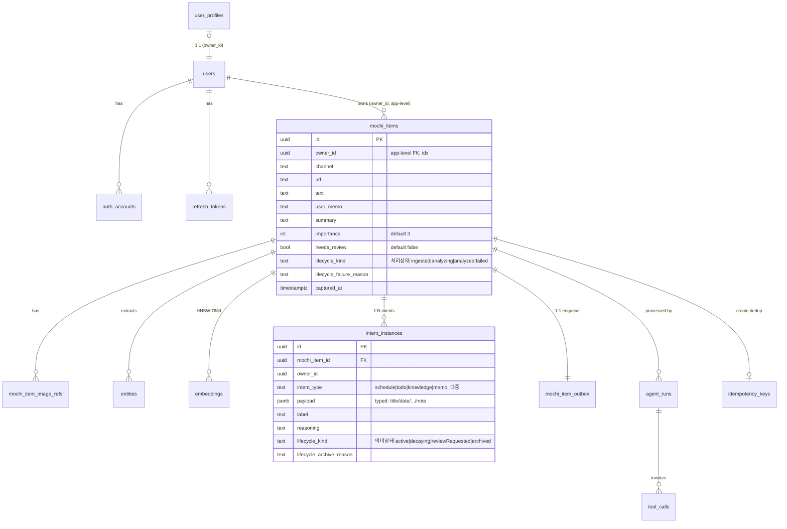

# 모찌(MOCHI) — 도메인 & 데이터베이스 설계

> Backend: Postgres 16 + pgvector · iOS: Realm (mirror)

> ⓘ **이 문서의 정본 규칙 (2026-06-03 전면 재작성)**
>
> 1. **본문(§3 ERD · §4 DDL · §11 인덱스 · §12 카탈로그)은 as-built 가 정본**이다 — alembic `0001`~`0008` + ORM 이 실제로 만든 **단일 `mochi_items` 테이블 모델**. 이전 문서는 정규화 3테이블(`mochi_items`/`mochi_sources`/`mochi_analyses`)·typed 파생·conversations 일가를 본문 DDL 로 실어 코드와 갈라졌다(drift 의 근원). 그 design-ahead 비전은 버리지 않고 **§13 향후 계획(미구현·게이트)**로 옮겼다.
> 2. **§4.4 Intent 모델은 2026-06-04 빅뱅으로 별도 `intent_instances` 테이블(1급 행·다중·위계없음)로 갔다.** intent 파생중복 5컬럼(`intent`/`secondary_intents`/`intent_applicability`/`intent_candidates`/`confidence`)을 alembic `0009` 가 DROP 하고 `intent_instances` 로 이관했다 — 점수·대표·위계 폐기, instance 단위 lifecycle. 근거·토론은 [`INTENT_REDESIGN.md`](INTENT_REDESIGN.md).
> 3. **명명 정본**: 코드가 `mochi_item`(2026-05-29 rename 완료). `capture` 는 이제 *이미지 캡처 행위* 만 의미(AppGroup `captures/`, 백탭 `CaptureScreenshotIntent`).

---

## 1. 설계 원칙

| # | 원칙 | 구체 (as-built 기준) |
|---|---|---|
| 1 | Self-documenting names | 약어 금지. 컬럼·테이블·enum 값 풀네임 |
| 2 | Owner scoping | 모든 user-data 행에 `owner_id` + 모든 read/write 에 owner 필터 (repository layer 강제, 테스트 검증) |
| 3 | Explicit lifecycle | boolean `is_active` 금지. 상태는 enum(`lifecycle_kind`) + application `LifecyclePolicy` 전이 검증 |
| 4 | Time is UTC `timestamptz` | 모든 시각 컬럼 `_at` suffix |
| 5 | Intent = 별도 1급 행 | intent 는 `mochi_items` 컬럼이 아니라 별도 `intent_instances` 테이블 행(다중·위계없음). 점수·대표·confidence 폐기 — **저장된 instance = active** (§4.4) |
| 6 | Transactional Outbox | 비동기 AI 처리의 reliability foundation (`mochi_item_outbox`) |
| 7 | Hybrid Search | BM25 tsvector(GIN) + 벡터 HNSW |

> ⚠️ 이전 문서의 원칙 "One concept = one table(`mochi_items`/`mochi_sources`/`mochi_analyses` 분리)" 와 "Append-only `mochi_analyses`" 는 **as-built 에서 채택되지 않았다**. 현재는 단일 `mochi_items` 에 출처(`channel`/`url`/`text`/`user_memo`)·분석결과(`summary`/`intents`/`importance`)를 인라인한다. 정규화 분리는 §13 의 향후 후보일 뿐 정본 원칙이 아니다.

### 명명 컨벤션

```
Table        mochi_items                       (snake_case, 복수형)
Column       lifecycle_kind, owner_id          (snake_case)
FK column    mochi_item_id, agent_run_id       ({referenced_singular}_id)
Timestamp    created_at, captured_at           (_at suffix)
JSONB        payload (intent_instances)         (typed optional 필드 묶음)
Enum 값      schedule / todo / knowledge / memo (Intent), scheduleEnded (ArchiveReason, camelCase)
```

> 명명 drift 잔존: 코드 `owner_id`(문서 옛 `user_id`), `captured_at`(옛 `occurred_at`), `summary`(옛 `title`), `importance` int(옛 `importance_score` numeric), `lifecycle_kind`(옛 `lifecycle_state`). **본 재작성에서 문서를 코드값으로 통일**했다.

---

## 2. Ubiquitous Language

iOS · 백엔드 · 프롬프트 모두 동일 용어를 쓴다.

| 용어 | 정의 |
|---|---|
| **MochiItem** | 사용자가 저장한 단일 기록. aggregate root. **입력 1건 = MochiItem 1개** (쪼개지 않는다) |
| **Intent** | MochiItem 의 의미 분류. enum `schedule`/`todo`/`knowledge`/`memo` (표시: 일정/할일/지식/기록) |
| **IntentInstance** | 한 MochiItem 의 의도 1건. 별도 `intent_instances` 행 `{intent_type, payload, label?, reasoning?, lifecycle_kind}`. **1:N** — 위계 없음, 같은 type 다중 허용 (§4.4) |
| **active instance** | **저장된 instance = 곧 active**. 점수·threshold 없음 — "넣을까 말까" 싶은 후보는 instance 로 안 넣고 `review_options` 로 (§4.4) |
| **needs_review** | "헷갈려요". 모찌가 분류를 확신 못 해 물을지의 `mochi_items` boolean 컬럼. LLM holistic 판단(threshold 아님). 저장·active 와 직교 |
| **memo fallback** | 대상/행동 불분명 시 memo instance 하나로 안전 보관 + needs_review=true (분류 못 해도 안 잃는다) |
| **Lifecycle Kind** | MochiItem 처리·생명 상태. 7값 enum (§7). intent 와 **독립**(레코드 단위) |
| **Channel** | 입력 채널 (`screenshot`/`appDirectInput`/`appShareSheet`/`appIntent`/…). `mochi_items.channel` 인라인 |
| **Entity** | AI 추출 의미 단위 (`entities.kind`/`value`) |
| **AgentRun** | MochiItem 1건 처리 LLM 오케스트레이션 실행 1회 |
| **Outbox Message** | mochi_items COMMIT 직후 worker 가 픽업할 행 (`mochi_item_outbox`) |
| **Idempotency Key** | `POST /mochi_items` 의 owner-scoped 키 |
| **Embedding** | text-embedding (768d) chunk 벡터 |

> design-ahead 용어(ActionCandidate · Citation · Tag · Conversation 등)는 §13 에서 정의. 본문은 as-built 만.

---

## 3. ERD (as-built)



> ERD 는 주요 컬럼만 보인다 (전체는 §4.3). intent 저장은 **별도 `intent_instances` 테이블**(0009~, §4.4 — instance 단위 lifecycle, 점수·대표·위계 폐기)이고, `mochi_items` 엔 `needs_review boolean` 만 남는다. `owner_id` 는 DB FK 가 아니라 **application-level** 격리(인덱스만). `idempotency_keys.mochi_item_id` 도 FK 없음. typed 파생(todos/calendar_events 등)·conversations·tags·search_index 는 **미존재** → §13.

---

## 4. SQL DDL (as-built, Postgres 16 + pgvector)

> 아래는 alembic `0001`~`0008` + ORM 이 만든 **실제 스키마**다. §4.4 만 타겟(0009 후).

### 4.1 Extensions

```sql
CREATE EXTENSION IF NOT EXISTS vector;     -- pgvector (0001)
CREATE EXTENSION IF NOT EXISTS pgcrypto;   -- gen_random_uuid() (0004)
```

### 4.2 Identity (alembic 0004)

```sql
CREATE TABLE users (
    id                      uuid PRIMARY KEY DEFAULT gen_random_uuid(),
    email                   varchar(320) NOT NULL,
    display_name            varchar(128) NOT NULL DEFAULT '',
    locale                  varchar(16)  NOT NULL DEFAULT 'ko-KR',
    onboarding_completed_at timestamptz,
    created_at              timestamptz NOT NULL DEFAULT now(),
    deleted_at              timestamptz,
    CONSTRAINT ck_users__email_lower CHECK (email = lower(email))
);
CREATE UNIQUE INDEX uq_users__email__active ON users(email) WHERE deleted_at IS NULL;

CREATE TABLE auth_accounts (
    id            uuid PRIMARY KEY DEFAULT gen_random_uuid(),
    user_id       uuid NOT NULL REFERENCES users(id) ON DELETE CASCADE,
    provider      varchar(16)  NOT NULL,
    subject       varchar(255) NOT NULL,
    email_at_link varchar(320) NOT NULL,
    linked_at     timestamptz NOT NULL DEFAULT now(),
    revoked_at    timestamptz,
    CONSTRAINT ck_auth__provider CHECK (provider IN ('apple','google')),
    CONSTRAINT uq_auth__provider_subject UNIQUE (provider, subject)
);
CREATE INDEX idx_auth__user ON auth_accounts(user_id);

CREATE TABLE refresh_tokens (
    id             uuid PRIMARY KEY DEFAULT gen_random_uuid(),
    user_id        uuid NOT NULL REFERENCES users(id) ON DELETE CASCADE,
    token_hash     varchar(64) NOT NULL UNIQUE,
    family_id      uuid NOT NULL,
    parent_id      uuid REFERENCES refresh_tokens(id) ON DELETE SET NULL,  -- rotation chain
    device_label   varchar(128),
    user_agent     varchar(512),
    issued_at      timestamptz NOT NULL DEFAULT now(),
    expires_at     timestamptz NOT NULL,
    used_at        timestamptz,
    revoked_at     timestamptz,
    revoked_reason varchar(32),
    CONSTRAINT ck_rt__expires       CHECK (expires_at > issued_at),
    CONSTRAINT ck_rt__revoke_paired CHECK ((revoked_at IS NULL) = (revoked_reason IS NULL)),
    CONSTRAINT ck_rt__revoke_reason_enum CHECK (
        revoked_reason IS NULL OR
        revoked_reason IN ('rotated','logout','reuse_detected','user_account_deleted','admin'))
);
CREATE INDEX idx_rt__user            ON refresh_tokens(user_id);
CREATE INDEX idx_rt__family_active   ON refresh_tokens(family_id)  WHERE revoked_at IS NULL;
CREATE INDEX idx_rt__expires_active  ON refresh_tokens(expires_at) WHERE revoked_at IS NULL;
```

### 4.3 Mochi Core (alembic 0001 + 0003 + 0005 + 0006 rename + 0008 + 0009)

```sql
CREATE TABLE mochi_items (
    id                       uuid PRIMARY KEY,
    owner_id                 uuid NOT NULL,          -- app-level 격리 (FK 없음), idx
    channel                  varchar(32) NOT NULL,   -- 입력 채널 (Pydantic enum 게이트)
    url                      varchar(2048),
    text                     text,
    user_memo                text,
    summary                  text,                   -- LLM 요약
    importance               int   NOT NULL DEFAULT 3,    -- 1~5 (numeric 0~1 아님)
    model_version            varchar(64),
    needs_review             boolean NOT NULL DEFAULT false,  -- LLM holistic (점수/threshold 폐기, §4.4)
    lifecycle_kind           varchar(32) NOT NULL DEFAULT 'ingested',  -- 처리상태 §7.1, idx
    lifecycle_failure_reason text,
    sync_kind                varchar(32) NOT NULL DEFAULT 'pending',  -- pending|uploaded|calendar_synced|reminder_synced|failed
    sync_detail              text,
    captured_at              timestamptz NOT NULL,   -- idx
    created_at               timestamptz NOT NULL DEFAULT now(),
    updated_at               timestamptz NOT NULL DEFAULT now(),
    deleted_at               timestamptz             -- soft delete (0013) — NULL=active. 모든 조회가 deleted_at IS NULL 로 가림
    -- 0009 빅뱅: intent 5컬럼(intent/secondary_intents/intent_applicability/intent_candidates/confidence) +
    -- lifecycle_archive_reason DROP. intent 는 별도 intent_instances 테이블로(아래), 의미 lifecycle 도 거기로.
);
CREATE INDEX ix_captures_owner_id      ON mochi_items(owner_id);
CREATE INDEX ix_captures_lifecycle_kind ON mochi_items(lifecycle_kind);
CREATE INDEX ix_captures_captured_at   ON mochi_items(captured_at);
CREATE INDEX ix_mochi_items_active ON mochi_items(owner_id) WHERE deleted_at IS NULL;  -- 0013 soft delete: active 행만
CREATE INDEX ix_mochi_items_fts ON mochi_items   -- 0006 이 ix_captures_fts → 로 rename (언더스코어 1개)
    USING gin (to_tsvector('simple', coalesce(summary,'') || ' ' || coalesce(text,'')));

-- Intent 저장 — 별도 1급 행 (0009). 저장된 instance = 곧 active. 위계 없음(같은 type 다중).
CREATE TABLE intent_instances (
    id            uuid PRIMARY KEY,
    mochi_item_id uuid NOT NULL REFERENCES mochi_items(id) ON DELETE CASCADE,  -- idx
    owner_id      uuid NOT NULL,
    intent_type   varchar(16) NOT NULL,        -- schedule|todo|knowledge|memo (다중)
    payload       jsonb NOT NULL DEFAULT '{}', -- typed: title/date/time/deadline/person/topic/url/note
    label         varchar(255),
    reasoning     text,
    lifecycle_kind           varchar(32) NOT NULL DEFAULT 'active',  -- 의미상태 §7.2
    lifecycle_archive_reason varchar(32),                            -- scheduleEnded|todoCompleted|knowledgeStale|userManual
    created_at    timestamptz NOT NULL DEFAULT now(),
    updated_at    timestamptz NOT NULL DEFAULT now()
);
CREATE INDEX ix_intent_instances_mochi_item_id ON intent_instances(mochi_item_id);
-- "owner 의 미완 todo 만" 등 (owner_id leftmost prefix):
CREATE INDEX ix_intent_instances_owner_type_lc ON intent_instances(owner_id, intent_type, lifecycle_kind);

-- 이미지 참조 (0003 → 0006 rename)
CREATE TABLE mochi_item_image_refs (
    id            bigserial PRIMARY KEY,
    mochi_item_id uuid NOT NULL REFERENCES mochi_items(id) ON DELETE CASCADE,  -- idx
    sha256        varchar(64)  NOT NULL,   -- idx
    mime_type     varchar(64)  NOT NULL,
    byte_size     bigint       NOT NULL,
    object_key    varchar(512)            -- GCS object key
);

-- 추출 엔티티 (0001 → 0006 rename). ※ as-built 는 단순 — user_id/normalized/provenance 없음
CREATE TABLE entities (
    id            bigserial PRIMARY KEY,
    mochi_item_id uuid NOT NULL REFERENCES mochi_items(id) ON DELETE CASCADE,  -- idx
    kind          varchar(16)  NOT NULL,   -- free str(미강제). 프롬프트 가이드 예시: date|person|place|topic|url|task|amount. repository 가 kind[:16] 절단
    value         varchar(512) NOT NULL
);

-- 임베딩 (0001). ※ as-built 는 owner/chunk_index/uniq 없음
CREATE TABLE embeddings (
    id            bigserial PRIMARY KEY,
    mochi_item_id uuid NOT NULL REFERENCES mochi_items(id) ON DELETE CASCADE,  -- idx
    chunk_text    text NOT NULL,
    embedding     vector(768) NOT NULL,
    model_version varchar(64) NOT NULL
);
CREATE INDEX ix_embeddings_vector_hnsw ON embeddings
    USING hnsw (embedding vector_cosine_ops) WITH (m=16, ef_construction=64);
```

### 4.4 Intent 모델 — 별도 `intent_instances` 테이블 (정본, 1:N · instance 단위 lifecycle)

> **as-built (alembic 0009~).** 2026-06-04 빅뱅: 실험([`lab/active/intent-schema-decision/FINDINGS.md`](../lab/active/intent-schema-decision/FINDINGS.md), intent F1 0.809→0.935)이 06-02 의 flat `intents`+threshold 안을 뒤집어, **점수(applicability/confidence/threshold)·대표(representative argmax)·위계(primary/secondary)를 폐기**하고 boolean instance 모델로 갔다. (근거: [`INTENT_REDESIGN.md`](INTENT_REDESIGN.md), 핸드오프 `journal/2026-06-04-intent-instances-bigbang-handoff.md`)

#### 저장 — 별도 테이블 (1급 행)

intent 를 `mochi_items` 컬럼이 아니라 별도 `intent_instances` 행으로 저장한다. **저장된 instance = 곧 active** — 점수도 threshold 도 없다. 위계 없음(같은 type 다중 허용: 한 캡쳐에 todo 둘).

```sql
CREATE TABLE intent_instances (
    id            uuid PRIMARY KEY,
    mochi_item_id uuid NOT NULL REFERENCES mochi_items(id) ON DELETE CASCADE,  -- idx
    owner_id      uuid NOT NULL,
    intent_type   varchar(16) NOT NULL,        -- schedule|todo|knowledge|memo (위계 없음, 다중)
    payload       jsonb NOT NULL DEFAULT '{}',  -- typed: title/date/time/deadline/person/topic/url/note
    label         varchar(255),                 -- 한국어 시나리오 라벨 (UI 부속, nil → intent.displayName)
    reasoning     text,
    lifecycle_kind           varchar(32) NOT NULL DEFAULT 'active',  -- §7 표 B (instance 의미상태)
    lifecycle_archive_reason varchar(32),
    created_at    timestamptz NOT NULL DEFAULT now(),
    updated_at    timestamptz NOT NULL DEFAULT now()
);
-- "owner 의 미완 todo 만" 등 instance 필터 (owner_id leftmost prefix):
CREATE INDEX ix_intent_instances_owner_type_lc ON intent_instances(owner_id, intent_type, lifecycle_kind);
-- "할일 보유 item": EXISTS(SELECT 1 FROM intent_instances ii WHERE ii.mochi_item_id=m.id AND ii.intent_type='todo')
```

`mochi_items` 에서 intent 5컬럼(intent/secondary_intents/intent_applicability/intent_candidates/confidence)은 **DROP** 되고, **`needs_review boolean`** 한 컬럼만 남는다(`lifecycle_archive_reason` 도 DROP — §7 처리상태엔 archive 없음).

#### 결정 정책 — LLM holistic boolean (threshold 폐기)

- **저장된 instance = active.** "넣을까 말까" 싶은 후보는 instance 로 넣지 않는다(애매하면 `review_options`).
- **`needs_review`**: 모찌가 분류를 확신 못 해 사용자에게 물을지의 boolean. τ/τ_review threshold 가 아니라 LLM 이 holistic 하게 판단(실험에서 score calibration 보다 정확 — review acc 0.833→0.944).
- **`review_options`**: needs_review=true 일 때 제시할 미확정 후보 `[{intent_type, label, reasoning}]`. **instance 아님**. 사용자가 고르면 그때 instance 생성. **`mochi_items.review_options` JSONB 컬럼 영속**(PR-B 컬럼 승격 — 헷갈려요 후보를 push payload·GET projection·앱 내 needsReview 버킷 fallback 이 모두 읽는다).
- **`memo` fallback**: 대상/행동 불분명 시 memo instance 하나로 안전 보관 + needs_review=true. 미션("놓치기 쉬운 순간은 쉽게 남긴다")과 정합 — 분류를 못 해도 안 잃는다.
- **`payload.title` 필수**(프롬프트 V13~, 2026-06-08): 저장되는 모든 instance 는 title 을 가진다. **LLM 출력 계약 레벨** — function schema `intent_instances.items.payload.required=['title']` + 프롬프트가 강제. iOS 카드·캘린더·기록상세가 제목으로 `payload.title`(대표=`representativeTitle`)을 쓰는데 요약문 폴백을 제거해, 누락 시 긴 summary 가 작은 cell 을 채우던 문제 해소. 정체조차 못 짚어 title 을 못 만들 정도면 그 자체가 분류 불신뢰 신호라 ambiguity ladder step4 에서 `needs_review=true` 로 빠진다(= instance 로 저장되는 캡처는 거의 항상 title 이 있다). 단 **DB 는 JSONB `DEFAULT '{}'` 유지**(필수는 계약 레벨이지 DB 제약 아님), **DTO `IntentPayloadDTO.title` 은 optional 유지**(graceful degradation — LLM 일탈 시에도 분석 전체가 ValidationError 로 죽지 않게, iOS 가 빈 title→summary 폴백).

#### 파생 — 저장 안 함, read 시 계산 (projection)

| 파생값 | 정의 | 용도 |
|---|---|---|
| `representative` (대표 intent) | **고정 우선순위** `schedule>todo>knowledge>memo` 중 존재하는 최상위 (없으면 null) | 캘린더 칸 대표색·UI 칩. **argmax 폐기**(점수 없음) |
| `intent_types` | instance 들의 distinct type (출현 순서) | 1:N 필터·프로필 window |

#### API projection

0009 로 DB·agent 를 갈면서 **API 응답도 함께 바뀐다** — instance 단위 lifecycle 이 응답 구조를 바꿔 "iOS 0줄 무중단" 은 성립 불가(폐기). iOS 는 instance 전제로 재배선됐다.

- 응답 `intentInstances` = `intent_instances` (intentType/payload/label/reasoning/lifecycleKind), `needsReview` = boolean, `reviewOptions` = projection(현재 빈 배열 가능).
- 옛 `intent`/`secondaryIntents`/`intentApplicability`/`confidence`/`candidates` **제거**.

#### lifecycle 결합 (2분할 — §7)

- **item 처리상태**(`mochi_items.lifecycle_kind`: ingested/analyzing/analyzed/failed)와 **instance 의미상태**(`intent_instances.lifecycle_kind`: active/decaying/reviewRequested/archived)는 **직교**.
- `archive_reason × intent` 호환·knowledge decay 자동전이는 **instance 단위**(각 행의 `intent_type` 기준). 한 캡쳐의 TODO_A 완료가 같은 캡쳐의 TODO_B·Schedule_C 와 독립.

### 4.5 Operations (alembic 0001 + 0002 + 0006 + 0007)

```sql
-- transactional outbox (0002 → 0006 rename)
CREATE TABLE mochi_item_outbox (
    id            bigserial PRIMARY KEY,
    event_id      uuid NOT NULL,
    mochi_item_id uuid NOT NULL REFERENCES mochi_items(id) ON DELETE CASCADE,  -- idx
    owner_id      uuid NOT NULL,   -- idx
    status        varchar(16) NOT NULL DEFAULT 'pending',  -- pending|in_flight|done|dead_letter, idx
    attempts      int  NOT NULL DEFAULT 0,
    last_error    text,
    created_at    timestamptz NOT NULL DEFAULT now(),
    locked_until  timestamptz
);
CREATE INDEX ix_capture_outbox_pending ON mochi_item_outbox(status, created_at) WHERE status='pending';

CREATE TABLE agent_runs (
    id               uuid PRIMARY KEY,
    mochi_item_id    uuid NOT NULL REFERENCES mochi_items(id) ON DELETE CASCADE,  -- idx
    current_node     varchar(32) NOT NULL DEFAULT 'ingested',  -- 부록 B
    total_tokens     int NOT NULL DEFAULT 0,
    total_latency_ms int NOT NULL DEFAULT 0,
    started_at       timestamptz NOT NULL DEFAULT now(),
    ended_at         timestamptz,
    failure_reason   text
);

CREATE TABLE tool_calls (
    id            bigserial PRIMARY KEY,
    agent_run_id  uuid NOT NULL REFERENCES agent_runs(id) ON DELETE CASCADE,  -- idx
    name          varchar(64)  NOT NULL,
    input_digest  varchar(128) NOT NULL,
    output_digest varchar(128),
    tokens_in     int NOT NULL DEFAULT 0,
    tokens_out    int NOT NULL DEFAULT 0,
    latency_ms    int NOT NULL DEFAULT 0,
    succeeded     boolean NOT NULL DEFAULT true,
    extra         jsonb    -- ⚠️ drift: migration=JSONB, ORM=generic JSON. 다음 BE 터치 시 ORM 1줄 정정
);

CREATE TABLE idempotency_keys (
    key           varchar(128) PRIMARY KEY,
    mochi_item_id uuid NOT NULL,   -- FK 없음 (app-level)
    created_at    timestamptz NOT NULL DEFAULT now()
);

-- 개인화 프로필 (0007). owner 당 1행. ※ ORM 모델 없이 raw SQL(profile_store.py) 접근
CREATE TABLE user_profiles (
    owner_id      uuid PRIMARY KEY,        -- == users(id)
    summary       text NOT NULL,
    model_version varchar(64) NOT NULL,
    items_covered int  NOT NULL DEFAULT 0,
    refreshed_at  timestamptz,
    created_at    timestamptz NOT NULL DEFAULT now()
);
```

### 4.6 Notifications — `device_push_tokens` (alembic 0011, PR-B)

> APNs background push 토큰. `apns_device`(단말 1:N, 완료 alert) + `live_activity`(item 1:1, `.ready` 전환). `environment` 로 sandbox/production 라우팅(BadDeviceToken 회피). **`token` 자체가 globally unique** — apns_device 는 폰 단위라 계정 전환 시 owner 를 갱신해 cross-account push 유출을 막는다.

```sql
CREATE TABLE device_push_tokens (
    id            uuid PRIMARY KEY,
    owner_id      uuid NOT NULL REFERENCES users(id) ON DELETE CASCADE,  -- idx
    token         text NOT NULL,           -- globally unique (계정 전환 시 owner 갱신)
    token_type    varchar(16) NOT NULL,    -- apns_device | live_activity
    mochi_item_id uuid REFERENCES mochi_items(id) ON DELETE SET NULL,  -- LA 만(item 1:1), device 는 NULL
    environment   varchar(16) NOT NULL DEFAULT 'sandbox',  -- sandbox | production
    created_at    timestamptz NOT NULL DEFAULT now(),
    updated_at    timestamptz NOT NULL DEFAULT now()
);
CREATE UNIQUE INDEX ux_device_push_tokens_token ON device_push_tokens(token);
```

---

## 5. iOS Realm Schema (mirror)

> Realm `schemaVersion = 6` (`RealmStoreFactory.currentSchemaVersion`). **로컬 id ≠ 서버 PK** — 서버 id 는 `SyncState.uploaded(serverID:)` 에 보관(부록 C). 0009 빅뱅이 응답 구조를 바꿔(intent 1:N instance) **v4→v5 재배선**: `RealmIntentInstance` 신설, 점수/대표/candidate 폐기. **v5→v6**: `RealmMochiItem.userTitle` 추가(기록상세 제목 인라인 교정 로컬 오버라이드). prod 아님이라 `deleteRealmIfMigrationNeeded:true`(실데이터 폐기 허용).

intent 관련 검증된 필드(정확한 전체 스키마는 `CorePersistence/RealmObjects.swift` 가 정본):

| Realm 필드 | 타입 | 의미 |
|---|---|---|
| `RealmMochiItem.intentInstances` | `List<RealmIntentInstance>` | intent 1:N. `RealmIntentInstance = {intentType, payload, label?, reasoning?, lifecycleRawValue}`. 빈 List = "분석 중" 버킷(`listAnalyzing`) |
| `RealmMochiItem.needsReview` | `Bool` | "헷갈려요" 버킷(`listNeedsReview`). 서버 boolean 직접 미러(client-derive threshold 폐기) |
| `RealmMochiItem.userTitle` | `String?` | 사용자가 기록상세에서 교정한 제목(로컬 오버라이드). nil 이면 AI 추출 제목(대표 `payload.title`). **서버 미동기화 — 로컬 전용**(재동기화로 instances 가 delete-reinsert 돼도 보존) |

| Backend | Realm |
|---|---|
| `intent_instances` → API `intentInstances` | `RealmMochiItem.intentInstances` (List) |
| `mochi_items.needs_review` → API `needsReview` | `RealmMochiItem.needsReview` |
| `mochi_item_image_refs` / `entities` | Embedded List |
| `embeddings`/`agent_runs`/`tool_calls`/`outbox`/`idempotency_keys`/`user_profiles` | 서버 only |

### 동기화 (as-built)

- **iOS → Backend**: `syncState=pendingUpload` 인 item 을 `MochiItemSyncWorker` 가 업로드. 이미지는 원본 PNG → 업로드용 JPEG(긴 변 ≤1920px, q60) 파생 → `sha256/mimeType/byteSize` 로 `POST /mochi_items/presign` → Signed URL 로 GCS 직접 PUT → `objectKey` 만 전달. 성공 → `syncState=uploaded(serverID:)`(**서버 자체 PK 보관**).
- **Backend → iOS** (PR-B 3분담): **foreground = SSE** `/mochi_items/{id}/stream` 구독(`AgentStreamClient` live — worker `lifecycle_kind` 관찰, `final` 수신 시 `GET /mochi_items/{serverID}` 재조회). **background/종료 = APNs** push(완료 alert + LA `.ready`). **SSE 실패/끊김 = 3초 폴링 fallback**(`GET /mochi_items/{serverID}`, 제거 금지). scenePhase active 복귀 시 reconcile(SSE 재연결 + 1회 폴링). 동기 Gemini 분류는 제거됨(2026-05-30).
- **분류 확정 / 재분석**: iOS `setIntent` 는 로컬 수동 확정(`reviewOptions` 후보 칩 즉시확정 — instance 조작, 서버 미동기화). **단 instance lifecycle 완료/완료취소는 `POST /mochi_items/{id}/instances/{instanceId}/lifecycle` 로 서버 동기화한다**(캘린더 완료 체크박스 — 낙관적 로컬 전이 + 서버 push, 실패 시 롤백). 서버가 instance id 를 응답에 실어(`instanceId`) iOS 가 그 id 로 대상을 지목한다. **"다른 의도" 자연어 재분석**은 `POST /mochi_items/{id}/reanalyze` 가 사용자 의도 힌트를 받아 기존 outbox→`AgentOrchestrator` 파이프라인을 **재실행**한다(같은 item 재분석 — 중복 캡처 없음). 힌트는 분석 프롬프트 context 에만 합류하고 **outbox 행에만 일시 적재**된다 — `mochi_items`/`user_memo` 에 저장하지 않는다(사용자가 직접 쓴 메모로 오해하는 것 방지). (구 "서버 override 라우트 폐기"는 대표·위계 소멸 맥락의 결정이었으나 — override≠재분석 — 재분석 라우트로 대체됨.)
- **충돌/Catch-up**: backend master 원칙. 양방향 충돌 해소·cold-start catch-up(`/sync`)은 미구현.

---

## 6. API Endpoints

> **요청/응답 스키마·필드 타입의 단일 원천은 [`mochi-backend/openapi.json`](../mochi-backend/openapi.json)** (`make openapi` 생성물, 로컬 `GET /docs`) 이다. 아래 표는 스키마를 *복제*하지 않고, 각 라우트의 **도메인 의미·배선 상태(✅실재배선 / ◑서버만·iOS 미배선 / ○라우트 미존재)** 만 소유한다.

| Method | Path | 상태 | 비고 |
|---|---|---|---|
| `POST` | `/api/v1/auth/apple` · `/auth/google` · `/dev` · `/refresh` · `/logout` | ✅ | OAuth → JWT(RS256) + refresh rotation |
| `GET` | `/api/v1/users/me` | ✅ | |
| `POST` | `/api/v1/mochi_items` | ✅ | **단일 ingest 경로**(스크린샷·메타데이터 통합). object_key 보유 imageRef 는 GCS 실측 검증. `Idempotency-Key` 필수 |
| `POST` | `/api/v1/mochi_items/presign` | ✅ | GCS V4 Signed PUT URL |
| `GET` | `/api/v1/mochi_items/{id}` | ✅ | owner 만. 응답에 `intentInstances`/`needsReview`/`reviewOptions` (§4.4) |
| `GET` | `/api/v1/mochi_items` | ✅ | 캘린더 탭 list — `capturedAt` 구간. query `capturedFrom`/`capturedTo`/`intent`(intent_instances EXISTS)/`limit`. owner-scoped |
| `GET` | `/api/v1/mochi_items/calendar` | ✅ | 캘린더 탭 — KST 월간 집계(`year`/`month` → 날짜별 count·대표 intent·대표 썸네일 objectKey) |
| `GET` | `/api/v1/mochi_items/todos/upcoming` | ✅ | 캘린더 탭 — 미완료(active) todo 마감 임박순. 마감일 = `entities(kind='deadline')` 서버 파싱 |
| `GET` | `/api/v1/mochi_items/{id}/stream` | ✅ | SSE — worker `lifecycle_kind` 관찰, `node`/`final`/`failed`. iOS foreground 구독(PR-B), `final`→GET 재조회 |
| `POST` | `/api/v1/mochi_items/{id}/reanalyze` | ✅ | "다른 의도" 재분석 — `userHint` 를 outbox 행에 실어 `AgentOrchestrator` 재실행. 힌트는 분석 프롬프트에만 합류, `mochi_items` 미저장. 응답 202 |
| `POST` | `/api/v1/mochi_items/{id}/instances/{instanceId}/lifecycle` | ✅ | intent instance 완료/완료취소 — `lifecycleKind`(+`archiveReason`) 전이. todo `active↔archived(todoCompleted)`. owner+instance 3중 scoped, 불법 전이 409. iOS 캘린더 완료 체크박스가 호출(낙관적 로컬 + 서버 push) |
| `POST` | `/api/v1/search` | ◑ | Hybrid Search 라우트 실재 · iOS 미배선 (이전 문서 '미존재' 는 오기) |
| `POST` | `/api/v1/devices/push-token` | ✅ | APNs 토큰 등록(`apns_device` 단말 / `live_activity` item). PR-B |
| `DELETE` | `/api/v1/mochi_items/{id}` | ✅ | 기록 soft delete — `deleted_at` 마킹(행 보존, 되돌릴 수 있게). owner-scoped, 없는/이미 삭제된 항목 404. 응답 204. iOS 기록상세 더보기 메뉴가 호출(서버 soft delete + 로컬 Realm hard delete + 화면 pop). 0013 |
| `*` | `/conversations` · `/sync` | ○ | **라우트 미존재** → §13 |

> ⚠️ 캘린더 탭 list/calendar/todos 라우트는 2026-06-04 신설(`mochi_items/presentation/router.py`). **정적 경로(`/calendar`·`/todos/upcoming`)는 동적 `/{id}` 보다 먼저 선언**해 path-param 충돌을 피한다. iOS 캘린더 탭은 즉시성·오프라인·실시간(`observeChanges`)을 위해 **로컬 Realm 구동**이고, 이 서버 API 는 멀티기기/웹 대비 계약(현재 iOS 클라 미배선). `POST /search` 도 실재(이전 '미존재' 는 문서 오기 — `search_router` 가 `api.py` 에 등록). `DELETE /{id}` 는 2026-06-08 신설(soft delete, 0013) — `conversations`·`sync` 만 여전히 라우트 없음.
>
> iOS 로컬 캘린더는 칸을 **두 축**으로 칠한다 — ① 저장 점(`capturedAt`, 대표 intent 색) ② 마감/일정 마커(active todo 의 `payload.deadline ?? payload.date`, active schedule 의 `payload.date` 를 KST 파싱, 날짜 숫자 강조). 마감/일정 날짜 칸을 탭하면 그날 캡처 + 그날 마감/일정 항목을 함께 보인다. 서버 `todos/upcoming` 은 마감일을 `entities(kind='deadline')` 로 파싱하지만, iOS 분석 응답엔 `entities`·`actionCandidate` 가 비어(`MochiItemDTO+Analysis` 가 `payload` 만 매핑) 클라는 `payload` 를 단일 소스로 쓴다 — 서버 API 배선 시 이 차이 정합 필요. 하단 리스트는 ① **다가오는 일정**(active schedule, 오늘 이후 빠른 시간순) ② **할 일**(미완료 마감임박순 + 완료 맨 밑)로 분리하고, 할 일 체크박스가 `active↔archived(todoCompleted)` 를 토글해 서버 `POST .../lifecycle` 로 영속한다(완료 todo 도 맨 밑에 남아 재토글 가능).

| Header | 필수 | 의미 |
|---|---|---|
| `Authorization: Bearer <token>` | health 제외 전부 | JWT(RS256) |
| `Idempotency-Key` | `POST /mochi_items*` | owner-scoped |
| `X-Mochi-Request-ID` | 옵션 | 분산 추적 |

---

## 7. Lifecycle (코드 정본 — `lifecycle_policy.py` / `entities.py` / `value_objects.py`)

> 이 절은 코드의 **유일 진실**이다. 2026-06-04 빅뱅으로 lifecycle 은 **2분할**됐다(가드레일 1) — item 처리상태와 intent instance 의미상태가 **직교**한다. 한 이름에 섞으면 다시 혼란.

### 7.1 처리상태 — `mochi_items.lifecycle_kind` (item 단위, 4값)

분석 파이프라인의 진행. archive_reason 없음, intent 무관(단일 선형 전이라 정책 불필요).

```
ingested → analyzing → analyzed
                  ↘ failed
```

> 저장값(`LifecycleStateKind`): `ingested`/`analyzing`/`analyzed`(구 `active` — 분석 완료·instance 적재됨, **iOS SSE `final`·폴링 컷오버 신호**)/`failed`.
>
> **처리상태 ↔ Live Activity phase 매핑** (PR-B, iOS `MochiLiveActivityAttributes`): `analyzing`→`.analyzing` / `analyzed`+`needs_review=false`→`.ready`(확정) / `analyzed`+`needs_review=true`→`.ready`(후보대기, `review_options` 표시·선택) / `failed`→LA 종료. LA 는 **전 채널**(스크린샷·링크·텍스트), 메인앱 foreground worker(`MochiItemSyncWorker`)가 시작한다.

### 7.2 의미상태 — `intent_instances.lifecycle_kind` (instance 단위, 4값)

각 intent instance 의 완료/만료/decay. instance 는 분석 성공 시 `active` 로 태어난다. intent_type 별 차등 전이(`InstanceLifecycleKind`: `active`/`decaying`/`reviewRequested`/`archived`).

전이 매트릭스 (`_ALLOWED_KIND_PAIRS`, intent_type 별):

| intent_type | 허용 전이 |
|---|---|
| `schedule` | `active → archived` |
| `todo` | `active → archived`, `archived → active`(완료 취소 — 잘못 누른 완료 되돌리기, todo 한정) |
| `knowledge` | `active ↔ decaying`, `decaying ↔ reviewRequested`, `reviewRequested → archived` |
| `memo` | `active → archived` |

### 7.3 archive_reason × intent_type (`_INTENT_ARCHIVE_REASONS`)

| intent_type | 허용 archive_reason |
|---|---|
| `schedule` | `scheduleEnded`, `userManual` |
| `todo` | `todoCompleted`, `userManual` |
| `knowledge` | `knowledgeStale`, `userManual` |
| `memo` | `userManual` |

> archive 전이는 instance 의 `intent_type` 으로 검증한다. 한 캡쳐의 todo 완료(`todoCompleted`)가 같은 캡쳐의 schedule instance 에 영향 없음(**행 단위 독립** — 검증기준 1).

### 7.4 자동 전이 (worker 주기 실행, instance 단위)

| 조건 | 전이 |
|---|---|
| `schedule` instance `active` 이고 일정 종료 시각 < now() | → `archived(scheduleEnded)` |
| `todo` instance `active` 이고 완료됨 | → `archived(todoCompleted)` |
| `knowledge` instance `active` 이고 마지막 회수 후 `KNOWLEDGE_ACTIVE_DAYS=30`일 경과 | → `decaying` |
| `knowledge` instance `decaying` 진입 후 `KNOWLEDGE_DECAY_DAYS=180`일 경과 | → `reviewRequested` |
| item dead-letter (outbox `attempts > max`) | item `lifecycle_kind` → `failed` |

> 일정/할일 종료 판정의 실제 소스(종료시각·완료여부)는 typed 테이블(§13) 구현 후 정밀화 — 현재는 entity/payload 기반.

### 7.5 전이 강제

instance 전이(from→to)·archive_reason×intent_type 검증은 `lifecycle_policy.is_allowed()` / `expected_archive_reason()` 가 수행(DB CHECK 아님). iOS `CoreDomain.LifecyclePolicy` 와 1:1.

---

## 8. 데이터 흐름

### 8.1 Ingestion (`POST /mochi_items`)

```python
async with db_session() as s, s.begin():
    if existing := await already_ingested(s, owner_id, idem_key):
        return existing                       # 멱등
    mi = insert_mochi_item(s, ..., lifecycle_kind='ingested')   # intents=[] (분석 전)
    bulk_insert_image_refs(s, mi, ...)
    insert_outbox(s, mi)                       # transactional outbox
    save_idem_key(s, idem_key, mi.id)
await pg_notify('mochi_item_outbox', str(mi.id))
return 201
```

### 8.2 Agent Worker (LLM = 분석가)

워커가 outbox 를 폴링 → 항목당 `AgentOrchestrator` 실행. 결정적 파이프라인이 아니라 **Gemini function-calling agent loop**(`gemini-3.1-flash-lite`, webFetch 그라운딩). 모델이 `finalizeAnalysis` 호출 → 종료.

```python
# 분석 산출: intent_instances [{intent_type, payload(typed), label, reasoning}] + needs_review + review_options
#           + summary + importance + entities
# write-back (instance delete-reinsert, 멱등):
apply_analysis(owner, id, analysis)   # 기존 intent_instances DELETE → 재적재 + needs_review write + entities 재적재
                                      # + lifecycle INGESTED→ANALYZING→ANALYZED
RefreshUserProfile.run(owner)         # best-effort 개인화 디바운스
```

> **현재 wire**: text+URL 분석 · write-back · 개인화 · **이미지 분석(클라 Signed URL → GCS, Gemini `gs://` 직접 read)** = 실연결. 임베딩 적재 · actions 파생 = design-ahead(§13).

### 8.3 Hybrid Search (as-built 골격)

`mochi_items` FTS GIN(tsvector) BM25 + `embeddings` HNSW 벡터 → RRF 융합. ※ embedding 적재·query embedding 품질은 아직 약함(known drift).

---

## 9. 보안

| 항목 | 메커니즘 |
|---|---|
| 인증 | Apple/Google OAuth → JWT(RS256) + refresh token rotation(`refresh_tokens`) |
| 인가 | repository layer 가 `owner_id` 필터 강제 (테스트 검증). DB FK 아닌 **app-level** 격리 |
| 멱등성 | `Idempotency-Key` → `idempotency_keys` (owner-scoped) |
| SSRF | WebFetch: 호스트 블록리스트 + A/AAAA IP 검증 + redirect 재검증 + MIME 화이트리스트 |
| Storage | `captures/{owner_id}/...` prefix + V4 Signed PUT URL. ingest 진입점 owner-prefix 강제(IDOR 방지) |
| Error envelope | 통일 응답 `{code, message, requestId, retryAfter}` (`ErrorEnvelope`, DomainError → JSONResponse) |
| 분산 추적 | `X-Mochi-Request-ID` 헤더 echo |
| PII purge | `users.deleted_at` set (soft delete). ※ email 익명화는 **미구현**(design-ahead) |

---

## 10. 마이그레이션

### 적용된 것 (alembic 0001~0009)

```
0001 initial            captures, entities, embeddings, idempotency_keys, agent_runs, tool_calls + pgvector + FTS GIN
0002 capture_outbox     transactional outbox
0003 capture_image_refs 이미지 참조
0004 auth               users, auth_accounts, refresh_tokens + pgcrypto
0005 capture_multi_intent  intent NOT NULL + secondary_intents + intent_applicability
0006 rename             captures → mochi_items (+ 모든 FK 컬럼 capture_id → mochi_item_id)
0007 add_user_profiles  개인화 프로필
0008 add_intent_candidates  intent_candidates(jsonb) — LLM 원천 후보 (0009 에서 DROP)
0009 intent_instances_bigbang  intent_instances 테이블 신규 + mochi_items.needs_review ADD
     + intent 5컬럼(intent/secondary_intents/intent_applicability/intent_candidates/confidence)·lifecycle_archive_reason DROP
     + ix_captures_intent DROP. backfill 없음(prod 아님), down 대칭
```

> **0009 빅뱅** (2026-06-04): intent 파생중복 5컬럼을 별도 `intent_instances` 1급 행으로 이관. **dual-write 중간 상태 없음**(실데이터 폐기 허용 → 한 마이그레이션에서 신설+DROP). 점수·대표·위계·override 폐기. prompt V7(boolean instances)·openapi 재덤프 동반. 향후 typed 파생 테이블은 §13(미구현).

---

## 11. 인덱스 정책 (as-built)

| 쿼리 패턴 | 인덱스 |
|---|---|
| owner 격리 | `ix_captures_owner_id` |
| intent 필터 | `ix_intent_instances_owner_type_lc`(owner_id, intent_type, lifecycle_kind) + `intent_instances` EXISTS 조인 |
| lifecycle 필터 | `ix_captures_lifecycle_kind` |
| 시간순 | `ix_captures_captured_at` |
| BM25 검색 | `ix_mochi_items_fts` (GIN tsvector) |
| auth rotation | `idx_rt__family_active` · `idx_rt__expires_active` (partial WHERE revoked_at IS NULL) |
| 벡터 ANN | `ix_embeddings_vector_hnsw` (HNSW, m=16, ef_construction=64) |
| Outbox pickup | `ix_capture_outbox_pending` (partial WHERE status='pending') |

> 옛 문서의 partial 인덱스(`idx_mochi__user__importance` 등)는 as-built 에 **없다**. importance/occurred 기반 정렬은 현재 application 또는 iOS 측(부록 C).

---

## 12. 테이블 카탈로그 (as-built, 14개)

| Group | Table | 책임 |
|---|---|---|
| Identity | `users` | 사용자 식별, soft delete |
| Identity | `auth_accounts` | Apple/Google OAuth 연결 |
| Identity | `refresh_tokens` | refresh rotation chain |
| Mochi | `mochi_items` | aggregate root. 출처·분석 인라인 (intent 는 별도 테이블) |
| Mochi | `intent_instances` | 의도 instance 1급 행(다중·위계없음·instance lifecycle, §4.4) |
| Mochi | `mochi_item_image_refs` | 이미지 참조(sha256/objectKey) |
| Mochi | `entities` | AI 추출 의미 단위(kind/value) |
| AI | `embeddings` | 청크 벡터(768d, HNSW) |
| Operations | `agent_runs` | AI 처리 실행 로그 |
| Operations | `tool_calls` | 도구 호출 로그 |
| Operations | `mochi_item_outbox` | 처리 대기 큐(1 item ⇔ 1 outbox) |
| Operations | `idempotency_keys` | 멱등성 키 |
| Operations | `user_profiles` | 개인화 프로필(owner 1행, raw SQL) |
| Notifications | `device_push_tokens` | APNs 단말/LA push 토큰(`token` globally unique, PR-B) |

---

## 13. 향후 계획 (미구현 · 게이트)

> 아래는 **roadmap** 이다 — 본문(§3·§4·§12)에 없고 코드에도 없다. DDL 은 **구현 시점에 확정**(여기 투기적 풀 DDL 을 들고 있지 않는다 — drift 원천 회피). 이전 정규화 설계 전문은 git 이력 / `docs/archive/` 참조.

### 13.1 실행 단위 typed 테이블 (intent materialize)

`todos` · `calendar_events` · `knowledge_summaries` · `memos` · `mochi_action_candidates`.

- **위치**: MochiItem 아래 파생. 입력 1건 = MochiItem 1개를 **쪼개지 않고**, 실행 단위만 분리(회의 2026-06-01 확정).
- **게이트**: "active instance 집합이 안정 **+** 실제 materialize 소비 코드가 필요로 판명" 될 때 생성. 무한 연기 방지를 위해 이 조건을 게이트로 명시.
- **시점**: 6/19~ 통합 sprint 후보(`0012+`).

### 13.2 검색·분석 부가

`mochi_analyses`(append-only 분석 이력) · `prompt_versions` · `mochi_search_index`(별도 tsvector 테이블). 현재는 `mochi_items` 인라인(`summary`/FTS) + `embeddings` 로 충분. 모델/프롬프트 비교 필요가 생기면 분리.

### 13.3 질문 탭 (RAG 대화)

`conversations` · `messages` · `message_citations`. 데모 P0(질문 탭)이나 미구현. citation = 답변이 인용한 MochiItem ID + 발췌.

### 13.4 기타

`tags`/`mochi_item_tags`(사용자 태그) · `dead_letters`(현재는 `outbox.attempts>max` 인라인) · `owner_id` DB FK 승격 · intent/lifecycle DB CHECK 승격(현재 app-level). 전부 별도 축 — 필요 시 개별 큐.

---

## 부록

### A. AgentRun current_node (`agent/domain/states.py` — `AgentNode` 8값, `HAPPY_PATH` 7노드)

| node | 의미 |
|---|---|
| `ingested` | DB INSERT 직후 |
| `normalized` | 텍스트 정제·URL 정규화 |
| `analyzed` | Gemini agent loop → intent_instances/summary/entities |
| `routed` | intent 별 후속 처리 결정 |
| `persisted` | write-back 완료 |
| `indexed` | 임베딩·tsvector 갱신 — ⚠️ 현재 임베딩 적재는 **no-op**(gateway 미주입 시 skip) |
| `synced` | iOS 반영(SSE foreground / 폴링 fallback / APNs background) |
| `failed` | 실패 → outbox 재시도/DLQ |

> 8값 전부 코드 `AgentNode` enum 의 live 멤버이고 `HAPPY_PATH` 가 `ingested`→…→`synced` 7노드를 실제 advance 한다(ARCHITECTURE §5.3·backend README 와 일치). `indexed` 의 임베딩 적재만 현재 no-op.

### B. Application-enforced invariants

| Invariant | 검증 |
|---|---|
| 모든 read/write 에 `owner_id` 필터 | repository + 테스트 |
| `LifecyclePolicy.validate(from, to, intent)` 전이 | unit test |
| **instance 없으면 memo fallback** (§4.4) | 정책 코드 + test |

> `entities.kind` 는 **미강제** — `ExtractedEntity.kind: str`(free), repository 가 `kind[:16]` 절단만. 위 예시 값(date/person/…)은 프롬프트 가이드일 뿐 DB/앱 제약 아님.

### C. iOS 헷갈려요 카드 · 폴링 · Daily Importance

- **헷갈려요 버튼**: 고정 라벨 아님. needs_review=true 일 때 API `reviewOptions`(`[{intentType, label, reasoning}]` — 점수·정렬 없음)를 `label ?? intent.displayName` 로 노출 + "다른 의도"(4-Intent 직접 지정).
- **실시간 반영(PR-B)**: foreground = SSE `/mochi_items/{id}/stream` 구독(`final`→`GET /mochi_items/{serverID}` 재조회) 1차. **SSE 실패/끊김 시 3초 폴링 fallback**(`GET /mochi_items/{serverID}`, 서버 PK). background = APNs. 로컬 id GET 은 404(서버 자체 uuid4 PK — 알려진 drift).
- **실패/지연 fallback**: lifecycle `failed` 또는 90s 초과 시 `demoteToManual` → "헷갈려요(의견 없음)" + 직접 분류 + "다시 맡기기"(`requeueForAnalysis`). webFetch 실패의 무한 폴링 차단.
- **Daily Importance** (`CorePersistence/DailyImportanceAnalyzer`): 앱 진입 시 lazy(24h 캐시). 현재는 로컬 `analysis.importance`(medium↑) 정렬, 신규 Gemini 호출 없음. App Group `daily-importance/YYYY-MM-DD.json` 캐시. Gemini 1일 *상대* importance 재산출은 후속.
