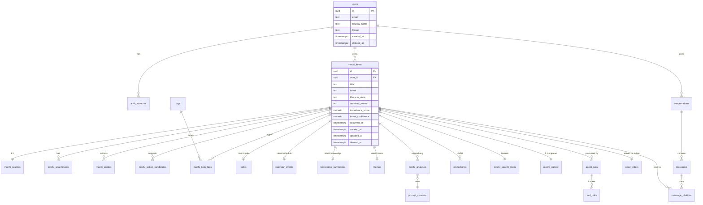

# 모찌(MOCHI) — 도메인 & 데이터베이스 설계

> Backend: Postgres 16 + pgvector
> iOS: Realm (mirror)

> ℹ️ **명명 drift 해소됨** (2026-05-29, `capture` → `mochi_item` rename B1~B4 완료)
>
> 이전엔 문서가 `mochi_item`, 코드가 `capture` 로 갈라져 있었으나, 2026-05-29 rename 으로 **코드도 `mochi_item` 정본**이 되었다(백엔드 `mochi_items` 테이블·모듈, iOS `MochiItemRepository`·`MochiItem`). `capture` 는 이제 *이미지 캡처 행위* 만 의미(AppGroup `captures/` 디렉토리, 백탭 `CaptureScreenshotIntent` 등 보존).
>
> **남은 구조 divergence (명명 아님)**: 본 문서는 정규화 3-table(`mochi_items`/`mochi_sources`/`mochi_analyses`) 을 서술하나 현재 백엔드 구현은 단일 `mochi_items` 테이블(평탄화)이다. 이는 *설계가 구현보다 앞선* 의도된 design-ahead 노트로, 정규화 분리는 별도 작업 큐. `audit.sh` 의 `mochi_item` grep 규칙은 향후 회귀 감시용으로 유지.

---

## 1. 설계 원칙

| # | 원칙 | 구체 |
|---|---|---|
| 1 | Self-documenting names | 약어 금지. 컬럼·테이블·enum 값 모두 풀네임 (예: `lifecycle_state`) |
| 2 | One concept = one table | God-table 금지. `mochi_items` 는 식별·상태만, 출처는 `mochi_sources`, 분석은 `mochi_analyses` 로 분리 |
| 3 | Owner scoping | 모든 user-data 테이블에 `user_id NOT NULL` + 모든 read/write 쿼리에 owner 필터 강제 |
| 4 | Explicit lifecycle | boolean `is_active` 금지. 모든 상태는 enum + CHECK + 전이 규칙 |
| 5 | Time is UTC `timestamptz` | 모든 시각 컬럼 `_at` suffix |
| 6 | Schema-level invariants | 가능한 모든 invariant 를 CHECK / UNIQUE / FK / partial index 로 표현 |
| 7 | Append-only history | LLM 분석 결과 (`mochi_analyses`) 는 immutable append-only |
| 8 | Soft delete | `deleted_at` + partial index `WHERE deleted_at IS NULL` |

### 핵심 패턴

| 패턴 | 이유 |
|---|---|
| **4-Intent enum + lifecycle_state enum + CHECK** | 도메인의 본질 |
| **intent × lifecycle 매트릭스 CHECK** | 잘못된 상태 진입 시 즉시 DB error |
| **Intent 파생 1:0..1** (todos / calendar_events / knowledge_summaries / memos) | typed 쿼리 가능 + UI 친화 |
| **Transactional Outbox** | 비동기 AI 처리의 reliability foundation |
| **agent_runs UNIQUE(mochi_item_id, attempt)** | retry 중복 INSERT 차단 |
| **Hybrid Search** (BM25 tsvector + 벡터 HNSW) | 검색 품질의 차별성 |
| **Append-only mochi_analyses** | 모델/프롬프트 교체 시 비교 가능 |

### 명명 컨벤션

```
Table        mochi_items                      (snake_case, 복수형)
Column       lifecycle_state                  (snake_case, 단수형)
FK column    user_id, mochi_item_id           ({referenced_singular}_id)
Timestamp    created_at, archived_at          (_at suffix)
JSONB        payload_json, source_metadata_json
Index        idx_mochi_items__user_id__created_at
CHECK        ck_mochi_items__intent_in_enum
UNIQUE       uq_mochi_items__user_id__id
```

---

## 2. Ubiquitous Language

iOS · 백엔드 · 프롬프트 모두 동일 용어를 쓴다.

| 용어 | 정의 |
|---|---|
| **MochiItem** | 사용자가 저장한 단일 기록. aggregate root |
| **Intent** | MochiItem 의 의미 분류. enum `schedule`/`todo`/`knowledge`/`memo` |
| **Lifecycle State** | MochiItem 처리·생명 상태. 7값 enum (§7) |
| **Source** | 입력 채널 + 원본 메타 |
| **Entity** | AI 추출 의미 단위 (date/person/place/topic/url/task/amount) |
| **ActionCandidate** | AI 제안 행동. 사용자 승인 → 실행 |
| **AgentRun** | MochiItem 1건 처리 LLM 오케스트레이션 실행 1회 |
| **ToolCall** | AgentRun 또는 Message 내 단일 함수 호출 |
| **Outbox Message** | mochi_items COMMIT 직후 worker 가 픽업할 메시지 |
| **Idempotency Key** | `POST /mochi-items` 의 owner-scoped SHA-256 키 |
| **Embedding** | text-embedding-005 (768d) chunk 벡터 |
| **Citation** | 챗봇 답변이 인용한 MochiItem ID + 발췌 |

---

## 3. ERD



---

## 4. SQL DDL (Postgres 16 + pgvector)

### 4.1 Extensions & helpers

```sql
CREATE EXTENSION IF NOT EXISTS pgcrypto;   -- gen_random_uuid()
CREATE EXTENSION IF NOT EXISTS pg_trgm;
CREATE EXTENSION IF NOT EXISTS vector;

CREATE OR REPLACE FUNCTION touch_updated_at() RETURNS trigger AS $$
BEGIN
    NEW.updated_at := now();
    RETURN NEW;
END $$ LANGUAGE plpgsql;
```

### 4.2 Identity

```sql
CREATE TABLE users (
    id                       uuid PRIMARY KEY DEFAULT gen_random_uuid(),
    email                    text NOT NULL,
    display_name             text NOT NULL DEFAULT '',
    locale                   text NOT NULL DEFAULT 'ko-KR',
    onboarding_completed_at  timestamptz,
    created_at               timestamptz NOT NULL DEFAULT now(),
    deleted_at               timestamptz,
    CONSTRAINT ck_users__email_lower CHECK (email = lower(email))
);
CREATE UNIQUE INDEX uq_users__email__active
    ON users(email) WHERE deleted_at IS NULL;

CREATE TABLE auth_accounts (
    id            uuid PRIMARY KEY DEFAULT gen_random_uuid(),
    user_id       uuid NOT NULL REFERENCES users(id) ON DELETE CASCADE,
    provider      text NOT NULL,
    subject       text NOT NULL,
    email_at_link text NOT NULL,
    linked_at     timestamptz NOT NULL DEFAULT now(),
    revoked_at    timestamptz,
    CONSTRAINT ck_auth__provider CHECK (provider IN ('apple','google')),
    CONSTRAINT uq_auth__provider_subject UNIQUE (provider, subject)
);
CREATE INDEX idx_auth__user ON auth_accounts(user_id);
```

### 4.3 Mochi Core

```sql
CREATE TABLE mochi_items (
    id                  uuid PRIMARY KEY DEFAULT gen_random_uuid(),
    user_id             uuid NOT NULL REFERENCES users(id) ON DELETE CASCADE,
    title               text NOT NULL DEFAULT '',
    intent              text NOT NULL,
    lifecycle_state     text NOT NULL DEFAULT 'ingested',
    archived_reason     text,
    importance_score    numeric(4,3) NOT NULL DEFAULT 0,
    intent_confidence   numeric(4,3) NOT NULL DEFAULT 0,
    occurred_at         timestamptz,
    created_at          timestamptz NOT NULL DEFAULT now(),
    updated_at          timestamptz NOT NULL DEFAULT now(),
    deleted_at          timestamptz,
    CONSTRAINT ck_mochi__intent
        CHECK (intent IN ('schedule','todo','knowledge','memo')),
    CONSTRAINT ck_mochi__lifecycle
        CHECK (lifecycle_state IN ('ingested','analyzing','active','decaying','review_requested','archived','failed')),
    CONSTRAINT ck_mochi__archived_reason
        CHECK ((lifecycle_state='archived') = (archived_reason IS NOT NULL)),
    CONSTRAINT ck_mochi__archived_reason_intent
        CHECK (
            archived_reason IS NULL
         OR (intent='schedule'  AND archived_reason IN ('schedule_ended','user_manual','system_error'))
         OR (intent='todo'      AND archived_reason IN ('todo_completed','user_manual','system_error'))
         OR (intent='knowledge' AND archived_reason IN ('knowledge_stale','user_manual','system_error'))
         OR (intent='memo'      AND archived_reason IN ('user_manual','system_error'))
        ),
    CONSTRAINT ck_mochi__intent_lifecycle_compat
        CHECK (
            (intent IN ('schedule','todo','memo') AND lifecycle_state NOT IN ('decaying','review_requested'))
         OR intent='knowledge'
        ),
    CONSTRAINT ck_mochi__scores
        CHECK (importance_score BETWEEN 0 AND 1 AND intent_confidence BETWEEN 0 AND 1),
    CONSTRAINT ck_mochi__occurred_at
        CHECK (intent='schedule' OR occurred_at IS NULL)
);
CREATE INDEX idx_mochi__user__created
    ON mochi_items(user_id, created_at DESC) WHERE deleted_at IS NULL;
CREATE INDEX idx_mochi__user__intent__lifecycle
    ON mochi_items(user_id, intent, lifecycle_state) WHERE deleted_at IS NULL;
CREATE INDEX idx_mochi__user__occurred
    ON mochi_items(user_id, occurred_at)
    WHERE intent='schedule' AND deleted_at IS NULL;
CREATE INDEX idx_mochi__user__importance
    ON mochi_items(user_id, importance_score DESC)
    WHERE lifecycle_state='active' AND deleted_at IS NULL;
CREATE INDEX idx_mochi__user__updated
    ON mochi_items(user_id, updated_at DESC);  -- iOS sync 용

CREATE TRIGGER trg_mochi__touch
    BEFORE UPDATE ON mochi_items
    FOR EACH ROW EXECUTE FUNCTION touch_updated_at();

CREATE TABLE mochi_sources (
    mochi_item_id        uuid PRIMARY KEY REFERENCES mochi_items(id) ON DELETE CASCADE,
    input_channel        text NOT NULL,
    content_kind         text NOT NULL,
    source_app           text,
    source_url           text,
    user_hint            text,
    raw_text             text,
    source_metadata_json jsonb NOT NULL DEFAULT '{}'::jsonb,
    -- ⚠️ 현재 backend 구현은 `mochi_items.channel String(32) NOT NULL` 의 평문 컬럼 (CHECK 없음).
    -- iOS `CoreDomain.IngestChannel` ↔ backend `IngestChannel` (StrEnum) 의 raw value 가 그대로 저장된다:
    --   kakaoTalk / instagram / youtube / safari / screenshot
    --   appIntent (Siri / Spotlight / 사용자 단축어가 QuickCaptureIntent 직접 호출)
    --   appShareSheet / appDirectInput / unknown
    -- 백탭 캡처는 `.screenshot` 으로 라벨링됨 (단축어가 PNG 를 모찌 `pending-backtap/` 에 stash →
    -- `CaptureScreenshotIntent` 가 `ShowsSnippetView` 로 외부 앱 위에 카드 표시 → 사용자가 "캡쳐"
    -- 선택 시 `CommitBackTapCaptureIntent` 가 background 에서 `.screenshot` 으로 Realm MochiItem
    -- 직접 upsert. "메모" 선택 시 `OpenBackTapMemoIntent` 가 marker 만 stash 후 모찌 진입 →
    -- `BackTapModalFeature` 의 textarea 가 `.appDirectInput` 으로 Realm MochiItem upsert + 백엔드 ingest).
    -- 백탭은 inbound queue 를 우회한다 — 큐 경유는 ShareExtension·`QuickCaptureIntent` 뿐.
    -- ShareExtension 경로의 추론(`guessChannel(from:hasImage:)`) 은 외부 앱 공유시트 진입에만 적용된다.
    -- 아래 CHECK 절은 향후 정책 강화 시 enable. 현재는 backend Pydantic enum 이 validation 게이트.
    -- CONSTRAINT ck_src__channel CHECK (input_channel IN (
    --     'kakaoTalk','instagram','youtube','safari','screenshot',
    --     'appIntent','appShareSheet','appDirectInput','unknown'
    -- )),
    CONSTRAINT ck_src__kind    CHECK (content_kind IN ('url','text','image','screenshot','mixed')),
    CONSTRAINT ck_src__url     CHECK (content_kind <> 'url' OR source_url IS NOT NULL)
);

-- 참고: 이 `mochi_sources` 스키마는 모듈 분리(`mochi_items` ↔ `mochi_sources`) 를 가정한 도메인 설계 문서이고,
-- 현재 백엔드 마이그레이션은 단일 `mochi_items` 테이블로 더 평탄하게 구현되어 있다 (alembic 0001 + 0006 rename).
-- 두 모델의 정합화는 별도 작업으로 큐 — 본 문서가 단일 진실 공급원이 될 때 backend 를 따라오게 한다.

CREATE TABLE mochi_attachments (
    id            uuid PRIMARY KEY DEFAULT gen_random_uuid(),
    mochi_item_id uuid NOT NULL REFERENCES mochi_items(id) ON DELETE CASCADE,
    user_id       uuid NOT NULL REFERENCES users(id) ON DELETE CASCADE,
    object_key    text NOT NULL,
    sha256        text NOT NULL,
    mime_type     text NOT NULL,
    byte_size     int  NOT NULL,
    width         int,
    height        int,
    ocr_text      text,
    uploaded_at   timestamptz NOT NULL DEFAULT now(),
    CONSTRAINT ck_att__bytes CHECK (byte_size > 0),
    CONSTRAINT ck_att__mime  CHECK (mime_type LIKE 'image/%' OR mime_type='application/pdf'),
    CONSTRAINT uq_att__user_sha UNIQUE (user_id, sha256)
);
CREATE INDEX idx_att__item ON mochi_attachments(mochi_item_id);

CREATE TABLE mochi_entities (
    id                      uuid PRIMARY KEY DEFAULT gen_random_uuid(),
    mochi_item_id           uuid NOT NULL REFERENCES mochi_items(id) ON DELETE CASCADE,
    user_id                 uuid NOT NULL REFERENCES users(id) ON DELETE CASCADE,
    entity_kind             text NOT NULL,
    raw_value               text NOT NULL,
    normalized_value        text NOT NULL,
    provenance              text NOT NULL,
    provenance_payload_json jsonb NOT NULL DEFAULT '{}'::jsonb,
    confidence              numeric(4,3) NOT NULL DEFAULT 0,
    extracted_at            timestamptz NOT NULL DEFAULT now(),
    CONSTRAINT ck_ent__kind CHECK (entity_kind IN ('date','person','place','topic','url','task','amount')),
    CONSTRAINT ck_ent__prov CHECK (provenance IN ('text_range','ocr_bbox','inferred')),
    CONSTRAINT ck_ent__conf CHECK (confidence BETWEEN 0 AND 1)
);
CREATE INDEX idx_ent__item_kind ON mochi_entities(mochi_item_id, entity_kind);

CREATE TABLE mochi_action_candidates (
    id             uuid PRIMARY KEY DEFAULT gen_random_uuid(),
    mochi_item_id  uuid NOT NULL REFERENCES mochi_items(id) ON DELETE CASCADE,
    user_id        uuid NOT NULL REFERENCES users(id) ON DELETE CASCADE,
    action_kind    text NOT NULL,
    label          text NOT NULL,
    payload_json   jsonb NOT NULL DEFAULT '{}'::jsonb,
    status         text NOT NULL DEFAULT 'pending',
    accepted_at    timestamptz,
    executed_at    timestamptz,
    expires_at     timestamptz,
    CONSTRAINT ck_act__kind   CHECK (action_kind IN ('create_todo','create_event','open_url','remind','tag','follow_up_search')),
    CONSTRAINT ck_act__status CHECK (status IN ('pending','accepted','rejected','executed','expired')),
    CONSTRAINT ck_act__accept CHECK (status <> 'accepted' OR accepted_at IS NOT NULL),
    CONSTRAINT ck_act__exec   CHECK (status <> 'executed' OR (executed_at IS NOT NULL AND accepted_at IS NOT NULL))
);
CREATE INDEX idx_act__item_status ON mochi_action_candidates(mochi_item_id, status);
CREATE INDEX idx_act__user_pending
    ON mochi_action_candidates(user_id, expires_at) WHERE status='pending';

CREATE TABLE tags (
    id      uuid PRIMARY KEY DEFAULT gen_random_uuid(),
    user_id uuid NOT NULL REFERENCES users(id) ON DELETE CASCADE,
    name    text NOT NULL,
    color   text,
    CONSTRAINT uq_tags__user_name UNIQUE (user_id, name)
);

CREATE TABLE mochi_item_tags (
    mochi_item_id uuid NOT NULL REFERENCES mochi_items(id) ON DELETE CASCADE,
    tag_id        uuid NOT NULL REFERENCES tags(id) ON DELETE CASCADE,
    tagged_at     timestamptz NOT NULL DEFAULT now(),
    PRIMARY KEY (mochi_item_id, tag_id)
);
CREATE INDEX idx_mit__tag ON mochi_item_tags(tag_id);
```

### 4.4 Intent 파생 (1:0..1)

`mochi_items.intent` 와 파생 테이블 존재 여부는 application 의 ingest/update use case 가 같은 트랜잭션 내에서 강제. `intent` 변경 시 옛 derived row DELETE + 새 derived row INSERT.

```sql
CREATE TABLE todos (
    id                    uuid PRIMARY KEY DEFAULT gen_random_uuid(),
    mochi_item_id         uuid NOT NULL REFERENCES mochi_items(id) ON DELETE CASCADE,
    user_id               uuid NOT NULL REFERENCES users(id) ON DELETE CASCADE,
    title                 text NOT NULL,
    due_at                timestamptz,
    priority              text NOT NULL DEFAULT 'medium',
    status                text NOT NULL DEFAULT 'open',
    completed_at          timestamptz,
    external_reminders_id text,
    CONSTRAINT ck_todos__priority CHECK (priority IN ('low','medium','high')),
    CONSTRAINT ck_todos__status   CHECK (status IN ('open','done','archived')),
    CONSTRAINT ck_todos__done_at  CHECK ((status='done') = (completed_at IS NOT NULL)),
    CONSTRAINT uq_todos__item UNIQUE (mochi_item_id)
);
CREATE INDEX idx_todos__user_status_due ON todos(user_id, status, due_at NULLS LAST);

CREATE TABLE calendar_events (
    id                         uuid PRIMARY KEY DEFAULT gen_random_uuid(),
    mochi_item_id              uuid NOT NULL REFERENCES mochi_items(id) ON DELETE CASCADE,
    user_id                    uuid NOT NULL REFERENCES users(id) ON DELETE CASCADE,
    title                      text NOT NULL,
    start_at                   timestamptz NOT NULL,
    end_at                     timestamptz,
    location                   text,
    external_calendar_provider text,
    external_event_id          text,
    status                     text NOT NULL DEFAULT 'candidate',
    CONSTRAINT ck_cal__order  CHECK (end_at IS NULL OR end_at >= start_at),
    CONSTRAINT ck_cal__prov   CHECK ((external_calendar_provider IS NULL) = (external_event_id IS NULL)),
    CONSTRAINT ck_cal__prov_enum CHECK (external_calendar_provider IS NULL OR external_calendar_provider IN ('apple','google')),
    CONSTRAINT ck_cal__status CHECK (status IN ('candidate','confirmed','done','cancelled')),
    CONSTRAINT uq_cal__item UNIQUE (mochi_item_id)
);
CREATE INDEX idx_cal__user_start ON calendar_events(user_id, start_at);

CREATE TABLE knowledge_summaries (
    id             uuid PRIMARY KEY DEFAULT gen_random_uuid(),
    mochi_item_id  uuid NOT NULL REFERENCES mochi_items(id) ON DELETE CASCADE,
    user_id        uuid NOT NULL REFERENCES users(id) ON DELETE CASCADE,
    headline       text NOT NULL,
    body_markdown  text NOT NULL,
    key_topics     text[] NOT NULL DEFAULT '{}',
    indexed_at     timestamptz NOT NULL DEFAULT now(),
    last_recall_at timestamptz,
    recall_count   int NOT NULL DEFAULT 0,
    CONSTRAINT uq_know__item UNIQUE (mochi_item_id)
);
CREATE INDEX idx_know__topics ON knowledge_summaries USING GIN (key_topics);
CREATE INDEX idx_know__user_last_recall
    ON knowledge_summaries(user_id, last_recall_at NULLS FIRST);

CREATE TABLE memos (
    id            uuid PRIMARY KEY DEFAULT gen_random_uuid(),
    mochi_item_id uuid NOT NULL REFERENCES mochi_items(id) ON DELETE CASCADE,
    user_id       uuid NOT NULL REFERENCES users(id) ON DELETE CASCADE,
    body_markdown text NOT NULL,
    CONSTRAINT uq_memos__item UNIQUE (mochi_item_id)
);
```

### 4.5 AI Analysis & Search

```sql
CREATE TABLE prompt_versions (
    id            text PRIMARY KEY,         -- 'agent_orchestrator@v1'
    name          text NOT NULL,
    version       text NOT NULL,
    model_name    text NOT NULL,
    body_markdown text NOT NULL,
    rationale     text NOT NULL DEFAULT '',
    revised_at    timestamptz NOT NULL DEFAULT now(),
    CONSTRAINT uq_prompt__name_ver UNIQUE (name, version)
);

CREATE TABLE mochi_analyses (
    id                uuid PRIMARY KEY DEFAULT gen_random_uuid(),
    mochi_item_id     uuid NOT NULL REFERENCES mochi_items(id) ON DELETE CASCADE,
    user_id           uuid NOT NULL REFERENCES users(id) ON DELETE CASCADE,
    model_name        text NOT NULL,
    prompt_version_id text NOT NULL REFERENCES prompt_versions(id),
    intent_predicted  text NOT NULL,
    intent_confidence numeric(4,3) NOT NULL,
    importance_score  numeric(4,3) NOT NULL,
    summary           text NOT NULL,
    total_tokens      int NOT NULL,
    latency_ms        int NOT NULL,
    analyzed_at       timestamptz NOT NULL DEFAULT now(),
    CONSTRAINT ck_ana__intent CHECK (intent_predicted IN ('schedule','todo','knowledge','memo')),
    CONSTRAINT ck_ana__scores CHECK (intent_confidence BETWEEN 0 AND 1 AND importance_score BETWEEN 0 AND 1)
);
CREATE INDEX idx_ana__item_time ON mochi_analyses(mochi_item_id, analyzed_at DESC);

CREATE TABLE embeddings (
    id            uuid PRIMARY KEY DEFAULT gen_random_uuid(),
    mochi_item_id uuid NOT NULL REFERENCES mochi_items(id) ON DELETE CASCADE,
    user_id       uuid NOT NULL REFERENCES users(id) ON DELETE CASCADE,
    chunk_index   int NOT NULL,
    chunk_text    text NOT NULL,
    model_name    text NOT NULL DEFAULT 'text-embedding-005',
    embedding     vector(768) NOT NULL,
    embedded_at   timestamptz NOT NULL DEFAULT now(),
    CONSTRAINT uq_emb__item_model_chunk UNIQUE (mochi_item_id, model_name, chunk_index),
    CONSTRAINT ck_emb__chunk_len CHECK (length(chunk_text) BETWEEN 1 AND 8000)
);
CREATE INDEX idx_emb__user ON embeddings(user_id);
CREATE INDEX idx_emb__hnsw
    ON embeddings USING hnsw (embedding vector_cosine_ops)
    WITH (m=16, ef_construction=64);

CREATE TABLE mochi_search_index (
    mochi_item_id uuid PRIMARY KEY REFERENCES mochi_items(id) ON DELETE CASCADE,
    user_id       uuid NOT NULL REFERENCES users(id) ON DELETE CASCADE,
    tsv_text      tsvector NOT NULL,
    indexed_at    timestamptz NOT NULL DEFAULT now()
);
CREATE INDEX idx_search__tsv  ON mochi_search_index USING GIN (tsv_text);
CREATE INDEX idx_search__user ON mochi_search_index(user_id);

-- ingest / update / agent worker 가 호출
CREATE OR REPLACE FUNCTION refresh_search_index(_mochi_item_id uuid, _user_id uuid)
RETURNS void AS $$
BEGIN
    INSERT INTO mochi_search_index (user_id, mochi_item_id, tsv_text)
    SELECT
        _user_id, _mochi_item_id,
        to_tsvector('simple',
            coalesce(mi.title,'') || ' ' ||
            coalesce(ms.raw_text,'') || ' ' ||
            coalesce(ms.user_hint,'') || ' ' ||
            coalesce(ma.summary,''))
    FROM mochi_items mi
    LEFT JOIN mochi_sources ms ON ms.mochi_item_id = mi.id
    LEFT JOIN LATERAL (
        SELECT summary FROM mochi_analyses
        WHERE mochi_item_id = mi.id
        ORDER BY analyzed_at DESC LIMIT 1
    ) ma ON true
    WHERE mi.id = _mochi_item_id
    ON CONFLICT (mochi_item_id)
    DO UPDATE SET tsv_text = EXCLUDED.tsv_text, indexed_at = now();

    DELETE FROM mochi_search_index
    WHERE mochi_item_id = _mochi_item_id
      AND EXISTS (SELECT 1 FROM mochi_items WHERE id = _mochi_item_id AND deleted_at IS NOT NULL);
END $$ LANGUAGE plpgsql;
```

### 4.6 Conversation

```sql
CREATE TABLE conversations (
    id              uuid PRIMARY KEY DEFAULT gen_random_uuid(),
    user_id         uuid NOT NULL REFERENCES users(id) ON DELETE CASCADE,
    title           text NOT NULL DEFAULT '',
    created_at      timestamptz NOT NULL DEFAULT now(),
    last_message_at timestamptz NOT NULL DEFAULT now(),
    archived_at     timestamptz
);
CREATE INDEX idx_conv__user_last
    ON conversations(user_id, last_message_at DESC) WHERE archived_at IS NULL;

CREATE TABLE messages (
    id               uuid PRIMARY KEY DEFAULT gen_random_uuid(),
    conversation_id  uuid NOT NULL REFERENCES conversations(id) ON DELETE CASCADE,
    user_id          uuid NOT NULL REFERENCES users(id) ON DELETE CASCADE,
    role             text NOT NULL,
    content_markdown text NOT NULL,
    total_tokens     int NOT NULL DEFAULT 0,
    created_at       timestamptz NOT NULL DEFAULT now(),
    CONSTRAINT ck_msg__role CHECK (role IN ('user','assistant','system','tool'))
);
CREATE INDEX idx_msg__conv_time ON messages(conversation_id, created_at);
CREATE INDEX idx_msg__user_time ON messages(user_id, created_at DESC);

CREATE TABLE message_citations (
    message_id      uuid NOT NULL REFERENCES messages(id) ON DELETE CASCADE,
    mochi_item_id   uuid NOT NULL REFERENCES mochi_items(id) ON DELETE SET NULL,
    user_id         uuid NOT NULL REFERENCES users(id) ON DELETE CASCADE,
    rank            int NOT NULL,
    excerpt         text NOT NULL,
    relevance_score numeric(4,3) NOT NULL,
    PRIMARY KEY (message_id, mochi_item_id),
    CONSTRAINT ck_cite__rank  CHECK (rank >= 1),
    CONSTRAINT ck_cite__score CHECK (relevance_score BETWEEN 0 AND 1)
);
CREATE INDEX idx_cite__item ON message_citations(mochi_item_id);
```

### 4.7 Operations

```sql
CREATE TABLE agent_runs (
    id                uuid PRIMARY KEY DEFAULT gen_random_uuid(),
    mochi_item_id     uuid NOT NULL REFERENCES mochi_items(id) ON DELETE CASCADE,
    user_id           uuid NOT NULL REFERENCES users(id) ON DELETE CASCADE,
    current_node      text NOT NULL DEFAULT 'ingested',
    failure_reason    text,
    prompt_version_id text NOT NULL REFERENCES prompt_versions(id),
    attempt           int NOT NULL DEFAULT 1,
    total_tokens      int NOT NULL DEFAULT 0,
    total_latency_ms  int NOT NULL DEFAULT 0,
    started_at        timestamptz NOT NULL DEFAULT now(),
    ended_at          timestamptz,
    CONSTRAINT ck_run__node CHECK (current_node IN ('ingested','normalized','analyzed','routed','persisted','indexed','synced','failed')),
    CONSTRAINT ck_run__order CHECK (ended_at IS NULL OR ended_at >= started_at),
    CONSTRAINT ck_run__failure CHECK (current_node <> 'failed' OR failure_reason IS NOT NULL),
    CONSTRAINT uq_run__item_attempt UNIQUE (mochi_item_id, attempt)
);
CREATE INDEX idx_run__item_time ON agent_runs(mochi_item_id, started_at DESC);

CREATE TABLE tool_calls (
    id             uuid PRIMARY KEY DEFAULT gen_random_uuid(),
    agent_run_id   uuid REFERENCES agent_runs(id) ON DELETE CASCADE,
    message_id     uuid REFERENCES messages(id)  ON DELETE CASCADE,
    user_id        uuid NOT NULL REFERENCES users(id) ON DELETE CASCADE,
    tool_name      text NOT NULL,
    input_json     jsonb NOT NULL DEFAULT '{}'::jsonb,
    output_json    jsonb,
    status         text NOT NULL DEFAULT 'running',
    failure_reason text,
    latency_ms     int NOT NULL DEFAULT 0,
    called_at      timestamptz NOT NULL DEFAULT now(),
    CONSTRAINT ck_tc__owner_xor CHECK ((agent_run_id IS NOT NULL)::int + (message_id IS NOT NULL)::int = 1),
    CONSTRAINT ck_tc__status CHECK (status IN ('running','success','failed')),
    CONSTRAINT ck_tc__failure CHECK (status <> 'failed' OR failure_reason IS NOT NULL)
);
CREATE INDEX idx_tc__run ON tool_calls(agent_run_id);
CREATE INDEX idx_tc__msg ON tool_calls(message_id);

CREATE TABLE idempotency_keys (
    id                     text PRIMARY KEY,           -- 'scope:user_id:sha256'
    user_id                uuid NOT NULL REFERENCES users(id) ON DELETE CASCADE,
    scope                  text NOT NULL,
    mochi_item_id          uuid REFERENCES mochi_items(id) ON DELETE SET NULL,
    response_snapshot_json jsonb NOT NULL DEFAULT '{}'::jsonb,
    created_at             timestamptz NOT NULL DEFAULT now(),
    expires_at             timestamptz NOT NULL,
    CONSTRAINT ck_idem__expires CHECK (expires_at > created_at),
    CONSTRAINT ck_idem__scope CHECK (scope IN ('mochi_item_create'))
);
CREATE INDEX idx_idem__user_scope ON idempotency_keys(user_id, scope);
CREATE INDEX idx_idem__expires    ON idempotency_keys(expires_at);

CREATE TABLE mochi_outbox (
    mochi_item_id    uuid PRIMARY KEY REFERENCES mochi_items(id) ON DELETE CASCADE,
    user_id          uuid NOT NULL REFERENCES users(id) ON DELETE CASCADE,
    status           text NOT NULL DEFAULT 'pending',
    attempt          int NOT NULL DEFAULT 0,
    max_attempt      int NOT NULL DEFAULT 5,
    available_at     timestamptz NOT NULL DEFAULT now(),
    locked_until     timestamptz,
    last_lease_owner text,
    last_error       text,
    created_at       timestamptz NOT NULL DEFAULT now(),
    updated_at       timestamptz NOT NULL DEFAULT now(),
    CONSTRAINT ck_outbox__status CHECK (status IN ('pending','in_flight')),
    CONSTRAINT ck_outbox__attempt CHECK (attempt <= max_attempt),
    CONSTRAINT ck_outbox__inflight CHECK (status <> 'in_flight' OR locked_until IS NOT NULL)
);
CREATE INDEX idx_outbox__lease ON mochi_outbox(status, available_at, locked_until);
CREATE TRIGGER trg_outbox__touch BEFORE UPDATE ON mochi_outbox
    FOR EACH ROW EXECUTE FUNCTION touch_updated_at();

CREATE TABLE dead_letters (
    id                 uuid PRIMARY KEY DEFAULT gen_random_uuid(),
    mochi_item_id      uuid REFERENCES mochi_items(id) ON DELETE SET NULL,
    user_id            uuid NOT NULL REFERENCES users(id) ON DELETE CASCADE,
    reason             text NOT NULL,
    error_payload_json jsonb NOT NULL DEFAULT '{}'::jsonb,
    moved_at           timestamptz NOT NULL DEFAULT now(),
    requeued_at        timestamptz
);
CREATE INDEX idx_dl__user_time ON dead_letters(user_id, moved_at DESC);
```

---

## 5. iOS Realm Schema

```swift
final class MochiItemObject: Object {
    @Persisted(primaryKey: true) var id: UUID
    @Persisted var userID: UUID
    @Persisted var title: String
    @Persisted var intent: String                 // schedule|todo|knowledge|memo
    @Persisted var lifecycleState: String
    @Persisted var archivedReason: String?
    @Persisted var importanceScore: Double
    @Persisted var intentConfidence: Double
    @Persisted var occurredAt: Date?
    @Persisted var createdAt: Date
    @Persisted var updatedAt: Date
    @Persisted var deletedAt: Date?

    @Persisted var source: MochiSourceEmbedded?
    @Persisted var attachments: List<MochiAttachmentEmbedded>
    @Persisted var entities: List<MochiEntityEmbedded>
    @Persisted var actionCandidates: List<MochiActionCandidateEmbedded>
    @Persisted var tagNames: List<String>

    @Persisted var todo: TodoEmbedded?
    @Persisted var calendarEvent: CalendarEventEmbedded?
    @Persisted var knowledgeSummary: KnowledgeSummaryEmbedded?
    @Persisted var memo: MemoEmbedded?

    @Persisted var syncState: String              // pendingUpload|uploaded|syncFailed
    @Persisted var syncServerID: UUID?
    @Persisted var lastSyncedAt: Date?
}
```

### Backend ↔ Realm 매핑

| Backend table | Realm representation |
|---|---|
| `mochi_items` | `MochiItemObject` (root, UUID 동일) |
| `mochi_sources` | `MochiItemObject.source` (Embedded 1:1) |
| `mochi_attachments` | `MochiItemObject.attachments` (Embedded 1:N) |
| `mochi_entities` | `MochiItemObject.entities` (Embedded 1:N) |
| `mochi_action_candidates` | `MochiItemObject.actionCandidates` (Embedded 1:N) |
| `mochi_item_tags` + `tags` | `MochiItemObject.tagNames` (List<String>) |
| `todos` / `calendar_events` / `knowledge_summaries` / `memos` | `MochiItemObject.{todo, calendarEvent, knowledgeSummary, memo}` (Embedded 0..1) |
| `mochi_analyses` / `embeddings` / `search_index` | 서버 only |
| `conversations` / `messages` | `ConversationObject` / `MessageObject` (별도 root) |
| `agent_runs` / `tool_calls` / `outbox` / `dead_letters` / `idempotency_keys` | 서버 only |

### 동기화

- **iOS → Backend**: `syncState=pendingUpload` 인 MochiItem 을 `CaptureSyncWorker` 가 POST `/mochi-items` (Idempotency-Key=item.id). 성공 → `syncState=uploaded`.
- **Backend → iOS**: agent worker 가 mochi_items 갱신 → SSE `/mochi-items/{id}/stream` → iOS upsert.
- **충돌**: backend master. iOS local edit 은 PATCH 로 push → server-wins.
- **Catch-up**: cold start / reconnect 시 `GET /mochi-items/sync?after=<lastSyncedAt>` 로 누락 분 fetch.

---

## 6. API Endpoints

| Method | Path | 응답 | 비고 |
|---|---|---|---|
| `POST` | `/api/v1/auth/apple` | `{access, refresh}` | Apple OAuth |
| `POST` | `/api/v1/auth/google` | `{access, refresh}` | Google OAuth |
| `GET` | `/api/v1/users/me` | `User` | |
| `GET` | `/api/v1/health` | `{status:'ok'}` | 인증 불요 |
| `POST` | `/api/v1/mochi-items` | `MochiItem (201)` | `Idempotency-Key` 헤더 필수 |
| `GET` | `/api/v1/mochi-items/{id}` | `MochiItem` | owner 만 |
| `PATCH` | `/api/v1/mochi-items/{id}` | `MochiItem` | server-wins |
| `DELETE` | `/api/v1/mochi-items/{id}` | 204 | soft delete |
| `GET` | `/api/v1/mochi-items` | `MochiItem[]` | filter: `intent`, `lifecycle_state`, `after`, `limit` |
| `GET` | `/api/v1/mochi-items/sync?after=` | `MochiItem[]` | catch-up |
| `GET` | `/api/v1/mochi-items/{id}/stream` | SSE | agent state graph |
| `POST` | `/api/v1/search` | `SearchResponse` | Hybrid (BM25 + 벡터 + RRF) |
| `POST` | `/api/v1/conversations` | `Conversation (201)` | |
| `POST` | `/api/v1/conversations/{id}/messages` | `Message + Citations` | |

### Request headers

| Header | 필수 | 의미 |
|---|---|---|
| `Authorization: Bearer <token>` | 모든 라우트 (health 제외) | JWT (RS256) |
| `X-Mochi-Request-ID` | 옵션 | 분산 추적 |
| `Idempotency-Key` | `POST /mochi-items` | owner-scoped SHA-256 |

---

## 7. 4-Intent Lifecycle

### 7.1 상태 다이어그램

```
ingested → analyzing → active → archived
                            ↘ failed

knowledge intent 만 추가 경로:
  active → decaying → review_requested → active 또는 archived
```

### 7.2 전이 매트릭스

| from \ to | analyzing | active | decaying | review_req | archived | failed |
|---|---|---|---|---|---|---|
| ingested | ✅ all | — | — | — | — | ✅ all |
| analyzing | — | ✅ all | — | — | — | ✅ all |
| active | — | — | ✅ knowledge | — | ✅ all | — |
| decaying | — | ✅ knowledge | — | ✅ knowledge | ✅ knowledge | — |
| review_requested | — | ✅ knowledge | — | — | ✅ knowledge | — |
| failed | — | — | — | — | ✅ all (user_manual) | — |

### 7.3 archived_reason × intent

| Intent | 허용 archived_reason |
|---|---|
| `schedule` | `schedule_ended`, `user_manual`, `system_error` |
| `todo` | `todo_completed`, `user_manual`, `system_error` |
| `knowledge` | `knowledge_stale`, `user_manual`, `system_error` |
| `memo` | `user_manual`, `system_error` |

### 7.4 자동 전이 (worker 가 5분 주기 실행)

| 조건 | 자동 전이 |
|---|---|
| `intent='schedule' AND COALESCE(end_at, start_at) < now() AND lifecycle_state='active'` | → `archived(schedule_ended)` |
| `intent='todo' AND todos.status='done' AND lifecycle_state='active'` | → `archived(todo_completed)` |
| `intent='knowledge' AND last_recall_at < now() - INTERVAL '90 days' AND lifecycle_state='active'` | → `decaying` |
| `intent='knowledge' AND lifecycle_state='decaying' AND created_at < now() - INTERVAL '180 days'` | → `review_requested` |
| dead_letters INSERT | → `failed` |

### 7.5 전이 강제

`intent × lifecycle_state` 매트릭스는 `ck_mochi__intent_lifecycle_compat` CHECK 로 schema 수준 강제. `archived_reason × intent` 매트릭스는 `ck_mochi__archived_reason_intent` CHECK 로 강제. 전이 자체 (from → to) 검증은 application `LifecyclePolicy.validate()` 가 수행.

---

## 8. 데이터 흐름

### 8.1 Ingestion (POST /mochi-items)

```python
async with db_session() as s:
    async with s.begin():
        if existing := await find_idem_key(s, key, user.id):
            return existing.response_snapshot
        mi = await insert_mochi_item(s, ..., intent='memo', lifecycle='ingested')
        await insert_source(s, mi, ...)
        await bulk_insert_attachments(s, mi, ...)
        await insert_outbox(s, mi)
        await save_idem_response(s, key, mi.id, user.id)
    await pg_notify('mochi_outbox', str(mi.id))
return 201
```

### 8.2 Agent Worker

```python
while True:
    rows = await pick_outbox_lease(s, lease_owner=POD_ID, lease_ms=60_000, limit=8)
    for row in rows:
        try:
            async with s.begin():
                run = await insert_agent_run(s, row.mochi_item_id, attempt=row.attempt+1)
                await update_mochi(s, row.mochi_item_id, lifecycle='analyzing')

            analysis  = await gemini_multimodal(mi)
            chunks    = chunk_text(mi.text, ...)
            vectors   = await embed_chunks(chunks)

            async with s.begin():
                await insert_mochi_analysis(s, run.id, analysis)
                await delete_entities(s, mi.id);  await bulk_insert_entities(s, mi.id, analysis.entities)
                await delete_actions(s, mi.id);   await bulk_insert_actions(s, mi.id, analysis.actions)
                await upsert_embeddings(s, mi.id, vectors)
                await delete_derived(s, mi.id);   await insert_derived(s, mi.id, analysis.intent, analysis)
                await update_mochi(s, mi.id, intent=analysis.intent, lifecycle='active',
                                   importance_score=..., intent_confidence=...)
                await refresh_search_index(s, mi.id, user.id)
                await delete_outbox(s, mi.id)             # done → 즉시 삭제
        except Exception as e:
            await handle_failure(s, row, e)
            # attempt < max  → status='pending', exponential backoff
            # attempt = max  → dead_letters INSERT + mochi.lifecycle='failed'
```

### 8.3 Hybrid Search

```python
async with db_session() as s:
    await s.execute(text("SET LOCAL hnsw.ef_search = 80"))
    bm25 = await s.execute(text("""
        SELECT mochi_item_id, ts_rank_cd(tsv_text, q) AS s
        FROM mochi_search_index, plainto_tsquery('simple', :q) q
        WHERE user_id=:uid AND tsv_text @@ q
        ORDER BY s DESC LIMIT 50
    """), {"q": query, "uid": user.id})
    vec = await s.execute(text("""
        SELECT mochi_item_id, 1 - (embedding <=> :v) AS s
        FROM embeddings
        WHERE user_id=:uid
        ORDER BY embedding <=> :v
        LIMIT 50
    """), {"v": query_vec, "uid": user.id})
    fused = reciprocal_rank_fusion(bm25, vec, k=60)
    return fused[:10]
```

---

## 9. 보안

| 항목 | 메커니즘 |
|---|---|
| 인증 | Apple/Google OAuth → JWT (RS256) + refresh token rotation |
| 인가 | repository layer 가 `WHERE user_id=$current_user` 강제 (테스트로 검증) |
| 멱등성 | `Idempotency-Key` 헤더 → `idempotency_keys` (owner-scoped SHA-256) |
| 분산 추적 | `X-Mochi-Request-ID` 헤더 echo |
| Error envelope | `{code, message, requestId, retryAfter}` 통일 포맷 |
| SSRF | WebFetch: 호스트 블록리스트 + A/AAAA 답변 IP 검증 + redirect 재검증 + MIME 화이트리스트 |
| Storage | `users/{user_id}/...` prefix + presigned URL (prefix 강제 검증) |
| PII purge | `users.deleted_at` set 시 email 익명화 (`deleted+{id}@invalid.local`) |

---

## 10. 마이그레이션

```
alembic/versions/
  0001_initial.py              # 본 문서 §4 DDL 전체
  0002_seed_prompt_versions.py # 초기 프롬프트 등록
```

이후 변경은 zero-downtime 패턴:
1. ADD COLUMN nullable
2. backfill
3. NOT NULL / CHECK / FK 추가

---

## 11. 인덱스 정책

| 쿼리 패턴 | 인덱스 |
|---|---|
| 홈 피드 (user 최신 N) | `idx_mochi__user__created` (partial) |
| 4-Intent 카드 | `idx_mochi__user__intent__lifecycle` (partial) |
| 캘린더 뷰 | `idx_mochi__user__occurred` (partial WHERE intent='schedule') |
| "중요해 보여요" | `idx_mochi__user__importance` (partial WHERE lifecycle='active') |
| 할 일 마감 임박 | `idx_todos__user_status_due` |
| 일정 시점 검색 | `idx_cal__user_start` |
| 지식 decay 스캔 | `idx_know__user_last_recall` |
| iOS catch-up sync | `idx_mochi__user__updated` |
| BM25 검색 | GIN `tsv_text` |
| 벡터 ANN | HNSW `embedding vector_cosine_ops` (m=16, ef_construction=64) |
| Outbox worker pickup | `idx_outbox__lease` |
| Idempotency lookup | `idx_idem__user_scope` |
| 챗봇 대화 로드 | `idx_msg__conv_time` |

---

## 12. 테이블 카탈로그

| Group | Table | 책임 |
|---|---|---|
| Identity | `users` | 사용자 식별, soft delete |
| Identity | `auth_accounts` | Apple/Google OAuth 연결 |
| Mochi | `mochi_items` | aggregate root, intent + lifecycle |
| Mochi | `mochi_sources` | 입력 채널 + 원본 메타 (1:1) |
| Mochi | `mochi_attachments` | 이미지/파일 첨부 |
| Mochi | `mochi_entities` | AI 추출 의미 단위 |
| Mochi | `mochi_action_candidates` | AI 제안 행동 |
| Mochi | `tags` / `mochi_item_tags` | 사용자 태그 (N:M) |
| Intent | `todos` | 할 일 (intent=todo 파생) |
| Intent | `calendar_events` | 일정 (intent=schedule 파생) |
| Intent | `knowledge_summaries` | 지식 요약 (intent=knowledge 파생) |
| Intent | `memos` | 기록 (intent=memo 파생) |
| AI | `prompt_versions` | 프롬프트 버전 이력 |
| AI | `mochi_analyses` | LLM 분석 결과 (append-only) |
| AI | `embeddings` | 청크 단위 벡터 (HNSW) |
| AI | `mochi_search_index` | tsvector BM25 인덱스 |
| Conversation | `conversations` | 챗봇 세션 |
| Conversation | `messages` | 대화 메시지 |
| Conversation | `message_citations` | assistant 답변 근거 |
| Operations | `agent_runs` | AI 처리 실행 (UNIQUE attempt) |
| Operations | `tool_calls` | 도구 호출 로그 |
| Operations | `idempotency_keys` | 멱등성 키 (TTL) |
| Operations | `mochi_outbox` | 처리 대기 큐 (1 item ⇔ 1 outbox) |
| Operations | `dead_letters` | 실패 격리 |

---

## 부록

### A. ActionCandidate payload schema

| action_kind | payload_json |
|---|---|
| `create_todo` | `{title: str, due_at?: iso, priority?: low\|medium\|high}` |
| `create_event` | `{title: str, start_at: iso, end_at?: iso, location?: str}` |
| `open_url` | `{url: str}` |
| `remind` | `{at: iso, message?: str}` |
| `tag` | `{tag_names: str[]}` |
| `follow_up_search` | `{query: str}` |

### B. AgentRun current_node 의미

| node | 의미 | 외부 호출 |
|---|---|---|
| `ingested` | DB INSERT 직후 | — |
| `normalized` | 텍스트 정제, URL 정규화 | — |
| `analyzed` | Gemini multimodal → intent/summary/entities/actions | Gemini Flash |
| `routed` | Intent 별 파생 entity INSERT 결정 | — |
| `persisted` | 파생 entity 저장 완료 | — |
| `indexed` | 임베딩 + tsvector 인덱스 갱신 | text-embedding-005 |
| `synced` | iOS SSE push 완료 | — |
| `failed` | 어디서든 실패 → DLQ 분기 | — |

### C. Application-enforced invariants

DB 가 직접 강제할 수 없으나 `tests/unit/test_invariants.py` 가 강제하는 항목:

| Invariant | 검증 위치 |
|---|---|
| `content_kind IN ('image','screenshot') ⇒ EXISTS mochi_attachments` | E2E test |
| `mochi_items.intent` 와 derived 테이블 1:0..1 일치 | ingest/update use case + unit test |
| `LifecyclePolicy.validate(from, to, intent)` 전이 규칙 | unit test |
| `ActionCandidate.payload_json` per-action_kind schema | Pydantic validator + unit test |
| 모든 SELECT/UPDATE/DELETE 쿼리에 `user_id` 필터 | 정적 AST 검사 |
| `embedding.chunk_text` 길이 ≤ 8000 chars | application chunker |
