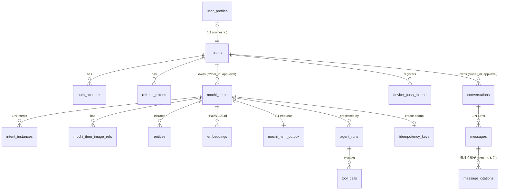

# 모찌(MOCHI) — 도메인 설계

> Backend: Postgres 16 + pgvector · iOS: Realm (mirror)

---

## 0. 정본 규칙 — 코드가 소유한 사실은 복제하지 않는다

이 문서는 **코드로 표현할 수 없는 것만 소유한다**: 용어 정의, 설계 결정과 근거(why), 양 플랫폼이 공유하는 불변식, 동기화 규약. as-built 사실의 정본은 코드다 (WORKFLOW §2.1):

| as-built 사실 | 정본 |
|---|---|
| DB 스키마·인덱스·마이그레이션 | `mochi-backend/alembic/versions/*` + ORM 모델 |
| API 라우트·요청/응답 스키마 | `mochi-backend/openapi.json` (`make openapi` 생성, ⓪티어) |
| lifecycle 전이 코드 | `intents/domain/lifecycle_policy.py` ↔ iOS `CoreDomain.LifecyclePolicy` (공유표면, 양쪽 동일 불변식) |
| Realm 스키마·schemaVersion | `CorePersistence/RealmObjects.swift` + `RealmStoreFactory.swift` |
| 분류 프롬프트·LLM 출력 계약 | `agent/prompts/system_prompts.py` (`ACTIVE_PROMPT`) |
| AgentRun 노드 | `agent/domain/states.py` (`AgentNode` 8값, `HAPPY_PATH` 7노드 — `indexed` 의 임베딩 적재만 현재 no-op) |

> 명명 정본: 코드가 `mochi_item`(2026-05-29 rename). `capture` 는 *이미지 캡처 행위* 만 의미(AppGroup `captures/`, 백탭 `CaptureScreenshotIntent`).

---

## 1. 설계 원칙

| # | 원칙 | 구체 |
|---|---|---|
| 1 | Self-documenting names | 약어 금지. 컬럼·테이블·enum 값 풀네임 |
| 2 | Owner scoping | 모든 user-data 행에 `owner_id` + 모든 read/write 에 owner 필터. DB FK 가 아니라 **repository layer 강제**(테스트 검증) |
| 3 | Explicit lifecycle | boolean `is_active` 금지. 상태는 enum(`lifecycle_kind`) + application `LifecyclePolicy` 전이 검증 |
| 4 | Time is UTC `timestamptz` | 모든 시각 컬럼 `_at` suffix |
| 5 | Intent = 별도 1급 행 | intent 는 `mochi_items` 컬럼이 아니라 별도 `intent_instances` 테이블 행(다중·위계없음). 점수·대표·confidence 폐기 — **저장된 instance = active** (§4) |
| 6 | Transactional Outbox | 비동기 AI 처리의 reliability foundation (`mochi_item_outbox`) |
| 7 | Hybrid Search | BM25 tsvector(GIN) + 벡터 HNSW |
| 8 | 단일 `mochi_items` 인라인 | 출처(`channel`/`url`/`text`/`user_memo`)·분석결과(`summary`/`importance`)를 한 테이블에 인라인. 정규화 분리(sources/analyses)는 과설계로 폐기 — typed 파생만 §10 향후 후보 |

### 명명 컨벤션

```
Table        mochi_items                       (snake_case, 복수형)
Column       lifecycle_kind, owner_id          (snake_case)
FK column    mochi_item_id, agent_run_id       ({referenced_singular}_id)
Timestamp    created_at, captured_at           (_at suffix)
JSONB        payload (intent_instances)        (typed optional 필드 묶음)
Enum 값      schedule / todo / knowledge / memo (Intent), scheduleEnded (ArchiveReason, camelCase)
```

---

## 2. Ubiquitous Language

iOS · 백엔드 · 프롬프트 모두 동일 용어를 쓴다.

| 용어 | 정의 |
|---|---|
| **MochiItem** | 사용자가 저장한 단일 기록. aggregate root. **입력 1건 = MochiItem 1개** (쪼개지 않는다) |
| **Intent** | MochiItem 의 의미 분류. enum `schedule`/`todo`/`knowledge`/`memo` (표시: 일정/할일/지식/기록) |
| **IntentInstance** | 한 MochiItem 의 의도 1건. 별도 `intent_instances` 행 `{intent_type, payload, label?, reasoning?, lifecycle_kind}`. **1:N** — 위계 없음, 같은 type 다중 허용 (§4) |
| **active instance** | **저장된 instance = 곧 active**. 점수·threshold 없음 — "넣을까 말까" 싶은 후보는 instance 로 안 넣고 `review_options` 로 (§4) |
| **needs_review** | "헷갈려요". 모찌가 분류를 확신 못 해 물을지의 `mochi_items` boolean 컬럼. LLM holistic 판단(threshold 아님). 저장·active 와 직교 |
| **review_options** | needs_review=true 일 때 제시할 미확정 후보 `[{intent_type, label, reasoning}]`. instance 아님 — 사용자가 고르면 그때 instance 생성 |
| **memo fallback** | 대상/행동 불분명 시 memo instance 하나로 안전 보관 + needs_review=true (분류 못 해도 안 잃는다) |
| **Lifecycle Kind** | 상태 enum. **2분할** — item 처리상태와 instance 의미상태가 직교 (§5) |
| **Channel** | 입력 채널 (`screenshot`/`appDirectInput`/`appShareSheet`/`appIntent`/`chat`/…). `mochi_items.channel` 인라인. `chat` = 채팅 proposal 확정으로 생성 (2026-06-10) |
| **Entity** | AI 추출 의미 단위 (`entities.kind`/`value`). kind 는 free str — 프롬프트 가이드일 뿐 DB/앱 제약 아님 |
| **AgentRun** | MochiItem 1건 처리 LLM 오케스트레이션 실행 1회 |
| **Outbox Message** | mochi_items COMMIT 직후 worker 가 픽업할 행 (`mochi_item_outbox`) |
| **Idempotency Key** | `POST /mochi_items` 의 owner-scoped 키 |
| **Embedding** | voyage-3-large (1024d) chunk 벡터 — input = summary + intent labels, INDEXED 노드가 색인 |
| **Category** | LLM 이 뽑는 자유 카테고리 라벨. 주간 정리가 coarse 정규화 write (§4.4) |

> design-ahead 용어(ActionCandidate · Citation · Tag · Conversation 등)는 §10 에서 정의. 본문은 as-built 만.

---

## 3. 도메인 구조 개요

테이블 그룹과 관계만 소유한다 — 컬럼·DDL·인덱스 정본은 alembic/ORM (§0).



| 그룹 | 테이블 | 책임 |
|---|---|---|
| Identity | `users` · `auth_accounts` · `refresh_tokens` | OAuth 연결, refresh rotation chain, soft delete |
| Mochi | `mochi_items` · `intent_instances` · `mochi_item_image_refs` · `entities` | aggregate root + 의도 1급 행 + 이미지·추출물 |
| AI | `embeddings` | 청크 벡터 (voyage-3-large 1024d, HNSW) |
| Operations | `agent_runs` · `tool_calls` · `mochi_item_outbox` · `idempotency_keys` · `user_profiles` | 처리 로그·큐·멱등성·개인화 |
| Notifications | `device_push_tokens` | APNs 토큰 (§6.4) |
| Conversations | `conversations` · `messages` · `message_citations` | 채팅(질문 탭) 멀티턴 대화 — **서버 단일원천, iOS Realm 미러 없음** (§6 미러 규약은 MochiItem 소관). run 영속은 별도 테이블 없이 user message 행의 `run_id/run_status/run_started_at`(stale 은 스냅샷 읽기 시점 lazy repair). citation 은 item FK 없는 스냅샷 — item 삭제 후에도 "그때의 근거" 보존 |

**구조적 결정 (DDL 에 안 보이는 why):**
- `owner_id` 는 DB FK 가 아니라 **application-level 격리** — repository 가 강제, 테스트가 검증. `idempotency_keys.mochi_item_id` 도 FK 없음.
- `mochi_items.deleted_at` soft delete — 행 보존(되돌릴 수 있게), 모든 조회가 `deleted_at IS NULL` 로 가림.
- `mochi_items.user_memo` — 사용자 메모는 분류 시 **화면보다 우선하는 1차 의도 증거** (휴리스틱 본문은 프롬프트가 단일원천, §0).
- `device_push_tokens.token` 은 **globally unique** — 폰 단위라 계정 전환 시 owner 를 갱신해 cross-account push 유출을 막는다.
- `user_profiles` 는 ORM 모델 없이 raw SQL(`profile_store.py`) 접근.

---

## 4. Intent 모델 — 별도 `intent_instances` 테이블 (1:N · instance 단위 lifecycle)

> 2026-06-04 빅뱅(alembic `0009`): 실험([`lab/`](../lab/) intent F1 0.809→0.935)이 flat `intents`+threshold 안을 뒤집어, **점수(applicability/confidence/threshold)·대표(representative argmax)·위계(primary/secondary)를 폐기**하고 boolean instance 모델로 갔다. 근거·토론: [`INTENT_REDESIGN.md`](INTENT_REDESIGN.md).

### 4.1 저장 — 별도 테이블 (1급 행)

intent 를 `mochi_items` 컬럼이 아니라 별도 `intent_instances` 행으로 저장한다. **저장된 instance = 곧 active** — 점수도 threshold 도 없다. 위계 없음(같은 type 다중 허용: 한 캡쳐에 todo 둘). `mochi_items` 에는 `needs_review boolean` + `review_options` JSONB 만 남는다.

### 4.2 결정 정책 — LLM holistic boolean (threshold 폐기)

- **저장된 instance = active.** "넣을까 말까" 싶은 후보는 instance 로 넣지 않는다(애매하면 `review_options`).
- **`needs_review`**: 모찌가 분류를 확신 못 해 사용자에게 물을지의 boolean. τ/τ_review threshold 가 아니라 LLM 이 holistic 하게 판단(실험에서 score calibration 보다 정확 — review acc 0.833→0.944).
- **`review_options`**: needs_review=true 일 때 제시할 미확정 후보. **instance 아님** — 사용자가 고르면 그때 instance 생성. `mochi_items.review_options` JSONB 컬럼 영속 — 헷갈려요 후보를 push payload·GET projection·앱 내 needsReview 버킷 fallback 이 모두 읽는다.
- **`memo` fallback**: 대상/행동 불분명 시 memo instance 하나로 안전 보관 + needs_review=true. 미션("놓치기 쉬운 순간은 쉽게 남긴다")과 정합 — 분류를 못 해도 안 잃는다.
- **`payload.title` 필수** (프롬프트 v13~, 현재 `ACTIVE_PROMPT`=v16): 저장되는 모든 instance 는 title 을 가진다. **LLM 출력 계약 레벨** — function schema `payload.required=['title']` + 프롬프트가 강제. iOS 카드·캘린더·기록상세가 제목으로 `payload.title` 을 쓴다. 정체조차 못 짚어 title 을 못 만들 정도면 그 자체가 분류 불신뢰 신호라 `needs_review=true` 로 빠진다. 단 **DB 는 JSONB `DEFAULT '{}'` 유지**(필수는 계약 레벨이지 DB 제약 아님), **DTO `title` 은 optional 유지**(graceful degradation — LLM 일탈 시에도 분석 전체가 죽지 않게, iOS 가 빈 title→summary 폴백).
- **기간형 일정 — `payload.end_date`/`end_time`** (프롬프트 v16~): schedule 의 `date`/`time` 은 **시작**(또는 단일 시점), `end_date`/`end_time` 은 기간형 일정의 **끝** — 없으면 점 일정(기존 데이터 하위호환). 사용자가 그 기간에 *참여*할 때만 채운다(여행·다회차 프로그램 — 할인 기간 등 화면에 보이는 정보성 span 은 비대상). 끝<시작 역전·비정형 값은 모든 소비자(검색 occurs overlap·iOS 캘린더 막대·EKEvent 등록)가 **점 일정으로 수렴**시킨다(graceful — DB 제약 없음, 채팅 `propose_create_schedule` 만 카드 생성 전 역전을 거부). API projection 은 camelCase `endDate`/`endTime`.

### 4.3 파생 — 저장 안 함, read 시 계산 (projection)

| 파생값 | 정의 | 용도 |
|---|---|---|
| `representative` (대표 intent) | **고정 우선순위** `schedule>todo>knowledge>memo` 중 존재하는 최상위 (없으면 null) | UI 칩·대표 제목. **argmax 폐기**(점수 없음) |
| `intent_types` | instance 들의 distinct type (출현 순서) | 1:N 필터·프로필 window |

API 응답은 `intentInstances`(intentType/payload/label/reasoning/lifecycleKind/instanceId) + `needsReview` + `reviewOptions` projection. 옛 `intent`/`secondaryIntents`/`confidence`/`candidates` 는 제거됐다.

### 4.4 카테고리 정규화 — read projection 아닌 **write** (주간 정리)

`mochi_items.category` 는 캡처마다 LLM 이 개별로 뽑아 파편화되기 쉽다("여행"/"여행 준비"/"여행 계획"). **주간 정리(`POST /mochi_items/weekly_digest`)** 가 그 주(KST 월~일) 항목의 category 를 LLM 1회(flash-lite structured output)로 더 큰 묶음(coarse)으로 **정규화해 DB 에 write** 한다 — read projection 과 달리 실제 컬럼을 재작성한다. 같은 호출이 "모찌의 한마디"(greeting) 도 생성한다.

- **연쇄 톤앤매너**: 정규화한 item 은 `category_normalized_at` 마커를 찍는다. 다음 주 digest 는 **정규화된 라벨만** "기존 카테고리" 컨텍스트로 LLM 에 넘겨 재사용을 유도한다 — raw fine 은 제외해 주별 흔들림을 줄인다.
- **iOS 반영**: 응답 그룹의 `itemIds`(서버 id)를 클라가 로컬 id 역매핑해 Realm `category` 를 갱신 → 홈 주간 카드가 정규화 라벨로 자동 반영.
- LLM 은 item id 를 다루지 않는다(fine→coarse 매핑만 반환, 서버가 적용). 매핑 누락 fine 은 원본 유지(결정론·유실 0). 그 주 항목 3건 미만이면 LLM 미호출 + 정적 greeting.

---

## 5. Lifecycle — 2분할 상태머신

> 전이 코드 정본: `lifecycle_policy.py` ↔ iOS `CoreDomain.LifecyclePolicy` (공유표면 — 양쪽 동일 불변식). 이 절은 그 코드가 구현해야 할 **의미 계약**을 소유한다.
>
> 2026-06-04 빅뱅으로 lifecycle 은 **2분할**됐다 — item 처리상태와 intent instance 의미상태가 **직교**한다. 한 이름에 섞으면 다시 혼란.

### 5.1 처리상태 — `mochi_items.lifecycle_kind` (item 단위, 4값)

분석 파이프라인의 진행. archive_reason 없음, intent 무관 — 단일 선형 전이라 정책 코드도 불필요.

```
ingested → analyzing → analyzed
                  ↘ failed
```

`analyzed`(분석 완료·instance 적재됨)가 **iOS SSE `final`·폴링 컷오버 신호**다.

### 5.2 의미상태 — `intent_instances.lifecycle_kind` (instance 단위, 4값)

각 intent instance 의 완료/만료/decay. instance 는 **분석 성공 시 또는 사용자 확정 시** 생성되며 항상 `active` 로 태어난다. intent_type 별 차등 전이 (`active`/`decaying`/`reviewRequested`/`archived`):

> **사용자 확정 예외 (2026-06-10, 팀 합의)**: 채팅 proposal 카드를 사용자가 확정하면(`POST /mochi_items` + `confirmedInstances`) 분석 파이프라인(outbox)을 **생략**하고 확정 instance 를 직접 생성한다 — item 은 곧바로 `lifecycle_kind='analyzed'`. 근거: 사용자 확정은 LLM 추론보다 상위 신뢰 — 확정한 구조를 재분석이 다른 intent/needs_review 로 덮으면 "확정했는데 모찌가 되묻는" 미션 위반. 자유 텍스트(`create_memo` 확정)는 구조 미확정이므로 기존대로 분석을 탄다.

| intent_type | 허용 전이 |
|---|---|
| `schedule` | `active → archived` |
| `todo` | `active → archived`, `archived → active` (완료 취소 — 잘못 누른 완료 되돌리기, todo 한정) |
| `knowledge` | `active ↔ decaying`, `decaying → reviewRequested`, `reviewRequested → active`(회수로 소생), `reviewRequested → archived` |
| `memo` | `active → archived` |

### 5.3 archive_reason × intent_type

| intent_type | 허용 archive_reason |
|---|---|
| `schedule` | `scheduleEnded`, `userManual` |
| `todo` | `todoCompleted`, `userManual` |
| `knowledge` | `knowledgeStale`, `userManual` |
| `memo` | `userManual` |

archive 전이는 instance 의 `intent_type` 으로 검증한다. 한 캡쳐의 todo 완료(`todoCompleted`)가 같은 캡쳐의 schedule instance 에 영향 없음 — **행 단위 독립**. `archived → active` 역전이(todo 완료취소)는 archive_reason 검증을 건너뛴다.

### 5.4 자동 전이 (worker 주기 실행, instance 단위)

| 조건 | 전이 |
|---|---|
| `schedule` instance `active` 이고 일정 종료 시각 < now() | → `archived(scheduleEnded)` |
| `todo` instance `active` 이고 완료됨 | → `archived(todoCompleted)` |
| `knowledge` instance `active` 이고 마지막 회수 후 `KNOWLEDGE_ACTIVE_DAYS=30`일 경과 | → `decaying` |
| `knowledge` instance `decaying` 진입 후 `KNOWLEDGE_DECAY_DAYS=180`일 경과 | → `reviewRequested` |
| item dead-letter (outbox `attempts > max`) | item `lifecycle_kind` → `failed` |

> **일정 종료 시각** = `payload.end_date`(+`end_time`), 없으면 `date`(+`time`) — 점 일정은 시작=종료, 기간형 일정은 끝이 지나야 종료(§4.2 기간형 일정). 일정/할일 종료 판정의 실제 소스(종료시각·완료여부)는 typed 테이블(§10) 구현 후 정밀화 — 현재는 entity/payload 기반.

### 5.5 전이 강제

instance 전이(from→to)·archive_reason×intent_type 검증은 application 레벨 `lifecycle_policy.is_allowed()` / `expected_archive_reason()` 가 수행 — DB CHECK 아님. iOS `CoreDomain.LifecyclePolicy` 와 1:1.

### 5.6 Live Activity 정책 (lifecycle 소비자)

**LA 는 needs_review=true 분석완료에서만 띄운다** (팀 결정 2026-06-09 — 진행중/완료 LA 폐기). iOS 가 LA 를 직접 시작하지 않고 **백엔드가 push-to-start 로 background 에서 시작**하는 단일 경로 (`la_start` 토큰, §6.4). needs_review 가 아닌 분석완료·실패는 LA 없이 alert push. UX 상세: `UX_SPEC.md` §3.10.

---

## 6. iOS 미러 · 동기화 규약

> Realm 스키마·schemaVersion 정본은 `CorePersistence/RealmObjects.swift` + `RealmStoreFactory.swift` (§0). prod 아님이라 `deleteRealmIfMigrationNeeded: true`(실데이터 폐기 허용). 이 절은 **규약(의미)** 만 소유한다.

### 6.1 미러 구조

- `RealmMochiItem.intentInstances` = `intent_instances` 미러 (List, 빈 List = "분석 중" 버킷). `needsReview` = 서버 boolean 직접 미러(client-derive 폐기).
- `RealmMochiItem.userTitle` = 사용자가 기록상세에서 교정한 제목 — **서버 미동기화, 로컬 전용** (재동기화로 instances 가 delete-reinsert 돼도 보존).
- `embeddings`/`agent_runs`/`tool_calls`/`outbox`/`idempotency_keys`/`user_profiles` 는 서버 only.

### 6.2 식별성 규약 — 로컬 id ≠ 서버 PK

- **새 캡처**: 로컬 Realm PK 는 로컬 UUID. 서버 id 는 업로드 성공 시 `syncState=.uploaded(serverID:)` 에 보관.
- **복구 pull 한정 예외**: 앱 재설치/기기 변경 시 로컬에 매칭 키가 없으므로 **서버 id 를 로컬 PK 로 채택** — 재pull 이 같은 행을 `add(update:.modified)` 해 멱등.
- 서버에 로컬 id 로 GET 하면 404 (서버는 자체 uuid4 PK).

### 6.3 동기화 흐름

- **iOS → Backend (업로드)**: `syncState=pendingUpload` 항목을 `MochiItemSyncWorker` 가 업로드. 이미지는 원본 PNG → 업로드용 JPEG(긴 변 ≤1920px, q60) 파생 → `POST /mochi_items/presign` → Signed URL 로 GCS 직접 PUT → `objectKey` 만 전달.
- **Backend → iOS (복구 pull)**: 재로그인 시 `pullRemote()` 가 `GET /mochi_items` 로 서버 항목을 Realm 에 upsert. **이미 로컬에 있는 항목은 건너뛴다** — ① `MochiItem.id`(이전 pull 복구분) ② `syncState.uploaded(serverID:)`(로컬 origin 업로드분, 로컬 UUID PK 라 server-id 로는 못 찾음) 두 키로 식별. ②를 빼면 로컬 origin 항목이 매 pull 마다 중복 insert 된다. skip 으로 중복 방지 + 로컬 전용 수정(userTitle·수동 분류) 보존. 이미지는 `objectKey` 만 있고 로컬 파일이 없으면 `POST /mochi_items/images/download-url`(Signed GET)로 받아 `captures/<sha256>.<ext>` 복원(content-addressed 멱등).
- **Backend → iOS (실시간, 3분담)**: foreground = **SSE** `/mochi_items/{id}/stream` 구독(`final` 수신 → GET 재조회). background/종료 = **APNs** push. SSE 실패/끊김 = **3초 폴링 fallback** (제거 금지). scenePhase active 복귀 시 reconcile. 분석 `failed`/90s 초과 시 iOS 는 `demoteToManual` 로 폴링을 끊고 수동 분류로 강등 (`UX_SPEC.md` §3.10).
- **분류 확정 / 재분석**: `reviewOptions` 후보 칩 선택은 로컬 instance 즉시확정(서버 미동기화). **단 instance 완료/완료취소는 `POST /mochi_items/{id}/instances/{instanceId}/lifecycle` 로 서버 동기화** (낙관적 로컬 전이 + 서버 push, 실패 시 롤백 — 캘린더 체크박스). **"다른 의도" 자연어 재분석**은 `POST /mochi_items/{id}/reanalyze` — 사용자 힌트를 받아 기존 outbox→`AgentOrchestrator` 파이프라인 재실행(같은 item, 중복 캡처 없음). 힌트는 분석 프롬프트에만 합류하고 **outbox 행에만 일시 적재** — `user_memo` 에 저장하지 않는다(사용자가 직접 쓴 메모로 오해 방지).
- **충돌/Catch-up**: backend master 원칙. 양방향 충돌 해소·cold-start catch-up(`/sync`)은 미구현.

> ⚠️ **known-drift**: 재분석(`reanalyze`)이 `intent_instances` 를 delete-reinsert 하여 사용자 완료상태를 리셋한다(`apply_analysis`). payload 기반 instance 보존은 후속 — 재분석은 사용자 명시 트리거라 영향 제한적.

### 6.4 API 계약 — 배선 예외만

요청/응답 스키마·전체 라우트 목록의 정본은 `openapi.json` (§0). 여기는 **openapi 만으론 알 수 없는 배선 상태**만 소유한다:

- `POST /search` — 서버 Hybrid Search + RAG 답변 라우트 실재 · **iOS 미배선** ◑ — 검색 탭 신시안(2026-06-10)은 샘플 데이터 로컬 매칭(`MockSearchService`), 서버 어댑터 교체 예정(동일 시그니처, `UX_SPEC.md` §3.5).
- `/conversations`(목록·스냅샷·삭제·proposal 상태 PATCH + 메시지 전송 POST-as-SSE) — 서버 실재 · **iOS live 배선 완료** ✅ (2026-06-10 채팅 PR-5 — `LiveChatStreamClient`+`OpenAPIChatClient`). SSE 이벤트 wire format 의 ⓪ 예외는 `ARCHITECTURE.md` §3.6. proposal 확정/취소는 assistant 행 `proposals` jsonb 의 `status` 로 영속(스냅샷 복귀 시 카드 상태 복원 — 2026-06-10 버그 픽스).
- `/sync` — **라우트 미존재** (§10 향후).
- 캘린더 계열(`GET /mochi_items`·`/calendar`·`/todos/upcoming`) — 서버 실재, iOS 캘린더 탭은 즉시성·오프라인을 위해 **로컬 Realm 구동** (멀티기기/웹 대비 계약). 서버 `todos/upcoming` 은 마감일을 `entities(kind='deadline')` 로 파싱하지만 iOS 는 `payload` 단일 소스 — 서버 API 배선 시 정합 필요.
- 라우터 규칙: 정적 경로(`/calendar` 등)는 동적 `/{id}` 보다 먼저 선언 (path-param 충돌 회피).

| Header | 필수 | 의미 |
|---|---|---|
| `Authorization: Bearer <token>` | health 제외 전부 | JWT(RS256) |
| `Idempotency-Key` | `POST /mochi_items*` | owner-scoped |
| `X-Mochi-Request-ID` | 옵션 | 분산 추적 |

---

## 7. 데이터 흐름

### 7.1 Ingestion (`POST /mochi_items`)

단일 트랜잭션: 멱등성 체크 → `mochi_items` INSERT(`lifecycle_kind='ingested'`, instance 없음) → image_refs → **outbox INSERT** → idem key 저장 → COMMIT 후 `pg_notify`. object_key 보유 imageRef 는 GCS 실측 검증(IDOR 방지).

### 7.2 Agent Worker (LLM = 분석가)

워커가 outbox 폴링 → 항목당 `AgentOrchestrator` 실행. 결정적 파이프라인이 아니라 **Gemini function-calling agent loop**(`gemini-3.1-flash-lite`, webFetch 그라운딩, 이미지는 GCS `gs://` 직접 read). 모델이 `finalizeAnalysis` 호출 → 종료.

분석 산출: `intent_instances` + `needs_review` + `review_options` + `summary` + `importance` + `entities` + `category`. write-back 은 **instance delete-reinsert (멱등)** + lifecycle `INGESTED→ANALYZING→ANALYZED` + 개인화 프로필 디바운스 갱신(best-effort).

> 현재 wire: text+URL+이미지 분석 · write-back · 개인화 = 실연결. **임베딩 적재 = no-op** (gateway 미주입 시 skip), actions 파생 = design-ahead (§10).

### 7.3 Hybrid Search

`mochi_items` FTS GIN(tsvector) BM25 + `embeddings` HNSW 벡터 → RRF 융합 → RAG 답변. ※ embedding 적재·query embedding 품질은 아직 약함 (known drift).

---

## 8. 보안

| 항목 | 메커니즘 |
|---|---|
| 인증 | Apple/Google OAuth → JWT(RS256) + refresh token rotation |
| 인가 | repository layer 가 `owner_id` 필터 강제 (테스트 검증). DB FK 아닌 **app-level** 격리 |
| 멱등성 | `Idempotency-Key` → `idempotency_keys` (owner-scoped) |
| SSRF | WebFetch: 호스트 블록리스트 + A/AAAA IP 검증 + redirect 재검증 + MIME 화이트리스트 |
| Storage | `captures/{owner_id}/...` prefix + V4 Signed PUT URL. ingest 진입점 owner-prefix 강제(IDOR 방지) |
| Error envelope | 통일 응답 `{code, message, requestId, retryAfter}` |
| 분산 추적 | `X-Mochi-Request-ID` 헤더 echo |
| PII purge | `users.deleted_at` soft delete. ※ email 익명화는 미구현(design-ahead) |

---

## 9. Application-enforced invariants

| Invariant | 검증 |
|---|---|
| 모든 read/write 에 `owner_id` 필터 | repository + 테스트 |
| `LifecyclePolicy` 전이 합법성 (from→to × intent_type) | unit test, BE↔iOS 1:1 |
| **instance 없으면 memo fallback** (§4.2) | 정책 코드 + test |
| 입력 1건 = MochiItem 1개 (쪼개지 않는다) | ingest 설계 |
| `.png`/`.memo` 백탭 잔재는 반드시 폐기·sweep | `UX_SPEC.md` §3.7 invariant |

---

## 10. 향후 계획 (미구현 · 게이트)

> 아래는 **roadmap** — 코드에 없다. DDL 은 구현 시점에 확정(투기적 풀 DDL 을 들고 있지 않는다 — drift 원천 회피). 이전 정규화 설계 전문은 git 이력 / `docs/archive/` 참조.

### 10.1 실행 단위 typed 테이블 (intent materialize)

`todos` · `calendar_events` · `knowledge_summaries` · `memos` · `mochi_action_candidates`.
- **위치**: MochiItem 아래 파생. 입력 1건 = MochiItem 1개를 **쪼개지 않고**, 실행 단위만 분리(회의 2026-06-01 확정).
- **게이트**: "active instance 집합이 안정 **+** 실제 materialize 소비 코드가 필요로 판명" 될 때 생성.

### 10.2 검색·분석 부가

`mochi_analyses`(append-only 분석 이력) · `prompt_versions` · `mochi_search_index`. 현재는 `mochi_items` 인라인 + `embeddings` 로 충분. 모델/프롬프트 비교 필요가 생기면 분리.

### 10.3 채팅 탭 (RAG 멀티턴 대화) — 게이트 개방, 대부분 구현

설계 확정·전체 플랜: `journal/2026-06-10-chat-tab-design.md`. **구현 완료**(2026-06-10): 테이블 3종 + 세션 CRUD(§3 Conversations 그룹) + 메시지 전송 `POST /conversations/{id}/messages`(POST-as-SSE — agent run 은 detached task 라 클라 이탈에도 완주·단계별 영속) + 툴 10종(read 3 — search_items·get_item_detail·view_item_image(캡처 이미지 직접 보기, 2026-06-12) + **proposal 5 — 전부 read-only**, 확정은 사용자 탭 → REST + web_search·web_fetch — 키/버킷 미설정 시 web_search·view_item_image 각각 제외) + 확정 실행 경로(`PATCH /mochi_items/{id}` 콘텐츠+instance 한 트랜잭션 · `POST /mochi_items` `confirmedInstances` — §5.2 사용자 확정 예외 · DELETE · 알림은 iOS 로컬) + proposal 카드 상태 영속(`PATCH /conversations/{id}/proposals/{id}` → `proposals` jsonb `status` 병합) + `chat@v8` 프롬프트 + citation + iOS live 배선. 잔여(roadmap): 없음 — 실기기 E2E 검증·lab 모델 벤치만.

### 10.4 기타

`tags`/`mochi_item_tags` · `dead_letters`(현재는 outbox 인라인) · `owner_id` DB FK 승격 · intent/lifecycle DB CHECK 승격(현재 app-level) · 임베딩 적재 실배선 · 재분석 시 instance 완료상태 보존(§6.3 known-drift). 전부 별도 축 — 필요 시 개별 큐.

— 끝 —
