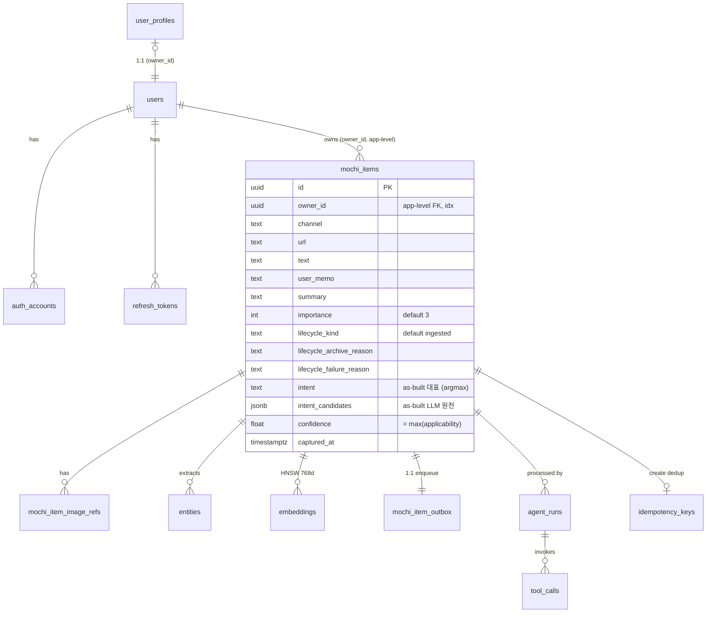

# 모찌(MOCHI) — 도메인 & 데이터베이스 설계

> Backend: Postgres 16 + pgvector · iOS: Realm (mirror)

> ⓘ **이 문서의 정본 규칙 (2026-06-03 전면 재작성)**
>
> 1. **본문(§3 ERD · §4 DDL · §11 인덱스 · §12 카탈로그)은 as-built 가 정본**이다 — alembic `0001`~`0008` + ORM 이 실제로 만든 **단일 `mochi_items` 테이블 모델**. 이전 문서는 정규화 3테이블(`mochi_items`/`mochi_sources`/`mochi_analyses`)·typed 파생·conversations 일가를 본문 DDL 로 실어 코드와 갈라졌다(drift 의 근원). 그 design-ahead 비전은 버리지 않고 **§13 향후 계획(미구현·게이트)**로 옮겼다.
> 2. **예외 — §4.4 Intent 모델은 "코드가 문서를 따라오는" 유일한 절**이다. intent 저장을 4컬럼 파생 중복(`intent`/`secondary_intents`/`intent_applicability`/`intent_candidates`)에서 **`intent_instances` 리스트 1개 + `needs_review` boolean**(per-instance `applicable: bool` + `payload`)로 바꾸는 타겟을 정의한다. 코드는 현재 4컬럼 상태이고, migration `0009` 로 이 절을 향해 이행한다. 근거·토론은 [`INTENT_REDESIGN.md`](INTENT_REDESIGN.md).
> 3. **명명 정본**: 코드가 `mochi_item`(2026-05-29 rename 완료). `capture` 는 이제 *이미지 캡처 행위* 만 의미(AppGroup `captures/`, 백탭 `CaptureScreenshotIntent`).

---

## 1. 설계 원칙

| # | 원칙 | 구체 (as-built 기준) |
|---|---|---|
| 1 | Self-documenting names | 약어 금지. 컬럼·테이블·enum 값 풀네임 |
| 2 | Owner scoping | 모든 user-data 행에 `owner_id` + 모든 read/write 에 owner 필터 (repository layer 강제, 테스트 검증) |
| 3 | Explicit lifecycle | boolean `is_active` 금지. 상태는 enum(`lifecycle_kind`) + application `LifecyclePolicy` 전이 검증 |
| 4 | Time is UTC `timestamptz` | 모든 시각 컬럼 `_at` suffix |
| 5 | Intent = `intent_instances` 원천 1개 (boolean) | per-instance `applicable: bool` + top-level `needs_review: bool`. 대표·집계 는 **저장하지 말고 계산**(§4.4). 파생 중복 금지, 임계값 없음 |
| 6 | Transactional Outbox | 비동기 AI 처리의 reliability foundation (`mochi_item_outbox`) |
| 7 | Hybrid Search | BM25 tsvector(GIN) + 벡터 HNSW |

> ⚠️ 이전 문서의 원칙 "One concept = one table(`mochi_items`/`mochi_sources`/`mochi_analyses` 분리)" 와 "Append-only `mochi_analyses`" 는 **as-built 에서 채택되지 않았다**. 현재는 단일 `mochi_items` 에 출처(`channel`/`url`/`text`/`user_memo`)·분석결과(`summary`/`intents`/`importance`)를 인라인한다. 정규화 분리는 §13 의 향후 후보일 뿐 정본 원칙이 아니다.

### 명명 컨벤션

```
Table        mochi_items                       (snake_case, 복수형)
Column       lifecycle_kind, owner_id          (snake_case)
FK column    mochi_item_id, agent_run_id       ({referenced_singular}_id)
Timestamp    created_at, captured_at           (_at suffix)
JSONB        intent_instances, payload          (단수/내용 기술)
Enum 값      schedule / todo / knowledge / memo (Intent), scheduleEnded (ArchiveReason, camelCase)
```

> 명명 drift 잔존: 코드 `owner_id`(문서 옛 `user_id`), `captured_at`(옛 `occurred_at`), `summary`(옛 `title`), `importance` int(옛 `importance_score` numeric), `lifecycle_kind`(옛 `lifecycle_state`). **본 재작성에서 문서를 코드값으로 통일**했다.

---

## 2. Ubiquitous Language

iOS · 백엔드 · 프롬프트 모두 동일 용어를 쓴다.

| 용어 | 정의 |
|---|---|
| **MochiItem** | 사용자가 저장한 단일 기록. aggregate root. **입력 1건 = MochiItem 1개** (쪼개지 않는다) |
| **Intent** | MochiItem 의 의미 분류. enum `schedule`/`todo`/`knowledge`/`memo` (표시: 일정/할일/지식/기록) |
| **intent_instances** | 한 MochiItem 의 **복수 의도 instance 원천**. 리스트 `[{intent_type, applicable: bool, payload, label?, reasoning?}]`. **1:N** — 위계 없음, 같은 `intent_type` 의 multi instance 가능 (§4.4) |
| **applicable** | 한 instance 의 *저장할지* boolean. **LLM 자기판단** (per-instance) |
| **active instances** | `applicable = true` 인 instance 집합. 비면 `memo` fallback |
| **needs_review** | "헷갈려요". top-level boolean, **LLM 출력** (*사용자에게 되물을지*). 저장·active 와 **직교** |
| **Lifecycle Kind** | MochiItem 처리·생명 상태. 7값 enum (§7). intent 와 **독립**(레코드 단위) |
| **Channel** | 입력 채널 (`screenshot`/`appDirectInput`/`appShareSheet`/`appIntent`/…). `mochi_items.channel` 인라인 |
| **Entity** | AI 추출 의미 단위 (`entities.kind`/`value`) |
| **AgentRun** | MochiItem 1건 처리 LLM 오케스트레이션 실행 1회 |
| **Outbox Message** | mochi_items COMMIT 직후 worker 가 픽업할 행 (`mochi_item_outbox`) |
| **Idempotency Key** | `POST /mochi_items` 의 owner-scoped 키 |
| **Embedding** | text-embedding (768d) chunk 벡터 |

> design-ahead 용어(ActionCandidate · Citation · Tag · Conversation 등)는 §13 에서 정의. 본문은 as-built 만.

---

## 3. ERD (as-built)



> ERD 는 mochi_items **주요 컬럼만** 보인다 (전체는 §4.3). intent 저장은 **현재 as-built 4컬럼+confidence**(`intent`/`secondary_intents`/`intent_applicability`/`intent_candidates`/`confidence`)이고, **§4.4 의 `intent_instances`(jsonb) + `needs_review`(bool) 는 0009 타겟(현재 미존재)**이다. `owner_id` 는 DB FK 가 아니라 **application-level** 격리(인덱스만). `idempotency_keys.mochi_item_id` 도 FK 없음. typed 파생·conversations·tags·search_index·mochi_analyses 는 **미존재** → §13.

---

## 4. SQL DDL (as-built, Postgres 16 + pgvector)

> 아래는 alembic `0001`~`0008` + ORM 이 만든 **실제 스키마**다. §4.4 만 타겟(0009 후).

### 4.1 Extensions

```sql
CREATE EXTENSION IF NOT EXISTS vector;     -- pgvector (0001)
CREATE EXTENSION IF NOT EXISTS pgcrypto;   -- gen_random_uuid() (0004)
```

### 4.2 Identity (alembic 0004)

```sql
CREATE TABLE users (
    id                      uuid PRIMARY KEY DEFAULT gen_random_uuid(),
    email                   varchar(320) NOT NULL,
    display_name            varchar(128) NOT NULL DEFAULT '',
    locale                  varchar(16)  NOT NULL DEFAULT 'ko-KR',
    onboarding_completed_at timestamptz,
    created_at              timestamptz NOT NULL DEFAULT now(),
    deleted_at              timestamptz,
    CONSTRAINT ck_users__email_lower CHECK (email = lower(email))
);
CREATE UNIQUE INDEX uq_users__email__active ON users(email) WHERE deleted_at IS NULL;

CREATE TABLE auth_accounts (
    id            uuid PRIMARY KEY DEFAULT gen_random_uuid(),
    user_id       uuid NOT NULL REFERENCES users(id) ON DELETE CASCADE,
    provider      varchar(16)  NOT NULL,
    subject       varchar(255) NOT NULL,
    email_at_link varchar(320) NOT NULL,
    linked_at     timestamptz NOT NULL DEFAULT now(),
    revoked_at    timestamptz,
    CONSTRAINT ck_auth__provider CHECK (provider IN ('apple','google')),
    CONSTRAINT uq_auth__provider_subject UNIQUE (provider, subject)
);
CREATE INDEX idx_auth__user ON auth_accounts(user_id);

CREATE TABLE refresh_tokens (
    id             uuid PRIMARY KEY DEFAULT gen_random_uuid(),
    user_id        uuid NOT NULL REFERENCES users(id) ON DELETE CASCADE,
    token_hash     varchar(64) NOT NULL UNIQUE,
    family_id      uuid NOT NULL,
    parent_id      uuid REFERENCES refresh_tokens(id) ON DELETE SET NULL,  -- rotation chain
    device_label   varchar(128),
    user_agent     varchar(512),
    issued_at      timestamptz NOT NULL DEFAULT now(),
    expires_at     timestamptz NOT NULL,
    used_at        timestamptz,
    revoked_at     timestamptz,
    revoked_reason varchar(32),
    CONSTRAINT ck_rt__expires       CHECK (expires_at > issued_at),
    CONSTRAINT ck_rt__revoke_paired CHECK ((revoked_at IS NULL) = (revoked_reason IS NULL)),
    CONSTRAINT ck_rt__revoke_reason_enum CHECK (
        revoked_reason IS NULL OR
        revoked_reason IN ('rotated','logout','reuse_detected','user_account_deleted','admin'))
);
CREATE INDEX idx_rt__user            ON refresh_tokens(user_id);
CREATE INDEX idx_rt__family_active   ON refresh_tokens(family_id)  WHERE revoked_at IS NULL;
CREATE INDEX idx_rt__expires_active  ON refresh_tokens(expires_at) WHERE revoked_at IS NULL;
```

### 4.3 Mochi Core (alembic 0001 + 0003 + 0005 + 0006 rename + 0008)

```sql
CREATE TABLE mochi_items (
    id                       uuid PRIMARY KEY,
    owner_id                 uuid NOT NULL,          -- app-level 격리 (FK 없음), idx
    channel                  varchar(32) NOT NULL,   -- 입력 채널 (Pydantic enum 게이트)
    url                      varchar(2048),
    text                     text,
    user_memo                text,
    summary                  text,                   -- LLM 요약
    importance               int   NOT NULL DEFAULT 3,    -- 1~5 (numeric 0~1 아님)
    model_version            varchar(64),
    lifecycle_kind           varchar(32) NOT NULL DEFAULT 'ingested',  -- §7, idx
    lifecycle_archive_reason varchar(32),            -- scheduleEnded|todoCompleted|knowledgeStale|userManual
    lifecycle_failure_reason text,
    sync_kind                varchar(32) NOT NULL DEFAULT 'pending',  -- pending|uploaded|calendar_synced|reminder_synced|failed
    sync_detail              text,
    captured_at              timestamptz NOT NULL,   -- idx
    created_at               timestamptz NOT NULL DEFAULT now(),
    updated_at               timestamptz NOT NULL DEFAULT now(),

    -- ▼▼▼ Intent 저장 — 현재 as-built (4컬럼 파생 중복). §4.4 에서 `intent_instances` + `needs_review` 로 이행(0009). ▼▼▼
    intent               varchar(32)   NOT NULL DEFAULT 'memo',  -- 대표 = argmax(candidates), idx
    secondary_intents    varchar(32)[] NOT NULL DEFAULT '{}',    -- 대표 제외 distinct
    intent_applicability jsonb         NOT NULL DEFAULT '{}',    -- {intent: max applicability}
    intent_candidates    jsonb         NOT NULL DEFAULT '[]',    -- LLM 원천 [{label,intent,applicability,reasoning}]
    confidence           float         NOT NULL DEFAULT 0        -- = max(applicability)
    -- ▲▲▲ 0009 이후: 위 5컬럼 DROP, `intent_instances jsonb` + `needs_review bool` 로 대체 (§4.4). ▲▲▲
);
-- ⚠️ 컬럼 인덱스는 `captures` 시절 SQLAlchemy 기본명(ix_<table>_<col>)이고 0006 이 rename 하지 않아
--    실제 이름은 ix_captures_* 로 잔존(테이블만 mochi_items 로 rename). FTS 만 0006 이 rename 함.
CREATE INDEX ix_captures_owner_id      ON mochi_items(owner_id);
CREATE INDEX ix_captures_intent        ON mochi_items(intent);          -- 0009 후 GIN(intents) 로 교체
CREATE INDEX ix_captures_lifecycle_kind ON mochi_items(lifecycle_kind);
CREATE INDEX ix_captures_captured_at   ON mochi_items(captured_at);
CREATE INDEX ix_mochi_items_fts ON mochi_items   -- 0006 이 ix_captures_fts → 로 rename (언더스코어 1개)
    USING gin (to_tsvector('simple', coalesce(summary,'') || ' ' || coalesce(text,'')));

-- 이미지 참조 (0003 → 0006 rename)
CREATE TABLE mochi_item_image_refs (
    id            bigserial PRIMARY KEY,
    mochi_item_id uuid NOT NULL REFERENCES mochi_items(id) ON DELETE CASCADE,  -- idx
    sha256        varchar(64)  NOT NULL,   -- idx
    mime_type     varchar(64)  NOT NULL,
    byte_size     bigint       NOT NULL,
    object_key    varchar(512)            -- GCS object key
);

-- 추출 엔티티 (0001 → 0006 rename). ※ as-built 는 단순 — user_id/normalized/provenance 없음
CREATE TABLE entities (
    id            bigserial PRIMARY KEY,
    mochi_item_id uuid NOT NULL REFERENCES mochi_items(id) ON DELETE CASCADE,  -- idx
    kind          varchar(16)  NOT NULL,   -- free str(미강제). 프롬프트 가이드 예시: date|person|place|topic|url|task|amount. repository 가 kind[:16] 절단
    value         varchar(512) NOT NULL
);

-- 임베딩 (0001). ※ as-built 는 owner/chunk_index/uniq 없음
CREATE TABLE embeddings (
    id            bigserial PRIMARY KEY,
    mochi_item_id uuid NOT NULL REFERENCES mochi_items(id) ON DELETE CASCADE,  -- idx
    chunk_text    text NOT NULL,
    embedding     vector(768) NOT NULL,
    model_version varchar(64) NOT NULL
);
CREATE INDEX ix_embeddings_vector_hnsw ON embeddings
    USING hnsw (embedding vector_cosine_ops) WITH (m=16, ef_construction=64);
```

### 4.4 Intent 모델 — `intent_instances` (타겟 정본, 1:N)

> **이 절만 doc-leads-code.** 코드는 현재 §4.3 의 4컬럼+confidence. migration `0009` 로 아래로 이행한다.
> **v2 (2026-06-03 채팅 합의 — 송준서 ↔ 박세현):** float `applicability` + `τ`/`τ_review` threshold 모델은 폐기. boolean `applicable` per-instance + boolean `needs_review` top-level, **LLM 출력 = single truth source**. 동기·결정 근거: [`INTENT_REDESIGN.md`](INTENT_REDESIGN.md) §4.

#### 저장 — 원천 1개 + 직교 플래그

```sql
-- mochi_items 에 추가 (0009), 위 5컬럼은 DROP (0011):
intent_instances jsonb   NOT NULL DEFAULT '[]',
needs_review     boolean NOT NULL DEFAULT false
-- intent_instances 형태: [
--   { "intent_type":  "<schedule|todo|knowledge|memo>",
--     "applicable":   <bool>,                       -- 이 instance 를 저장할지 (LLM 결정)
--     "payload":      { <intent_type 별 typed 필드> },  -- todo: {title}, schedule: {title,date,time}, ...
--     "label":        "<UI/디버깅 부속, optional>",
--     "reasoning":    "<근거, optional>" },
--   ... 같은 intent_type 의 multi instance 허용 (회의록 → todo 두 개 + schedule 한 개 등)
-- ]
-- 위계 없음 — primary/secondary 폐기. payload 가 실행 단위(todos / calendar_events 직접 매핑).
```

```sql
-- 1:N intent 필터용 (대표 단일컬럼으로는 1:N 표현 불가 → containment):
CREATE INDEX idx_mochi__intent_instances ON mochi_items USING gin (intent_instances jsonb_path_ops);
-- "할일 전부": WHERE owner_id = :o AND intent_instances @> '[{"intent_type":"todo","applicable":true}]'
```

- **`needs_review`** = top-level boolean. LLM 의 *사용자에게 되물을지* 자기판단. 직교 플래그 — 저장과 분리.
- **`applicable`** = per-instance boolean. LLM 의 *이 의도를 저장할지* 자기판단. (의미 확정: 박세현·송준서 6/3 채팅)
- **`label`/`reasoning` 유지 옵션** — `payload` 가 typed 라 reasoning 따로 둘 가치 재검토. iOS "헷갈려요" 카드 라벨은 `intent_type.displayName` fallback 가능.

#### 결정 정책 — boolean 규칙 3개 (single truth source)

```
1) active_instances(item) = intent_instances.filter(applicable = true)     # boolean filter
2) if active_instances == ∅                                                # 분류 실패 → 안전 보존
     : active_instances = [{intent_type: memo, applicable: true, payload: {...}}]
3) if needs_review (LLM 출력 boolean) : iOS "헷갈려요" 카드 표시              # 사용자 직교
```

- **임계값 없음.** v1 의 `τ`·`τ_review` 폐기. **컨트롤 surface = LLM boolean 정확도 하나**(프롬프트 + eval 로 관리).
- **`memo` fallback** 그대로 — 미션(*"놓치기 쉬운 순간은 쉽게 남기고, 필요한 기억은 쉽게 떠오른다"*) 정합. 분류 못 해도 안 잃는다.
- **`needs_review` = LLM 출력 직접 사용** (derived/override 없음). single truth source 원칙(송준서: *"트루소스를 하나로 맞추는게 나을듯"*). [`INTENT_REDESIGN.md`](INTENT_REDESIGN.md) §3.3 의 LLM self-confidence 한계는 known risk 로 수용 — 프롬프트 + eval 로 관리.

#### 파생 — 저장 안 함, read 시 계산 (projection)

| 파생값 | 정의 | 용도 |
|---|---|---|
| `representative` (대표 intent_type) | `first(active_instances).intent_type` (active 비면 `memo`) | lifecycle archive_reason 호환, UI 대표 칩 |
| `active_count` | `len(active_instances)` | UI 다중 의도 표현(대표 + 작은 chip N개) |
| API `instances` | `intent_instances` 그대로 | wire — 클라이언트가 typed payload 까지 받음 |
| API `needs_review` | `needs_review` 그대로 | iOS "헷갈려요" 직접 사용 (client-derive 폐기) |

#### API projection — iOS 이행

0009/0011 로 DB·agent 를 갈 때 **API 응답은 새 원천 위의 stable projection**:

- 응답 `intent` = `representative`(계산), `instances` = `intent_instances`, `needs_review` = LLM 출력 직접.
- 응답에서 `secondaryIntents`/`intentApplicability`/`confidence` **제거** — iOS dead-read 였거나 client-derive 였으므로 무중단.
- iOS "헷갈려요" 가 v1 의 `confidence < 0.6` client-derive 에서 → `needs_review` server boolean 직접 사용으로 재배선 필요(부록 C 참조).

#### lifecycle 결합 (1:N 조정)

- 레코드 lifecycle(`lifecycle_kind`)는 intent 와 **독립**(record 단위) — 변경 없음.
- `archive_reason × intent_type` 호환(§7.3)은 **대표 instance 의 `intent_type`**(`representative`) 기준.
- knowledge decay 자동전이(§7.4)는 **`knowledge ∈ active_instances.intent_type`** 기준으로 읽는다(옛 `intent='knowledge'` 단일 비교의 1:N 일반화).

### 4.5 Operations (alembic 0001 + 0002 + 0006 + 0007)

```sql
-- transactional outbox (0002 → 0006 rename)
CREATE TABLE mochi_item_outbox (
    id            bigserial PRIMARY KEY,
    event_id      uuid NOT NULL,
    mochi_item_id uuid NOT NULL REFERENCES mochi_items(id) ON DELETE CASCADE,  -- idx
    owner_id      uuid NOT NULL,   -- idx
    status        varchar(16) NOT NULL DEFAULT 'pending',  -- pending|in_flight|done|dead_letter, idx
    attempts      int  NOT NULL DEFAULT 0,
    last_error    text,
    created_at    timestamptz NOT NULL DEFAULT now(),
    locked_until  timestamptz
);
CREATE INDEX ix_capture_outbox_pending ON mochi_item_outbox(status, created_at) WHERE status='pending';

CREATE TABLE agent_runs (
    id               uuid PRIMARY KEY,
    mochi_item_id    uuid NOT NULL REFERENCES mochi_items(id) ON DELETE CASCADE,  -- idx
    current_node     varchar(32) NOT NULL DEFAULT 'ingested',  -- 부록 B
    total_tokens     int NOT NULL DEFAULT 0,
    total_latency_ms int NOT NULL DEFAULT 0,
    started_at       timestamptz NOT NULL DEFAULT now(),
    ended_at         timestamptz,
    failure_reason   text
);

CREATE TABLE tool_calls (
    id            bigserial PRIMARY KEY,
    agent_run_id  uuid NOT NULL REFERENCES agent_runs(id) ON DELETE CASCADE,  -- idx
    name          varchar(64)  NOT NULL,
    input_digest  varchar(128) NOT NULL,
    output_digest varchar(128),
    tokens_in     int NOT NULL DEFAULT 0,
    tokens_out    int NOT NULL DEFAULT 0,
    latency_ms    int NOT NULL DEFAULT 0,
    succeeded     boolean NOT NULL DEFAULT true,
    extra         jsonb    -- ⚠️ drift: migration=JSONB, ORM=generic JSON. 다음 BE 터치 시 ORM 1줄 정정
);

CREATE TABLE idempotency_keys (
    key           varchar(128) PRIMARY KEY,
    mochi_item_id uuid NOT NULL,   -- FK 없음 (app-level)
    created_at    timestamptz NOT NULL DEFAULT now()
);

-- 개인화 프로필 (0007). owner 당 1행. ※ ORM 모델 없이 raw SQL(profile_store.py) 접근
CREATE TABLE user_profiles (
    owner_id      uuid PRIMARY KEY,        -- == users(id)
    summary       text NOT NULL,
    model_version varchar(64) NOT NULL,
    items_covered int  NOT NULL DEFAULT 0,
    refreshed_at  timestamptz,
    created_at    timestamptz NOT NULL DEFAULT now()
);
```

---

## 5. iOS Realm Schema (mirror)

> Realm `schemaVersion = 4` (`RealmStoreFactory.currentSchemaVersion`). **로컬 id ≠ 서버 PK** — 서버 id 는 `SyncState.uploaded(serverID:)` 에 보관(부록 D). 0009/0011 은 **API projection** 이라 Realm 변경 불요(v4 유지). 1:N 을 UI 칩으로 노출하려면 v5 신설 필요(§13·향후 UI 결정).

intent 관련 검증된 필드(정확한 전체 스키마는 `CorePersistence/RealmObjects.swift` 가 정본):

| Realm 필드 | 타입 | 의미 |
|---|---|---|
| `RealmMochiItem.intentRawValue` | `String?` | 대표 intent. `nil` = "분석 중" 버킷(`listAnalyzing`) |
| `RealmMochiItem.confidence` | `Double` | `= max(applicability)`. `< 0.6` = "헷갈려요"(`listAmbiguous` NSPredicate). ※ 0.6 은 현 iOS client-derive 임계 — §4.4 의 실험값 `τ_review` 와 별개 |
| `RealmMochiItem.intentCandidates` | `List<RealmIntentCandidate>` | `RealmIntentCandidate = {label: String?, intentRawValue: String, applicability: Double}`. `reasoning` 미저장 |

| Backend | Realm |
|---|---|
| `mochi_items` (대표 `intent`/`confidence` projection) | `RealmMochiItem.intentRawValue` / `confidence` |
| `mochi_items.intents` → API `candidates` | `RealmMochiItem.intentCandidates` (List, `reasoning` 미저장) |
| `mochi_item_image_refs` / `entities` | Embedded List |
| `embeddings`/`agent_runs`/`tool_calls`/`outbox`/`idempotency_keys`/`user_profiles` | 서버 only |

### 동기화 (as-built)

- **iOS → Backend**: `syncState=pendingUpload` 인 item 을 `MochiItemSyncWorker` 가 업로드. 이미지는 원본 PNG → 업로드용 JPEG(긴 변 ≤1920px, q60) 파생 → `sha256/mimeType/byteSize` 로 `POST /mochi_items/presign` → Signed URL 로 GCS 직접 PUT → `objectKey` 만 전달. 성공 → `syncState=uploaded(serverID:)`(**서버 자체 PK 보관**).
- **Backend → iOS**: back-tap·metadata-only **모두 비동기 worker 분석** 후 **foreground 3초 폴링**(`GET /mochi_items/{serverID}`)으로 `lifecycle=active` 시 반영. 동기 Gemini 분류는 제거됨(2026-05-30). SSE `/mochi_items/{id}/stream` 은 서버에 존재하나 iOS 미구독. APNs 도입 후 즉시 갱신.
- **분류 확정**: iOS `setIntent` 는 로컬 전용. 서버 override `PATCH /mochi_items/{id}/intent` 는 존재하나 **iOS 미배선**.
- **충돌/Catch-up**: backend master 원칙. 양방향 충돌 해소·cold-start catch-up(`/sync`)은 미구현.

---

## 6. API Endpoints

| Method | Path | 상태 | 비고 |
|---|---|---|---|
| `POST` | `/api/v1/auth/apple` · `/auth/google` · `/dev` · `/refresh` · `/logout` | ✅ | OAuth → JWT(RS256) + refresh rotation |
| `GET` | `/api/v1/users/me` | ✅ | |
| `POST` | `/api/v1/mochi_items` | ✅ | metadata-only ingest. `Idempotency-Key` 필수 |
| `POST` | `/api/v1/mochi_items/back-tap` | ✅ | 스크린샷 ingest (`application/json {objectKey,…}`). ※ UX surface 이름 — §13 에서 `POST /mochi_items` 흡수 후보 |
| `POST` | `/api/v1/mochi_items/presign` | ✅ | GCS V4 Signed PUT URL |
| `GET` | `/api/v1/mochi_items/{id}` | ✅ | owner 만. 응답에 `intent`/`confidence`/`candidates` projection (§4.4) |
| `PATCH` | `/api/v1/mochi_items/{id}/intent` | ◑ | 서버 존재 · iOS 미배선 |
| `GET` | `/api/v1/mochi_items/{id}/stream` | ◑ | SSE agent state · iOS 미구독 |
| `*` | list `GET /mochi_items` · `DELETE /{id}` · `POST /search` · `/conversations` · `/sync` | ○ | **라우트 미존재** → §13 |

> ⚠️ 현재 라우터 실재 경로는 위 ✅/◑ 9개뿐(`mochi_items/presentation/router.py`, `auth/presentation`). list·delete·search·conversations·sync 는 라우트 자체가 없다(홈/모찌들 탭은 현재 iOS 로컬 Realm 으로 구동, 서버 list API 후속).

| Header | 필수 | 의미 |
|---|---|---|
| `Authorization: Bearer <token>` | health 제외 전부 | JWT(RS256) |
| `Idempotency-Key` | `POST /mochi_items*` | owner-scoped |
| `X-Mochi-Request-ID` | 옵션 | 분산 추적 |

---

## 7. 4-Intent Lifecycle (코드 정본 — `lifecycle_policy.py` / `entities.py`)

> 이 절은 코드의 **유일 진실**이다. 값은 코드(`LifecycleStateKind`/`ArchiveReason`/`KNOWLEDGE_ACTIVE_DAYS`)를 따른다.

### 7.1 상태 (`lifecycle_kind`, 7값)

```
ingested → analyzing → active → archived
                            ↘ failed
knowledge 만:  active → decaying → reviewRequested → (active | archived)
```

> 저장값(`lifecycle_kind`)은 camelCase: `ingested`/`analyzing`/`active`/`decaying`/`reviewRequested`/`archived`/`failed` (`LifecycleStateKind`).

### 7.2 전이 매트릭스 (`_ALLOWED_KIND_PAIRS`)

| from \ to | analyzing | active | decaying | reviewRequested | archived | failed |
|---|---|---|---|---|---|---|
| ingested | ✅ all | — | — | — | — | ✅ all |
| analyzing | — | ✅ all | — | — | — | ✅ all |
| active | — | — | ✅ knowledge | — | ✅ all | — |
| decaying | — | ✅ knowledge | — | ✅ knowledge | ✅ knowledge | — |
| reviewRequested | — | ✅ knowledge | — | — | ✅ knowledge | — |
| failed | — | — | — | — | ✅ all (userManual) | — |

### 7.3 archive_reason × intent (camelCase, `_INTENT_ARCHIVE_REASONS`)

| Intent | 허용 archived_reason |
|---|---|
| `schedule` | `scheduleEnded`, `userManual` |
| `todo` | `todoCompleted`, `userManual` |
| `knowledge` | `knowledgeStale`, `userManual` |
| `memo` | `userManual` |

> 옛 문서의 `system_error` 는 **코드에 없다** — 제거. 값은 camelCase(`scheduleEnded`). 1:N 에선 **대표 intent** 기준(§4.4).

### 7.4 자동 전이 (worker 주기 실행)

| 조건 | 전이 |
|---|---|
| `schedule ∈ active` 이고 일정 종료 시각 < now() 이고 `active` | → `archived(scheduleEnded)` |
| `todo ∈ active` 이고 완료됨 이고 `active` | → `archived(todoCompleted)` |
| `knowledge ∈ active` 이고 마지막 회수 후 `KNOWLEDGE_ACTIVE_DAYS=30`일 경과 이고 `active` | → `decaying` |
| `knowledge` 이고 `decaying` 진입 후 `KNOWLEDGE_DECAY_DAYS=180`일 경과 | → `reviewRequested` |
| dead-letter (outbox `attempts > max`) | → `failed` |

> ⚠️ 옛 문서의 decay 90일 → **30일**(코드 `KNOWLEDGE_ACTIVE_DAYS=30`), review 전이는 `KNOWLEDGE_DECAY_DAYS=180`. 일정/할일 종료 판정의 실제 소스(종료시각·완료여부)는 typed 테이블(§13) 구현 후 정밀화 — 현재는 entity/lifecycle 기반.

### 7.5 전이 강제

전이(from→to)·archive_reason×intent 검증은 application `LifecyclePolicy.validate()` / `expected_archive_reason()` 가 수행(DB CHECK 아님 — as-built `mochi_items` 에 intent/lifecycle CHECK 제약 **없음**).

---

## 8. 데이터 흐름

### 8.1 Ingestion (`POST /mochi_items`)

```python
async with db_session() as s, s.begin():
    if existing := await already_ingested(s, owner_id, idem_key):
        return existing                       # 멱등
    mi = insert_mochi_item(s, ..., lifecycle_kind='ingested')   # intents=[] (분석 전)
    bulk_insert_image_refs(s, mi, ...)
    insert_outbox(s, mi)                       # transactional outbox
    save_idem_key(s, idem_key, mi.id)
await pg_notify('mochi_item_outbox', str(mi.id))
return 201
```

### 8.2 Agent Worker (LLM = 분석가)

워커가 outbox 를 폴링 → 항목당 `AgentOrchestrator` 실행. 결정적 파이프라인이 아니라 **Gemini function-calling agent loop**(`gemini-3.1-flash-lite`, webFetch 그라운딩). 모델이 `finalizeAnalysis` 호출 → 종료.

```python
# 분석 산출(현재): candidates [{label,intent,applicability,reasoning}] + summary + importance + entities
# write-back (현재 4컬럼):
apply_analysis(owner, id, analysis)   # intent/secondary/applicability/candidates/confidence + entities 재적재
                                      # + lifecycle INGESTED→ANALYZING→ACTIVE
# 0009 이후 (타겟): intents = candidates 를 원천으로 1컬럼 write. 대표/confidence 는 projection.
RefreshUserProfile.run(owner)         # best-effort 개인화 디바운스
```

> **현재 wire**: text+URL 분석 · write-back · 개인화 · **이미지 분석(클라 Signed URL → GCS, Gemini `gs://` 직접 read)** = 실연결. 임베딩 적재 · actions 파생 = design-ahead(§13).

### 8.3 Hybrid Search (as-built 골격)

`mochi_items` FTS GIN(tsvector) BM25 + `embeddings` HNSW 벡터 → RRF 융합. ※ embedding 적재·query embedding 품질은 아직 약함(known drift).

---

## 9. 보안

| 항목 | 메커니즘 |
|---|---|
| 인증 | Apple/Google OAuth → JWT(RS256) + refresh token rotation(`refresh_tokens`) |
| 인가 | repository layer 가 `owner_id` 필터 강제 (테스트 검증). DB FK 아닌 **app-level** 격리 |
| 멱등성 | `Idempotency-Key` → `idempotency_keys` (owner-scoped) |
| SSRF | WebFetch: 호스트 블록리스트 + A/AAAA IP 검증 + redirect 재검증 + MIME 화이트리스트 |
| Storage | `captures/{owner_id}/...` prefix + V4 Signed PUT URL. ingest 진입점 owner-prefix 강제(IDOR 방지) |
| Error envelope | 통일 응답 `{code, message, requestId, retryAfter}` (`ErrorEnvelope`, DomainError → JSONResponse) |
| 분산 추적 | `X-Mochi-Request-ID` 헤더 echo |
| PII purge | `users.deleted_at` set (soft delete). ※ email 익명화는 **미구현**(design-ahead) |

---

## 10. 마이그레이션

### 적용된 것 (alembic 0001~0008)

```
0001 initial            captures, entities, embeddings, idempotency_keys, agent_runs, tool_calls + pgvector + FTS GIN
0002 capture_outbox     transactional outbox
0003 capture_image_refs 이미지 참조
0004 auth               users, auth_accounts, refresh_tokens + pgcrypto
0005 capture_multi_intent  intent NOT NULL + secondary_intents + intent_applicability
0006 rename             captures → mochi_items (+ 모든 FK 컬럼 capture_id → mochi_item_id)
0007 add_user_profiles  개인화 프로필
0008 add_intent_candidates  intent_candidates(jsonb) — LLM 원천 후보
```

### 계획 (§4.4 이행 — doc-leads)

```
0009 intent_instances_source  ADD intent_instances jsonb + needs_review boolean + GIN(jsonb_path_ops on intent_instances). 분기 backfill:
       · intent_candidates ≠ '[]'  → intent_instances := candidates 매핑
           (intent_type := candidate.intent, applicable := true, payload := {}, label/reasoning 보존)
       · candidates='[]' 이나 applicability 채워짐(pre-0008 구형 row, 실서버 존재)
           → 각 intent 별 {intent_type, applicable=true, payload={}} instance 합성
       · 분석 전 → '[]'
       · needs_review default false (backfill 안 함 — 신규 분석부터 LLM 출력 사용)
     동반 코드: apply_analysis 가 intent_instances + needs_review 원천 write, 대표/active 는 projection.
     ※ v1 과 차이: needs_review DB 컬럼 추가됨(v1 에서는 미생성). iOS client-derive(`confidence < 0.6`) → server boolean 컷오버 동반 필요.
0011 drop_legacy_intent_columns  DROP intent / secondary_intents / intent_applicability / intent_candidates / confidence.
     ix_captures_intent → idx_mochi__intent_instances(GIN) 로 교체.
     프롬프트 V7 (top-level needs_review + per-instance {intent_type, applicable, payload}) + openapi 재덤프.
     ※ DROP 전제 = "intent_instances 원천 검증 + iOS needs_review 직접 사용 컷오버".
```

> zero-downtime: 0009(additive)와 0011(파괴) 사이 `intent_instances`/`needs_review` + 4컬럼이 공존하는 dual-write 중간 상태가 존재한다. **영구 설계 아님** — 종료 조건은 0011. 중간 상태에서 `OverrideIntent` 는 `intent_instances` 원천도 갱신해야 단일화가 유지된다.

---

## 11. 인덱스 정책 (as-built)

| 쿼리 패턴 | 인덱스 |
|---|---|
| owner 격리 | `ix_captures_owner_id` |
| intent 필터 (현재) | `ix_captures_intent` → **0009 후 `idx_mochi__intents`(GIN, containment)** |
| lifecycle 필터 | `ix_captures_lifecycle_kind` |
| 시간순 | `ix_captures_captured_at` |
| BM25 검색 | `ix_mochi_items_fts` (GIN tsvector) |
| auth rotation | `idx_rt__family_active` · `idx_rt__expires_active` (partial WHERE revoked_at IS NULL) |
| 벡터 ANN | `ix_embeddings_vector_hnsw` (HNSW, m=16, ef_construction=64) |
| Outbox pickup | `ix_capture_outbox_pending` (partial WHERE status='pending') |

> 옛 문서의 partial 인덱스(`idx_mochi__user__importance` 등)는 as-built 에 **없다**. importance/occurred 기반 정렬은 현재 application 또는 iOS 측(부록 D).

---

## 12. 테이블 카탈로그 (as-built, 12개)

| Group | Table | 책임 |
|---|---|---|
| Identity | `users` | 사용자 식별, soft delete |
| Identity | `auth_accounts` | Apple/Google OAuth 연결 |
| Identity | `refresh_tokens` | refresh rotation chain |
| Mochi | `mochi_items` | aggregate root. 출처·분석·intent(§4.4) 인라인 |
| Mochi | `mochi_item_image_refs` | 이미지 참조(sha256/objectKey) |
| Mochi | `entities` | AI 추출 의미 단위(kind/value) |
| AI | `embeddings` | 청크 벡터(768d, HNSW) |
| Operations | `agent_runs` | AI 처리 실행 로그 |
| Operations | `tool_calls` | 도구 호출 로그 |
| Operations | `mochi_item_outbox` | 처리 대기 큐(1 item ⇔ 1 outbox) |
| Operations | `idempotency_keys` | 멱등성 키 |
| Operations | `user_profiles` | 개인화 프로필(owner 1행, raw SQL) |

---

## 13. 향후 계획 (미구현 · 게이트)

> 아래는 **roadmap** 이다 — 본문(§3·§4·§12)에 없고 코드에도 없다. DDL 은 **구현 시점에 확정**(여기 투기적 풀 DDL 을 들고 있지 않는다 — drift 원천 회피). 이전 정규화 설계 전문은 git 이력 / `docs/archive/` 참조.

### 13.1 실행 단위 typed 테이블 (intent materialize)

`todos` · `calendar_events` · `knowledge_summaries` · `memos` · `mochi_action_candidates`.

- **위치**: MochiItem 아래 파생. 입력 1건 = MochiItem 1개를 **쪼개지 않고**, 실행 단위만 분리(회의 2026-06-01 확정).
- **게이트**: "`active_instances` 가 안정 **+** 실제 materialize 소비 코드가 필요로 판명" 될 때 생성. v2 이후 임계값 없음 — 안정성은 LLM `applicable` 정확도 eval(박세현) 로 측정. 무한 연기 방지를 위해 이 정량 조건을 게이트로 명시.
- **시점**: 6/19~ 통합 sprint 후보(`0012+`).

### 13.2 검색·분석 부가

`mochi_analyses`(append-only 분석 이력) · `prompt_versions` · `mochi_search_index`(별도 tsvector 테이블). 현재는 `mochi_items` 인라인(`summary`/FTS) + `embeddings` 로 충분. 모델/프롬프트 비교 필요가 생기면 분리.

### 13.3 질문 탭 (RAG 대화)

`conversations` · `messages` · `message_citations`. 데모 P0(질문 탭)이나 미구현. citation = 답변이 인용한 MochiItem ID + 발췌.

### 13.4 기타

`tags`/`mochi_item_tags`(사용자 태그) · `dead_letters`(현재는 `outbox.attempts>max` 인라인) · `owner_id` DB FK 승격 · intent/lifecycle DB CHECK 승격(현재 app-level). 전부 별도 축 — 필요 시 개별 큐.

---

## 부록

### A. AgentRun current_node (`agent/domain/states.py` — `AgentNode` 8값, `HAPPY_PATH` 7노드)

| node | 의미 |
|---|---|
| `ingested` | DB INSERT 직후 |
| `normalized` | 텍스트 정제·URL 정규화 |
| `analyzed` | Gemini agent loop → candidates/summary/entities |
| `routed` | intent 별 후속 처리 결정 |
| `persisted` | write-back 완료 |
| `indexed` | 임베딩·tsvector 갱신 — ⚠️ 현재 임베딩 적재는 **no-op**(gateway 미주입 시 skip) |
| `synced` | iOS 반영(현재 폴링) |
| `failed` | 실패 → outbox 재시도/DLQ |

> 8값 전부 코드 `AgentNode` enum 의 live 멤버이고 `HAPPY_PATH` 가 `ingested`→…→`synced` 7노드를 실제 advance 한다(ARCHITECTURE §5.3·backend README 와 일치). `indexed` 의 임베딩 적재만 현재 no-op.

### B. Application-enforced invariants

| Invariant | 검증 |
|---|---|
| 모든 read/write 에 `owner_id` 필터 | repository + 테스트 |
| `LifecyclePolicy.validate(from, to, intent)` 전이 | unit test |
| **`intent_instances` 의 `applicable=true` 가 없으면 active=`{memo}`** (§4.4) | 정책 코드 + test (0009 후) |

> `entities.kind` 는 **미강제** — `ExtractedEntity.kind: str`(free), repository 가 `kind[:16]` 절단만. 위 예시 값(date/person/…)은 프롬프트 가이드일 뿐 DB/앱 제약 아님.

### C. "헷갈려요" UX — as-built (pre-0009) vs 타겟 v2 (post-0009)

**as-built (현재 코드, pre-0009)** — `confidence := max(intent_candidates.applicability)`. iOS 가 client-derive:

- **헷갈림** (`confidence < 0.6` = `isUncertain`): 최상위 의도조차 약함 → "헷갈려요" 카드.
- **단일 확신** (top1 ≥ 0.6, top2 < 0.6): 대표 단일 의도로 active.
- **복수 의도** (top1·top2 둘 다 ≥ 0.6 = `isMultiIntent`): 박빙이어도 헷갈림 아님 — 둘 다 적용. UI 엔 대표만, 보조는 추천·알림·채팅 활용.

> 박빙(top-2 gap) 헷갈림 판정은 **폐기**됨 — 복수 의도를 오분류했기 때문. as-built 의 진짜 신호는 "최상위가 약함"이다.
> 현재는 서버에 `needs_review` 컬럼 없으므로 iOS 가 `confidence < 0.6` 으로 **client-derive**.

**타겟 v2 (0009 이후, §4.4)** — `needs_review` 가 **LLM 출력 server boolean**. iOS 직접 사용:

- **헷갈림** (`needs_review = true`): LLM 의 holistic 자기판단 — *사용자에게 되물을지* 를 LLM 이 직접 결정 → passive "헷갈려요" 카드.
- **단일 / 복수 의도**: `active_instances = intent_instances.filter(applicable = true)` 의 size 로 결정(1 vs N). 복수여도 사용자에게 multi-select 강요 안 함 — UI 는 대표 1개 + 작은 chip 들(자세한 사례: [`../journal/2026-06-03-intent-fallback-clarification.md`](../journal/2026-06-03-intent-fallback-clarification.md)).
- **컷오버**: 0009 시점에 iOS 가 `confidence < 0.6` derive 에서 → `needs_review` 직접 사용으로 재배선. v1 의 `isUncertain`/`isMultiIntent` 컴퓨팅은 폐기 또는 server 값 mirror 로 변경.
- v1 의 임계값(`0.6`/`τ_review`) 폐기. v2 컨트롤 surface = LLM boolean 정확도 (프롬프트 + eval — 박세현).

### D. iOS 헷갈려요 카드 · 폴링 · Daily Importance

- **헷갈려요 버튼**: 고정 라벨 아님. `MochiItemAnalysis.reviewOpinions` = `candidates`(= `intents`) applicability 내림차순 dedup-by-intent 상위 2개를 `label ?? intent.displayName` 로 노출 + "다른 의도"(4-Intent 직접 지정).
- **폴링**: `GET /mochi_items/{serverID}` (서버 PK) 3초 폴링. 로컬 id GET 은 404(서버가 자체 uuid4 PK 부여 — 알려진 drift).
- **실패/지연 fallback**: lifecycle `failed` 또는 90s 초과 시 `demoteToManual` → "헷갈려요(의견 없음)" + 직접 분류 + "다시 맡기기"(`requeueForAnalysis`). webFetch 실패의 무한 폴링 차단.
- **Daily Importance** (`CorePersistence/DailyImportanceAnalyzer`): 앱 진입 시 lazy(24h 캐시). 현재는 로컬 `analysis.importance`(medium↑) 정렬, 신규 Gemini 호출 없음. App Group `daily-importance/YYYY-MM-DD.json` 캐시. Gemini 1일 *상대* importance 재산출은 후속.
